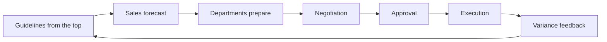

## 1. Why organisations budget

| 🛠️ Purpose | 🧠 What it does | 💡 Example |
|---|---|---|
| Planning | Sets targets and resources | 12,000 units needs 4 machines and 30 staff |
| Control | Compares actual with plan | Overhead 8% over plan |
| Coordination | Fits departments together | Sales 12,000 → production 12,400 |
| Communication | Publishes priorities | Everyone knows material cost matters |
| Motivation and evaluation | Creates the benchmark for rewards | Bonus tied to target |

The built-in tension: one document is used both to *motivate* and to *judge*. That explains most
behaviour problems.

## 2. The cycle and the people

| 👤 Who | 📋 Role |
|---|---|
| Board | Sets targets, approves the budget |
| Budget committee | Coordinates and resolves conflicts |
| Controller / budget director | Runs the process and timetable |
| Line managers | Prepare their own budgets |
| Everyone | Supplies the operational knowledge |

**Top-down** is fast and strategic but poorly owned. **Bottom-up** is accurate and owned but slow and
prone to padding. Real budgets blend both.

## 3. Behaviour you must be able to name

| 😬 Behaviour | 🧠 What it is | 🛡️ Remedy |
|---|---|---|
| Budgetary slack | Easy targets built in by the preparer | Stretch targets, review, benchmarking |
| Gaming / smoothing | Shifting results between periods | Trend analysis and controls |
| Over-consumption | Spending because the budget exists | Zero-based budgeting |
| Rigid behaviour | Refusing a good decision that breaks budget | Approved exceptions |
| Goal conflict | Department aim clashes with company aim | Aligned measures |
| Demotivation | An unfair, imposed target | Participation and explanation |

**Goal congruence** is the headline idea: the measure should make the manager's best interest the
company's best interest.

## 4. Standard costs

A standard is the planned cost of one unit. Build it input by input:

| 🧱 Element | 📏 Standard | 💰 Per unit |
|---|---|---|
| Direct material | 2 kg at $5 | $10.00 |
| Direct labour | 0.5 hour at $20 | $10.00 |
| Variable overhead | 0.5 hour at $4 | $2.00 |
| Fixed overhead | 0.5 hour at $6 | $3.00 |
| **Standard cost** | | **$25.00** |

| 📐 Type | 🎯 Meaning | 👍 / 👎 |
|---|---|---|
| Ideal | Nothing wasted, best possible | Stretching but demotivating |
| Currently attainable | Normal waste and normal downtime allowed | Fair, motivating, good for variances |

Standards are set from engineering studies, historical data, benchmarking and employee input. They are
used for pricing, budgeting, inventory valuation, variance analysis and performance evaluation. They age
quickly when prices or technology move, and they can over-focus the business on cost.

**Worked example:** a bakery standard: 0.5 kg flour at $2 = $1.00; 6 minutes of labour at $18/hour =
$1.80; variable overhead $0.30; fixed overhead $0.40 → **$3.50 per loaf**. At 10,000 loaves the
material budget is 5,000 kg = $10,000; using 5,300 kg leaves a 300 kg gap to investigate in Module 7.
