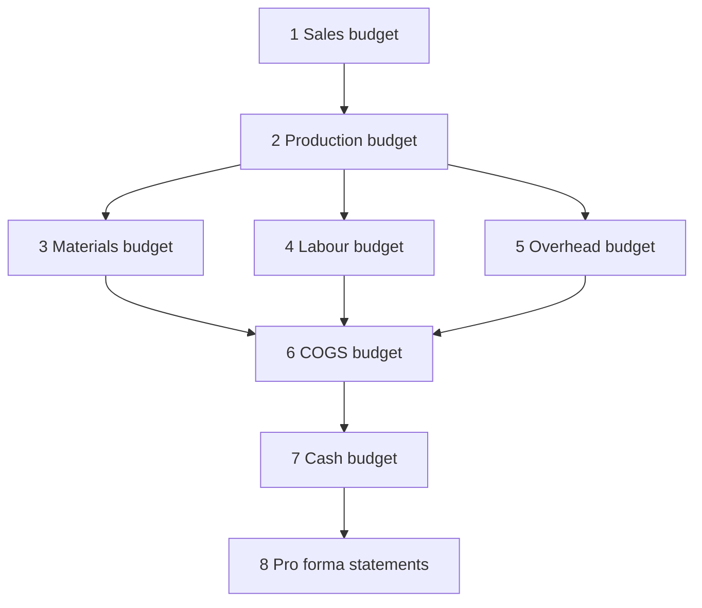

## 1. The chain of budgets

| 🧾 Budget | 🧮 Formula |
|---|---|
| Sales | Units × price |
| Production | Sales units + ending finished goods − beginning finished goods |
| Materials usage | Production units × material per unit |
| Materials purchases | Usage + ending materials − beginning materials |
| Labour | Production units × hours × rate |
| Cash | Opening cash + receipts − payments ± financing |

## 2. Worked case: Nile Snacks

Assumptions: sales Q1 5,000 units, Q2 6,000, Q3 7,000 at $20; ending finished goods = 10% of next
quarter's sales (opening Q1 500 units); material 2 kg per unit at $3; ending materials = 20% of next
quarter's usage (opening 2,000 kg); labour 0.25 hour at $16.

| Units | Q1 | Q2 |
|---|---|---|
| Sales | 5,000 | 6,000 |
| + Ending FG (10% of next quarter) | 600 | 700 |
| − Beginning FG | 500 | 600 |
| **Production** | **5,100** | **6,100** |

| kg | Q1 |
|---|---|
| Production × 2 kg = usage | 10,200 |
| + Ending materials (20% of Q2 usage 12,200) | 2,440 |
| − Beginning materials | 2,000 |
| **Purchases** | **10,640 kg = $31,920** |

Labour Q1 = 5,100 × 0.25 × $16 = **$20,400**. Variable overhead at $8 per labour hour = 1,275 × 8 =
**$10,200**; fixed overhead $30,000 (including $6,000 depreciation) → cash overhead = **$34,200**.

## 3. The cash budget

| Line | $ |
|---|---|
| Opening cash | 15,000 |
| Collections | 80,000 |
| Payments (materials, labour, overhead, S&A, tax) | (85,000) |
| Net before financing | 10,000 |
| Minimum balance required | 20,000 |
| **Borrowing needed** | **10,000** |

Collections follow the pattern given: if 60% is collected in the quarter of sale and 40% next quarter,
Q1 collections = 60% of Q1 sales + 40% of last year's Q4 sales.

## 4. Retailers, services and pro forma statements

| 🏪 Type | 🧮 Purchases | 🧠 Note |
|---|---|---|
| Retailer | COGS + ending inventory − beginning inventory | No production budget |
| Service | Budget labour hours and billable time | Capacity and utilisation replace inventory |

Finally, turn the budgets into **pro forma statements**. Check: ending cash on the pro forma balance
sheet must equal ending cash in the cash budget. If not, something in the chain is wrong.

| ⚠️ Trap | ✅ Fix |
|---|---|
| Using sales units to buy material | Materials follow **production** |
| Forgetting opening = last period's closing | Carry balances forward |
| Treating depreciation as cash | Add it back |
| Ignoring the minimum cash balance | Borrow to reach it |
