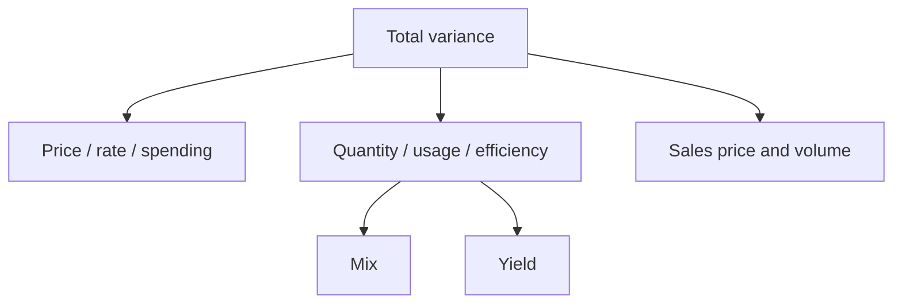

## 1. The same logic in a non-factory setting

| 🏢 Setting | 🔁 The "quantity" driver | 💡 Example variance |
|---|---|---|
| Hospital | Bed-days, nursing hours | Nursing hours per patient-day above standard |
| Law firm | Billable hours | Billed rate vs standard rate |
| Restaurant | Food cost % | Portion-control loss and supplier price gaps |
| Bank branch | Transactions per teller | Staffing efficiency |
| Call centre | Minutes per call | Average handling time |

The formulas never change: **price variance = price difference × quantity; efficiency variance =
standard price × quantity difference.** Only the names of the drivers change.

## 2. The variance tree

## 3. Deciding what to investigate

Not every variance deserves a meeting. Use four filters:

| 🔎 Filter | ❓ Question | 💡 Example |
|---|---|---|
| Size | Is it material? | $10,000 on a $50,000 budget |
| Trend | Is it repeating or one-off? | Third month of rising waste |
| Controllability | Can anyone act on it? | Volume variance from a demand slump |
| Cause pattern | Do variances point one way? | Cheap material plus high usage = quality problem |

**Best-practice answer in a CBQ:** investigate large, repeated, controllable variances first, and read
related variances together — never judge a single number in isolation.

## 4. Section C first half: the seven formulas

| 🧮 Variance | 🧮 Formula |
|---|---|
| Material price | AQ × (AP − SP) |
| Material usage | SP × (AQ − SQ) |
| Labour rate | AH × (AR − SR) |
| Labour efficiency | SR × (AH − SH) |
| Variable overhead spending | Actual VOH − (AH × SR) |
| Fixed overhead budget | Actual − budget |
| Fixed overhead volume | Budget − applied |
