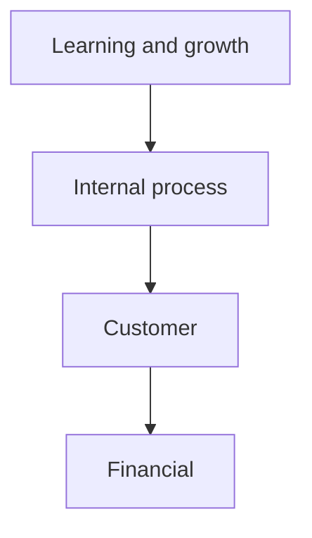

## 1. Profitability in layers

| 🧱 Layer | 🧮 What it shows | 🎯 Use it for |
|---|---|---|
| Contribution margin | Money left after variable costs | Accepting one extra order |
| Segment margin | Money left after traceable fixed costs | Keeping or dropping a line |
| Net profit | After all allocations and tax | Reporting to owners |

**Customer profitability:** the biggest customer is not always the most profitable. Cost-to-serve
drivers include order size, frequency, returns, delivery speed and payment terms. A loss-making
customer may be fixed with a minimum order size rather than dropped.

## 2. ROI and its DuPont split

> **ROI = operating income ÷ invested capital = margin × turnover**
>
> margin = income ÷ sales · turnover = sales ÷ invested capital

**Worked example:** income 180,000, sales 1,200,000, capital 900,000 → margin 15%, turnover 1.33,
ROI = **20%**.

The problem: a division at 20% will reject a 15% project even though the company needs only 12%.

## 3. Residual income and EVA

> **RI = operating income − (required rate × invested capital)** = 180,000 − 108,000 = **72,000**

Add a $100,000 project earning $15,000: ROI falls to 19.5% (so an ROI-managed manager refuses), but RI
rises to 195,000 − 120,000 = **$75,000** (so the company gains). RI aligns the manager with the
company; its weakness is that it is an absolute amount, hard to compare across sizes.

> **EVA = NOPAT − (WACC × invested capital)**
>
> NOPAT 375,000 − (10% × 2,500,000) = **125,000**

| 🔍 Feature | RI | EVA |
|---|---|---|
| Profit | Accounting operating income | NOPAT (after tax, before interest) |
| Charge | Required rate × capital | WACC × adjusted capital |
| Adjustments | Usually none | Capitalised R&D, provisions added back |

## 4. Measurement issues and the balanced scorecard

| ⚠️ Issue | 🧠 Effect |
|---|---|
| Book vs market value | Old, depreciated assets flatter ROI |
| Depreciation method | Changes the capital base over time |
| Short-term focus | Cutting R&D and maintenance lifts this year's ROI |
| Allocated costs | Distort divisional profit without changing group profit |

| 🎯 Perspective | 📏 Example measures |
|---|---|
| Financial | ROI, EVA, revenue growth, margin |
| Customer | Satisfaction, retention, on-time delivery |
| Internal process | Cycle time, defect rate, launch speed |
| Learning and growth | Training hours, staff satisfaction, skills coverage |

The chain of cause and effect — train staff → better processes → happier customers → stronger
financials — is what makes the scorecard *balanced*: leading drivers on one side, lagging results on
the other.
