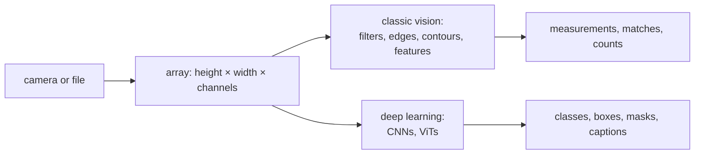

# Images are arrays of numbers

**Computer vision** is getting useful information out of images and video: what's in them, where, how big, how it moves. Every method, from a 1970s edge detector to a modern vision-language model, starts from the same fact: an image is a grid of numbers.



## Pixels, channels and types

A grayscale image is a 2-D array: one brightness value per pixel, usually 0 (black) to 255 (white) stored as `uint8`. A colour image has three **channels** per pixel: red, green and blue.

```python
import numpy as np
import cv2   # pip install opencv-python

img = np.zeros((120, 160, 3), dtype=np.uint8)          # height 120, width 160, 3 channels, all black
cv2.rectangle(img, (20, 30), (70, 90), (0, 0, 255), -1)  # a filled red rectangle (OpenCV order is B, G, R)
cv2.circle(img, (115, 60), 25, (0, 255, 0), -1)          # a filled green circle

print(img.shape, img.dtype)          # (120, 160, 3) uint8
print(img[60, 40])                   # pixel at row 60, column 40: [  0   0 255] (red)
gray = cv2.cvtColor(img, cv2.COLOR_BGR2GRAY)
print(gray.shape, gray[60, 40], gray[60, 115])
```

Three details catch everyone once:

- **Rows first:** `img[y, x]`, row (y) then column (x), with y growing downwards. OpenCV drawing functions take points as `(x, y)`.
- **OpenCV uses BGR**, not RGB. Convert with `cv2.cvtColor(img, cv2.COLOR_BGR2RGB)` before showing images with other libraries.
- **uint8 wraps around:** `np.uint8(250) + 10` is 4, not 260. Convert to `float32` before arithmetic.

## Colour spaces

RGB mixes colour and brightness. For tasks like "find the green objects", **HSV** (hue, saturation, value) is easier, because hue alone says the colour whatever the lighting:

```python
hsv = cv2.cvtColor(img, cv2.COLOR_BGR2HSV)
green_mask = cv2.inRange(hsv, (40, 100, 100), (80, 255, 255))   # OpenCV hue runs 0 to 179
print("green pixels:", int((green_mask > 0).sum()))
```

The circle has about π × 25² ≈ 1,963 pixels, and the mask finds that many: a first measurement from pixels alone.

## Optional videos

The lesson above is complete on its own. These go deeper, if you like learning by watching.

**CS231n Lecture 1: introduction to computer vision (Stanford)**

https://www.youtube.com/watch?v=vT1JzLTH4G4
