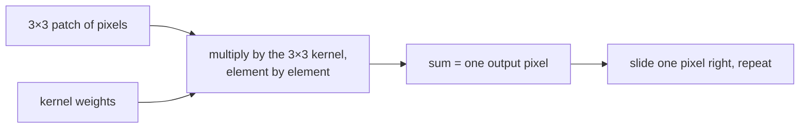

# Filters and convolution: blur, sharpen, edges

A **filter** (or **kernel**) is a small grid of weights. **Convolution** slides it over the image; at each position, multiply the kernel by the pixels under it and add up. The result is a new image. The same operation is the core of convolutional neural networks, except there the network learns the weights.



```python
import numpy as np
import cv2

def convolve(img, k):
    """Plain convolution (really cross-correlation, as in deep learning), zero padding, same size output."""
    h, w = img.shape
    kh, kw = k.shape
    pad = np.pad(img.astype(np.float32), ((kh // 2,), (kw // 2,)))
    out = np.zeros((h, w), np.float32)
    for y in range(h):
        for x in range(w):
            out[y, x] = (pad[y:y + kh, x:x + kw] * k).sum()
    return out

img = np.zeros((40, 40), np.float32)
img[:, 20:] = 200                                  # dark left half, bright right half: one vertical edge

box_blur = np.ones((3, 3), np.float32) / 9
sobel_x = np.array([[-1, 0, 1], [-2, 0, 2], [-1, 0, 1]], np.float32)

blurred = convolve(img, box_blur)
gx = convolve(img, sobel_x)
print(blurred[20, 18:23].round(1))   # the step becomes a ramp: [  0.   66.7 133.3 200.  200. ]
print(np.abs(gx[20]).argmax())        # the strongest horizontal change is at the edge (column 19 or 20)

same = cv2.filter2D(img, -1, sobel_x, borderType=cv2.BORDER_CONSTANT)
print(np.allclose(same, gx))          # OpenCV's fast version gives the same result
```

## Kernels to know

| Kernel | Effect | Used for |
|---|---|---|
| Box or **Gaussian** blur | averages neighbours | removing noise before other steps |
| **Sharpen** (centre 5, neighbours -1) | boosts differences | crisper images |
| **Sobel x / y** | difference across columns / rows | gradients: where brightness changes, and in which direction |
| **Laplacian** | second difference | finding edges and blobs |

## Edges with Canny

An **edge** is where brightness changes quickly. The Canny detector (1986) is still the standard classic method: blur, compute Sobel gradients, keep only the thinnest line along each edge, then use two thresholds so strong edges are kept and weak ones only if connected to strong ones.

```python
scene = np.zeros((100, 100), np.uint8)
cv2.rectangle(scene, (30, 30), (70, 70), 255, -1)
noisy = cv2.add(scene, np.random.default_rng(0).integers(0, 40, scene.shape, dtype=np.uint8))
edges = cv2.Canny(cv2.GaussianBlur(noisy, (5, 5), 1.0), 50, 150)
print("edge pixels:", int((edges > 0).sum()))     # about 160: the square's outline, 4 × 40
```

Why blur first? Noise creates many small brightness changes; the derivative amplifies them. Smoothing trades a little edge sharpness for far fewer false edges.

## Optional videos

The lesson above is complete on its own. These go deeper, if you like learning by watching.

**But what is a convolution? (3Blue1Brown)**

https://www.youtube.com/watch?v=KuXjwB4LzSA

**How Blurs and Filters Work (Computerphile)**

https://www.youtube.com/watch?v=C_zFhWdM4ic

**Finding the Edges, Sobel operator (Computerphile)**

https://www.youtube.com/watch?v=uihBwtPIBxM

**Canny Edge Detector (Computerphile)**

https://www.youtube.com/watch?v=sRFM5IEqR2w
