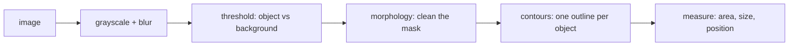

# Thresholds, masks and contours: measuring objects

Many real vision jobs need no deep learning: count parts on a conveyor, measure a crack, check a label is present. The classic pipeline is short.



```python
import numpy as np
import cv2

img = np.full((200, 300), 30, np.uint8)                     # dark background
cv2.circle(img, (60, 100), 30, 220, -1)                     # three bright "parts"
cv2.rectangle(img, (130, 60), (190, 140), 220, -1)
cv2.ellipse(img, (245, 100), (35, 20), 0, 0, 360, 220, -1)
img = cv2.add(img, np.random.default_rng(1).integers(0, 25, img.shape, dtype=np.uint8))

blur = cv2.GaussianBlur(img, (5, 5), 0)
_, mask = cv2.threshold(blur, 0, 255, cv2.THRESH_BINARY + cv2.THRESH_OTSU)   # Otsu picks the threshold
mask = cv2.morphologyEx(mask, cv2.MORPH_OPEN, np.ones((3, 3), np.uint8))   # remove small specks

contours, _ = cv2.findContours(mask, cv2.RETR_EXTERNAL, cv2.CHAIN_APPROX_SIMPLE)
for c in sorted(contours, key=lambda c: cv2.boundingRect(c)[0]):
    x, y, w, h = cv2.boundingRect(c)
    print(f"area {cv2.contourArea(c):7.0f}  box x={x} y={y} w={w} h={h}")
print(len(contours), "objects")
```

## The tools

- **Thresholding** turns gray into a black-and-white mask. **Otsu's method** chooses the threshold automatically when the histogram has two clear peaks; **adaptive thresholding** handles uneven lighting by using a local threshold per region.
- **Morphology** cleans masks: *erode* shrinks, *dilate* grows, *open* (erode then dilate) removes specks, *close* (dilate then erode) fills small holes.
- **Contours** are the outlines of connected regions. From them: area, perimeter, bounding box, centre, and shape measures like circularity (4π·area / perimeter²; 1 for a circle).

## Where classic methods break

Controlled light, a plain background and a fixed camera make thresholding reliable; that's why factories use enclosures and lighting. With cluttered scenes, changing light or objects that vary a lot (people, animals, damage), learned models (modules 3 to 5) win. Knowing both lets you choose the cheaper one that works.

To turn pixels into millimetres, image a ruler or a calibration target of known size at the same distance; the *Machine vision* course shows how full camera calibration works.
