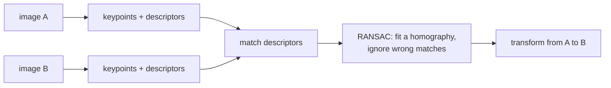

# Features and matching: finding the same thing twice

How does a phone stitch a panorama, or an app find a book cover in a photo? By finding **keypoints** (distinctive spots, like corners) in both images, describing each with a **descriptor** (a short code summarising the patch around it), matching descriptors, and fitting a geometric transform to the matches.



```python
import numpy as np
import cv2

rng = np.random.default_rng(0)
A = np.zeros((300, 300), np.uint8)
for _ in range(40):                                        # a textured test image: random rectangles
    x, y = rng.integers(0, 260, 2)
    cv2.rectangle(A, (int(x), int(y)), (int(x + rng.integers(10, 40)), int(y + rng.integers(10, 40))),
                  int(rng.integers(60, 255)), -1)

H_true = np.array([[0.9, 0.1, 20], [-0.1, 0.9, 30], [0, 0, 1]], np.float32)   # rotate a bit, shrink, shift
B = cv2.warpPerspective(A, H_true, (300, 300))

orb = cv2.ORB_create(1000)
kpa, da = orb.detectAndCompute(A, None)
kpb, db = orb.detectAndCompute(B, None)
matches = cv2.BFMatcher(cv2.NORM_HAMMING, crossCheck=True).match(da, db)

src = np.float32([kpa[m.queryIdx].pt for m in matches])
dst = np.float32([kpb[m.trainIdx].pt for m in matches])
H, inliers = cv2.findHomography(src, dst, cv2.RANSAC, 3.0)
print(len(matches), "matches,", int(inliers.sum()), "inliers")
print(np.round(H / H[2, 2], 2))       # close to H_true
```

## The pieces

- **Detectors** find repeatable points: corners (Harris, FAST), blobs at many scales (SIFT).
- **Descriptors** summarise the patch: SIFT (128 numbers, very robust, patent expired in 2020 and now in OpenCV's main package) and ORB (256 bits, fast, free).
- **Matching** finds the nearest descriptor; a ratio test or cross-check removes ambiguous matches.
- **RANSAC** fits the transform to random small subsets of matches and keeps the one most matches agree with, so wrong matches (outliers) don't spoil the result.
- A **homography** maps one plane to another view of it: right for flat things (documents, book covers, a floor) or for a camera that only rotates (panoramas).

Learned features (for example SuperPoint and LightGlue) now beat hand-made ones in hard conditions, but the pipeline (detect, describe, match, robustly fit) stays the same.
