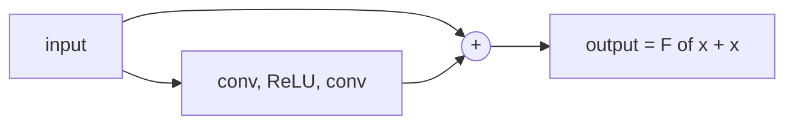

# Famous architectures and transfer learning

Knowing a few landmark networks helps you read papers, pick models and answer interviews. Each one fixed a specific problem.

| Year | Network | What it introduced |
|---|---|---|
| 1998 | **LeNet-5** | convolution + pooling for handwritten digits |
| 2012 | **AlexNet** | a deep CNN trained on GPUs with ReLU and dropout; won ImageNet by a huge margin and started the deep learning boom |
| 2014 | **VGG** | very deep stacks of simple 3×3 convolutions |
| 2014 | **GoogLeNet / Inception** | parallel branches with different kernel sizes |
| 2015 | **ResNet** | **residual connections** (add the input to the output of each block), making 100+ layer networks trainable |
| 2017 to 2019 | **MobileNet, EfficientNet** | accuracy per unit of compute, for phones and edge devices |
| 2020 | **Vision Transformer (ViT)** | transformers on image patches instead of convolutions (module 5) |
| 2022 | **ConvNeXt** | modernised CNNs that match transformers on many tasks |

The residual idea is worth explaining in an interview: if a block isn't useful, it can learn F(x) ≈ 0 and pass the input straight through, so adding layers can't easily make the network worse, and gradients flow back through the shortcut.

## Transfer learning in practice

1. Pick a pretrained backbone sized for where it will run (a small one for phones, a larger one for servers).
2. Replace the last layer with one for your classes.
3. Train only the new head first; then unfreeze the last blocks and train with a small learning rate.
4. Use augmentation and a clean validation set from the *same conditions* as production (same cameras, lighting, sites).
5. Look at the mistakes (a confusion matrix plus examples) before changing the model.

## Choosing a metric

**Accuracy** misleads when classes are unbalanced: if 1% of parts are defective, "always OK" scores 99%. Use **precision** (of the parts flagged, how many were really defective), **recall** (of the defective parts, how many were caught) and pick the threshold that fits the cost of each kind of mistake.

## Optional videos

The lesson above is complete on its own. These go deeper, if you like learning by watching.

**CS231n Lecture 5: convolutional neural networks (Stanford)**

https://www.youtube.com/watch?v=bNb2fEVKeEo
