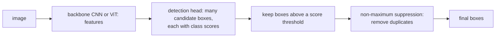

# Object detection: boxes, IoU and NMS

**Classification** says *what* is in the image. **Detection** says what and *where*: a box and a class for every object.



## IoU: how much two boxes overlap

**Intersection over union** = overlap area / combined area. It's 1 for identical boxes and 0 for separate ones. Detection uses it everywhere: to decide whether a predicted box matches the true one (often IoU ≥ 0.5), and to remove duplicates.

```python
import numpy as np

def iou(a, b):
    """Boxes as (x1, y1, x2, y2)."""
    x1, y1 = max(a[0], b[0]), max(a[1], b[1])
    x2, y2 = min(a[2], b[2]), min(a[3], b[3])
    inter = max(0, x2 - x1) * max(0, y2 - y1)
    area = lambda r: (r[2] - r[0]) * (r[3] - r[1])
    return inter / (area(a) + area(b) - inter)

def nms(boxes, scores, threshold=0.5):
    """Keep the best box, drop boxes overlapping it too much, repeat."""
    order = list(np.argsort(scores)[::-1])
    keep = []
    while order:
        best = order.pop(0)
        keep.append(int(best))
        order = [i for i in order if iou(boxes[best], boxes[i]) < threshold]
    return keep

print(round(iou((0, 0, 10, 10), (5, 5, 15, 15)), 3))     # 25 / 175 = 0.143
boxes = [(10, 10, 60, 60), (12, 12, 62, 62), (100, 100, 150, 150), (11, 9, 58, 61)]
scores = [0.90, 0.75, 0.80, 0.60]
print(nms(boxes, scores))                                # [0, 2]: one box per object
```

## Families of detectors

| Family | Idea | Examples |
|---|---|---|
| Two-stage | propose regions, then classify and refine each | Faster R-CNN (2015) |
| One-stage | predict boxes and classes in one pass over a grid | YOLO (first version 2016, many versions since), SSD, RetinaNet |
| Transformer-based | predict a set of boxes directly, no NMS needed | DETR (2020) and its successors |
| Open-vocabulary | find objects described by any text prompt | Grounding DINO, OWL-ViT |

For most projects, start from a pretrained one-stage detector and fine-tune on a few hundred to a few thousand labelled images of your own.

## Measuring detectors: mAP

For each class, sort predictions by score, count a prediction as correct if it matches an unmatched true box with IoU above the threshold, and draw the precision-recall curve; **average precision (AP)** is the area under it. **mAP** averages over classes (and in the COCO benchmark, over IoU thresholds from 0.5 to 0.95). Always also look at the errors by type: missed small objects, wrong class, loose boxes.

## Optional videos

The lesson above is complete on its own. These go deeper, if you like learning by watching.

**CS231n Lecture 11: detection and segmentation (Stanford)**

https://www.youtube.com/watch?v=nDPWywWRIRo
