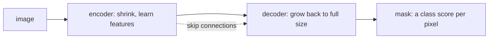

# Segmentation: labelling every pixel

Boxes are rough. When you need the exact shape (the area of a burn, the outline of a road, where a tumour ends), use **segmentation**.

| Task | Output | Example |
|---|---|---|
| **Semantic segmentation** | a class for every pixel | road, sidewalk, car, sky |
| **Instance segmentation** | a separate mask for each object | car 1, car 2, car 3 |
| **Panoptic segmentation** | both: every pixel gets a class, and countable things get instance ids | self-driving scenes |

## How the networks work



- **U-Net** (2015, designed for medical images) is an encoder-decoder with **skip connections** that pass fine detail from the encoder to the decoder, so masks keep sharp edges. Still the default for many medical and industrial tasks.
- **Mask R-CNN** (2017) adds a mask head to a detector: a box per object, then a mask inside each box.
- **Segment Anything (SAM)** from Meta (2023, followed by SAM 2 for video) is a foundation model that segments whatever you point at with a click or a box, without training on your classes. It's excellent for speeding up labelling, and for apps where a user indicates the object.

## Measuring masks

**IoU per class** (also called the Jaccard index) compares predicted and true masks; **mean IoU** averages over classes. The **Dice score** (2 × overlap / total size) is common in medical imaging. Check boundaries visually too: a mask can have good IoU and still miss a thin, important part.

```python
import numpy as np

truth = np.zeros((10, 10), bool); truth[2:8, 2:8] = True      # a 6×6 object
pred = np.zeros((10, 10), bool);  pred[3:9, 3:9] = True       # shifted by one pixel
inter, union = (truth & pred).sum(), (truth | pred).sum()
print("IoU", round(inter / union, 3), " Dice", round(2 * inter / (truth.sum() + pred.sum()), 3))
```

A one-pixel shift on a small object already drops IoU to about 0.53: small objects need careful labels and metrics.

## Labels cost the most

Pixel masks are slow to draw. Use tools with model-assisted labelling (SAM-style clicks), label a small set well, train, and then correct the model's predictions instead of drawing from scratch.
