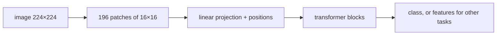

# Vision transformers and CLIP

## ViT: an image as a sentence of patches

The **Vision Transformer** (2020) cuts the image into patches (for example 16×16 pixels), flattens each into a vector, adds a position signal, and feeds the sequence to a standard transformer, the same architecture LLMs use. Attention lets any patch use information from any other patch from the first layer, while a CNN builds up its view step by step.



```python
import numpy as np

img = np.random.default_rng(0).random((224, 224, 3)).astype(np.float32)
p = 16
patches = img.reshape(224 // p, p, 224 // p, p, 3).swapaxes(1, 2).reshape(-1, p * p * 3)
print(patches.shape)          # (196, 768): 196 "tokens", each a 768-number vector
```

ViTs need more data than CNNs to train from scratch (they have fewer built-in assumptions about images), but with large pretraining they match or beat CNNs, and they scale well. They're also the vision part of most vision-language models.

## CLIP: images and text in one space

OpenAI's **CLIP** (2021) trained an image encoder and a text encoder together on 400 million image-caption pairs from the web, pulling matching pairs together and pushing others apart (**contrastive learning**). The result: an image of a dog and the text "a photo of a dog" get nearby vectors.

That enables **zero-shot classification**: write your class names as text, embed them, and pick the one closest to the image, with no training on your classes.

```python
def normalize(v):
    return v / np.linalg.norm(v, axis=-1, keepdims=True)

# toy vectors standing in for real CLIP embeddings
text = normalize(np.array([[0.9, 0.1, 0.0],     # "a photo of a damaged parcel"
                           [0.1, 0.9, 0.1],     # "a photo of an intact parcel"
                           [0.0, 0.2, 0.9]]))   # "a photo of a cat"
image = normalize(np.array([0.8, 0.3, 0.05]))
sims = text @ image
probs = np.exp(100 * sims) / np.exp(100 * sims).sum()   # CLIP scales similarities before softmax
print(sims.round(3), probs.round(3))                    # the damaged-parcel prompt wins
```

Uses: image search by text, finding near-duplicates, filtering datasets, quick prototypes before you train anything. Limits: it can be fooled by text written in the image, and it's weaker on fine-grained or specialised classes (medical, industrial defects), where fine-tuning still wins.

## Optional videos

The lesson above is complete on its own. These go deeper, if you like learning by watching.

**An Image is Worth 16x16 Words: ViT paper explained (Yannic Kilcher)**

https://www.youtube.com/watch?v=TrdevFK_am4

**OpenAI CLIP: connecting text and images (Yannic Kilcher)**

https://www.youtube.com/watch?v=T9XSU0pKX2E
