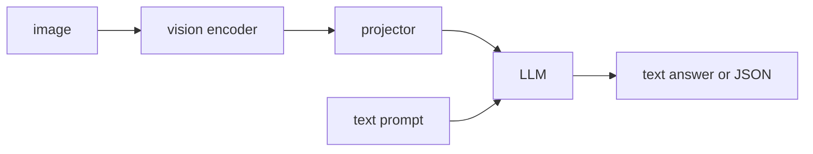
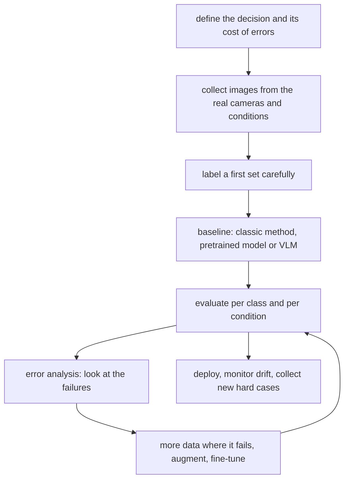

# Vision-language models and shipping a vision project

## Vision-language models

**Vision-language models (VLMs)** connect a vision encoder (usually a ViT) to an LLM: the image becomes a sequence of tokens the LLM reads next to your text. Most frontier chat models accept images this way, and open VLMs run locally. One model can now describe photos, answer questions about charts, read receipts and screenshots, and compare images, all from a prompt.

**When a VLM, when a specialised model?**

| Use a VLM | Train a specialised model |
|---|---|
| varied tasks, few examples, a prototype this week | one narrow task at high volume |
| reading documents, charts, screenshots | precise boxes, masks or measurements |
| cost per image is acceptable | real-time video on a small device |
| explanations in words are useful | you need exact, repeatable numbers |

VLMs can misread numbers and miss small details, and images can contain injected instructions; validate outputs like any LLM output.

## Shipping a vision project

Lessons that save months:

- **Data beats architecture.** Most gains come from more and better-labelled examples of the cases that fail, not from a newer model.
- **Split by situation, not randomly.** If the same camera or patient appears in both training and test sets, your score is inflated. Hold out whole sites, days or devices.
- **Test the conditions you'll meet:** night, rain, glare, dirty lenses, new product versions.
- **Monitor drift:** cameras move, lighting changes, products change. Watch prediction confidence and sample images for review every week.
- **Privacy:** faces, licence plates and medical images are personal data. Collect only what you need, and blur or delete what you don't.

The *Machine vision* course in the library is the complementary view: geometry, light and precise measurement, the physics that learned models don't replace.
