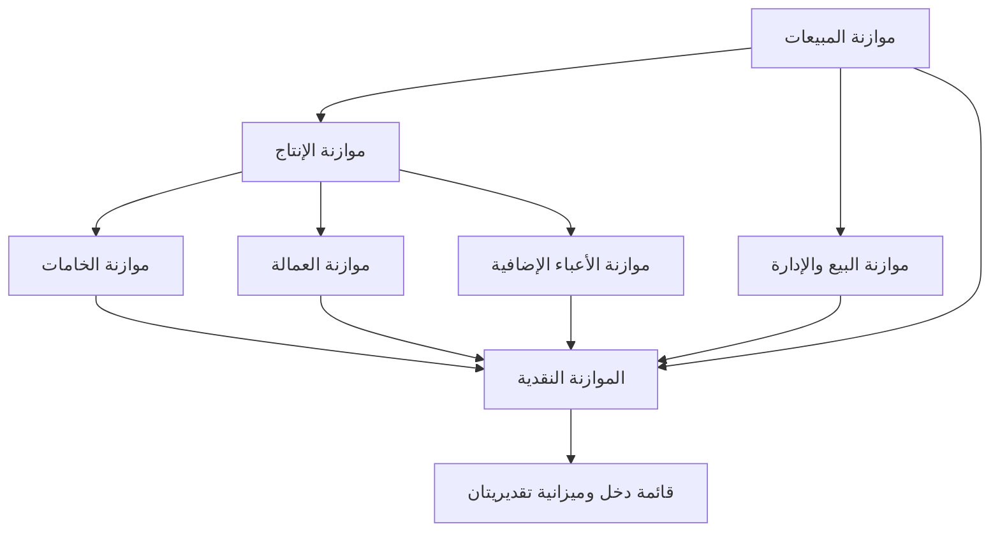

# الموازنات: التخطيط للأشهر القادمة

**الموازنة** هي الخطة بالأرقام. تجبرك على التفكير مسبقًا، وتنسّق بين الناس، وتعطيك ما تقارن به النتائج.

## الموازنة الشاملة

كل شيء يبدأ من **المبيعات**: لو أخطأت فيها، أخطأت في كل شيء بعدها.

## الربع الأول لنور

**1. موازنة المبيعات** (السعر 120)

| | يناير | فبراير | مارس | الربع |
|---|---|---|---|---|
| الكيكات | 450 | 500 | 550 | 1,500 |
| المبيعات | 54,000 | 60,000 | 66,000 | 180,000 |

**2. المتحصلات النقدية.** 60% من المبيعات نقدًا؛ و40% آجلة تُدفع الشهر التالي. مبيعات ديسمبر تركت **20,000** عملاء تُحصَّل في يناير.

| | يناير | فبراير | مارس |
|---|---|---|---|
| من مبيعات الشهر (60%) | 32,400 | 36,000 | 39,600 |
| من الشهر السابق (40%) | 20,000 | 21,600 | 24,000 |
| **إجمالي المتحصلات** | **52,400** | **57,600** | **63,600** |

**3. الموازنة النقدية ليناير.** النقدية أول المدة 9,000. التكاليف المتغيّرة (50 للكيكة) تُدفع في نفس الشهر. التكاليف الثابتة 21,000، منها 1,000 إهلاك (بلا نقدية)، فيُدفع 20,000. نور تخطط لشراء فرن ثانٍ بـ 15,000. وتريد ألا يقل رصيد البنك عن **5,000** أبدًا.

| | يناير |
|---|---|
| النقدية أول المدة | 9,000 |
| يُضاف: المتحصلات | 52,400 |
| **النقدية المتاحة** | **61,400** |
| التكاليف المتغيّرة (450 × 50) | (22,500) |
| التكاليف الثابتة النقدية | (20,000) |
| الفرن الجديد | (15,000) |
| **إجمالي المدفوعات** | **(57,500)** |
| **النقدية قبل التمويل** | **3,900** |
| اقتراض للوصول للحد الأدنى | 1,100 (أو أكثر بمبالغ مقرّبة) |
| **النقدية آخر المدة** | **5,000** |

بدون الموازنة النقدية، كانت نور ستكتشف في آخر يناير أنها لا تقدر على دفع أجر الخبّاز. بها، تقدر ترتّب قرضًا صغيرًا الآن، أو تؤجّل الفرن شهرًا.

## الربح ليس نقدية، مرة أخرى

ربح يناير المقدّر 450 × 70 − 21,000 = **10,500**، ومع ذلك ستنزل النقدية تحت الحد الأدنى بسبب شراء الفرن وتوقيت التحصيل. خطّط للاثنين.

## أساليب إعداد الموازنة

- **التزايدية:** العام الماضي زائد نسبة. سريعة، لكنها تُبقي الهدر القديم.
- **الصفرية:** كل تكلفة تُبرَّر من الصفر. دقيقة، لكنها بطيئة.
- **المستمرة (المتجددة):** دائمًا 12 شهرًا للأمام، يُضاف شهر عندما ينتهي شهر.
- **بالمشاركة:** من سيُحاسَب على الموازنة يساهم في إعدادها. التزام أفضل، لكن احذر *الاحتياطي المخفي* (تضخيم التكاليف للظهور بمظهر جيد لاحقًا).

## جرّب بنفسك

المبيعات: أبريل 40,000، مايو 50,000. الزبائن يدفعون 70% في شهر البيع و30% الشهر التالي. مبيعات مارس 30,000. كم المتحصلات في أبريل ومايو؟

**الإجابة:** أبريل = 28,000 + 9,000 = **37,000**. مايو = 35,000 + 12,000 = **47,000**.
