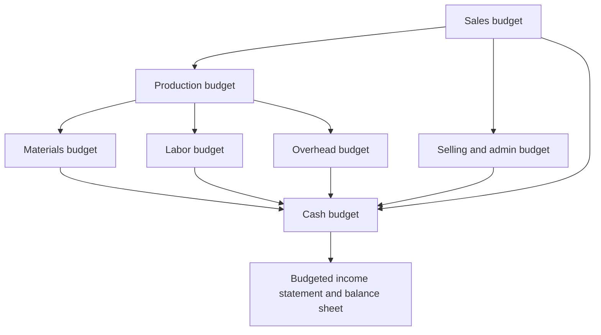

# Budgets: planning the months ahead

A **budget** is the plan in numbers. It forces you to think ahead, coordinates people, and gives you something to compare results with.

## The master budget

Everything starts with **sales**: get that wrong and everything else is wrong too.

## Nour's first quarter

**1. Sales budget** (price 120)

| | Jan | Feb | Mar | Quarter |
|---|---|---|---|---|
| Cakes | 450 | 500 | 550 | 1,500 |
| Sales | 54,000 | 60,000 | 66,000 | 180,000 |

**2. Cash collections.** 60% of sales are paid in cash; 40% are on account and paid the following month. December's sales left **20,000** of receivables, collected in January.

| | Jan | Feb | Mar |
|---|---|---|---|
| From this month (60%) | 32,400 | 36,000 | 39,600 |
| From last month (40%) | 20,000 | 21,600 | 24,000 |
| **Total collections** | **52,400** | **57,600** | **63,600** |

**3. Cash budget for January.** Opening cash 9,000. Variable costs (50 per cake) are paid in the same month. Fixed costs are 21,000, but 1,000 is depreciation (no cash), so 20,000 is paid. Nour plans to buy a second oven for 15,000. She wants at least **5,000** in the bank at all times.

| | January |
|---|---|
| Opening cash | 9,000 |
| Add: collections | 52,400 |
| **Cash available** | **61,400** |
| Variable costs (450 × 50) | (22,500) |
| Fixed cash costs | (20,000) |
| New oven | (15,000) |
| **Total payments** | **(57,500)** |
| **Cash before financing** | **3,900** |
| Borrow to reach the minimum | 1,100 (or more, in round amounts) |
| **Closing cash** | **5,000** |

Without the cash budget, Nour would have found out in late January that she couldn't pay the baker. With it, she can arrange a small loan now, or delay the oven by a month.

## Profit is not cash, again

January's budgeted profit is 450 × 70 − 21,000 = **10,500**, yet cash would fall below the minimum because of the oven purchase and the timing of collections. Plan both.

## Budget approaches

- **Incremental:** last year plus a percentage. Quick, but keeps old waste.
- **Zero-based:** every cost justified from zero. Thorough, but slow.
- **Rolling:** always 12 months ahead, adding a month as one ends.
- **Participative:** the people who'll be held to the budget help build it. Better buy-in, but watch for *budgetary slack* (padding costs to look good later).

## Try it

Sales: April 40,000, May 50,000. Customers pay 70% in the month of sale and 30% the next month. March sales were 30,000. What are cash collections in April and May?

**Answer:** April = 28,000 + 9,000 = **37,000**. May = 35,000 + 12,000 = **47,000**.
