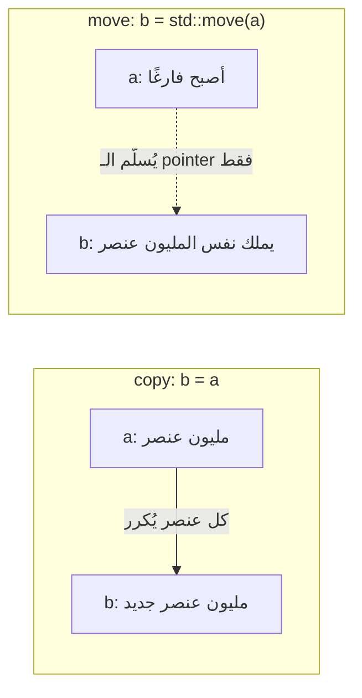

# move semantics

هذا الكورس يكمل من *C++ للمبتدئين*. يجب أن تكون مرتاحًا مع الـ classes والـ references و`std::vector` و`std::unique_ptr` وlambdas.

أول فكرة كبيرة في C++ الحديثة: بدل **نسخ** object على وشك أن يختفي، **خذ** محتوياته. وهذا هو **النقل (move)**.

## تكلفة النسخ

‏`std::vector<std::string>` فيه مليون اسم يملك كتلة ذاكرة كبيرة. ونسخه يعني حجز كتلة كبيرة أخرى ونسخ كل نص. ولو كان الأصل سيُرمى على أي حال، فكل هذا الشغل ضائع.

```cpp
#include <iostream>
#include <string>
#include <utility>
#include <vector>

int main() {
    std::vector<std::string> a{"one", "two", "three"};

    std::vector<std::string> b = a;              // copy: a still has its items
    std::vector<std::string> c = std::move(a);   // move: c takes a's memory

    std::cout << "b has " << b.size() << ", c has " << c.size()
              << ", a has " << a.size() << "\n";
    return 0;
}
```

```output
b has 3, c has 3, a has 0
```

النقل سلّم فقط الـ pointer إلى كتلة الذاكرة؛ ولم يُنسخ أي نص. وبعد النقل يُترك المصدر "صالحًا لكن غير محدد". وللأنواع القياسية معنى ذلك أنك تستطيع إعطاءه قيمة جديدة أو تدميره، لكن لا تعتمد على ما يحتويه.

## ‏lvalues وrvalues

- الـ **lvalue** له اسم ويستمر: `a` و`names[2]` و`*p`.
- الـ **rvalue** قيمة مؤقتة على وشك الاختفاء: `make_list()` و`x + y` و`std::string("hi")`.

النقل من الـ rvalues آمن دائمًا: لا أحد يستطيع النظر إليها مرة أخرى. و`std::move(a)` **لا** تنقل أي شيء بنفسها. إنها تحويل يقول "عامل `a` كـ rvalue؛ لقد انتهيت منها". والنقل يحدث عندما يأخذها شيء ما.

## rvalue references: ‏T&&

يمكن للـ function أن تأخذ rvalue reference، أي `T&&`، وهو لا يرتبط إلا بالأشياء التي يمكن النقل منها. وهكذا يقول الـ class "هذه طريقة نقلي":

<!-- diagram -->


```cpp
#include <cstring>
#include <iostream>
#include <utility>

class Buffer {
public:
    explicit Buffer(std::size_t n) : size_(n), data_(new char[n]) {
        std::cout << "allocate " << n << "\n";
    }
    ~Buffer() { delete[] data_; }

    Buffer(const Buffer& other) : size_(other.size_), data_(new char[other.size_]) {    // copy
        std::memcpy(data_, other.data_, size_);
        std::cout << "copy " << size_ << "\n";
    }
    Buffer(Buffer&& other) noexcept                                                  // move
        : size_(std::exchange(other.size_, 0)), data_(std::exchange(other.data_, nullptr)) {
        std::cout << "move " << size_ << "\n";
    }
    Buffer& operator=(const Buffer&) = delete;    // keep the example short
    Buffer& operator=(Buffer&&) = delete;

    std::size_t size() const { return size_; }

private:
    std::size_t size_;
    char* data_;
};

int main() {
    Buffer a(1024);
    Buffer b = a;               // copy constructor
    Buffer c = std::move(a);    // move constructor
    std::cout << "a " << a.size() << ", b " << b.size() << ", c " << c.size() << "\n";
    return 0;
}
```

```output
allocate 1024
copy 1024
move 1024
a 0, b 1024, c 1024
```

- `std::exchange(x, v)` تجعل x تساوي v وترجع القيمة القديمة. مثالية لفكرة "خذه واترك المصدر فارغًا".
- `noexcept` تعد بأن النقل لن يرمي exception. و`std::vector` لا تستخدم نقلك عند الكبر إلا لو كان `noexcept`؛ وإلا فإنها تنسخ لتبقى آمنة. **علّم عمليات النقل دائمًا بـ noexcept.**
- يجب أن يظل `a` المنقول منه آمنًا للتدمير: مؤشره `nullptr`، و`delete[] nullptr` لا تفعل شيئًا.

## نقل تحصل عليه مجانًا

نادرًا ما تكتب `std::move` عند الإرجاع:

```cpp
std::vector<int> make_big() {
    std::vector<int> v(1'000'000, 7);
    return v;          // no copy: built in place or moved automatically
}
```

كتابة `return std::move(v);` هنا أسوأ في الحقيقة: قد تمنع الـ compiler من بناء `v` مباشرة في مساحة المستدعي.

أماكن مفيدة لـ `std::move`:

- تمرير variable محلي لم تعد تحتاجه إلى function أو حاوية: `list.push_back(std::move(name));`
- نقل عضو إلى الخارج: `return std::move(data_);` من function تتخلى عن الملكية
- نقل `unique_ptr`

## المعاملات التي ستحتفظ بها: مرّر بالقيمة ثم انقل

عندما يخزّن constructor نصًا، خذه بالقيمة وانقله إلى العضو:

```cpp
#include <iostream>
#include <string>
#include <utility>

class Person {
public:
    explicit Person(std::string name) : name_(std::move(name)) {}
    const std::string& name() const { return name_; }

private:
    std::string name_;
};

int main() {
    std::string n = "Habiba";
    Person a(n);                    // n is copied once into the parameter, then moved
    Person b(std::string("Adel"));  // the temporary becomes the parameter, then is moved
    std::cout << a.name() << " " << b.name() << " " << n << "\n";
    return 0;
}
```

```output
Habiba Adel Habiba
```

constructor واحد يتعامل جيدًا مع الحالتين: من يمرر lvalue يدفع نسخة واحدة، ومن يمرر rvalue لا يدفع إلا عمليات نقل.

## الخلاصة

- النقل يأخذ موارد الـ object بدل نسخها؛ ويُترك المصدر صالحًا لكن غير محدد.
- `std::move` مجرد تحويل؛ ومعاملات `T&&` تستقبل أشياء يمكن النقل منها.
- علّم عمليات النقل بـ `noexcept`؛ ولا تستخدم `std::move` مع variable محلي في جملة return.

## فيديوهات اختيارية

الدرس أعلاه كامل وحده. هذه الفيديوهات للتعمق إن كنت تحب التعلم بالمشاهدة. الفيديوهات المكتوب بجانبها (بالإنجليزية) يمكنك تشغيل الترجمة لها (**CC**)، ثم **الإعدادات ← الترجمة ← ترجمة تلقائية ← العربية**.

**lvalues and rvalues in C++ (The Cherno) (بالإنجليزية)**

https://www.youtube.com/watch?v=fbYknr-HPYE

**Move semantics in C++ (The Cherno) (بالإنجليزية)**

https://www.youtube.com/watch?v=ehMg6zvXuMY
