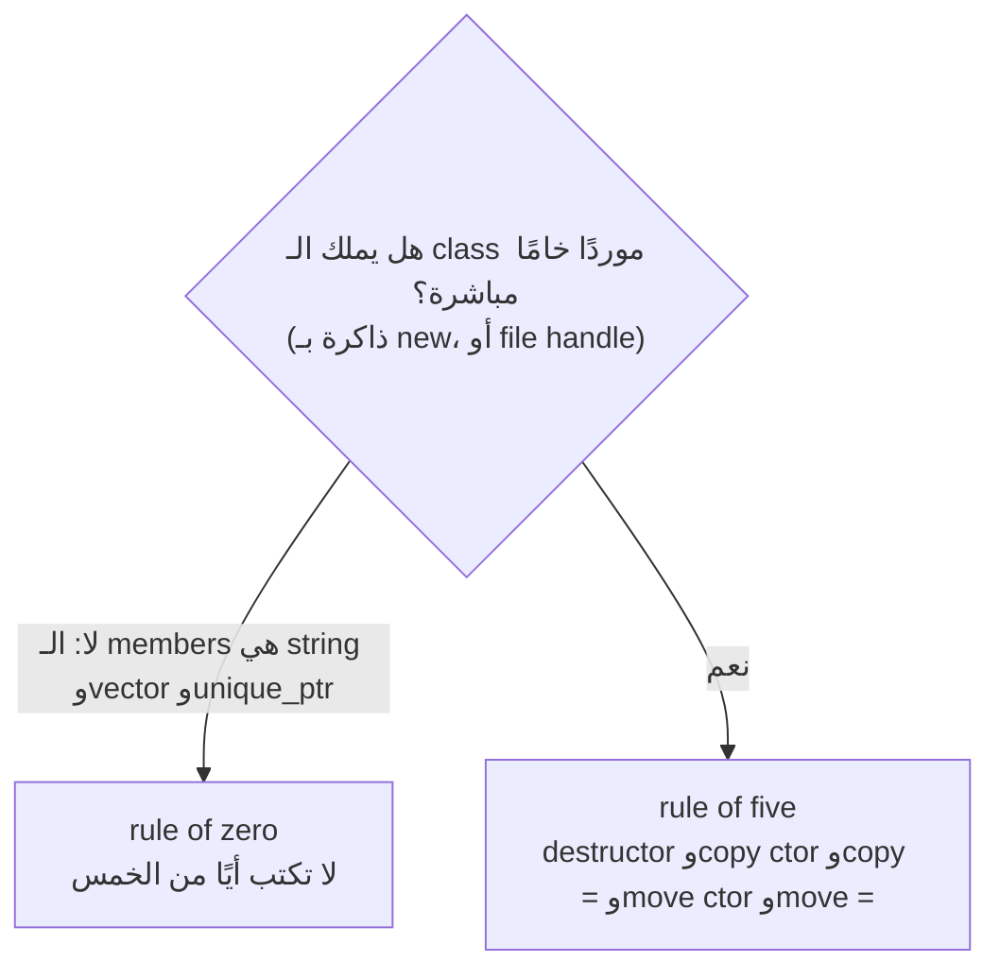

# قاعدة الصفر والثلاثة والخمسة

لكل class خمس عمليات خاصة تتحكم في النسخ والنقل والتدمير:

```text
~T()                       destructor
T(const T&)                copy constructor
T& operator=(const T&)     copy assignment
T(T&&)                     move constructor
T& operator=(T&&)          move assignment
```

الـ compiler يكتبها لك عندما يستطيع. والسؤال: متى يجب أن تكتبها بنفسك؟

## قاعدة الصفر (التي تريدها)

> لو كان كلاسك لا يدير موردًا بشكل مباشر، فلا تكتب **أيًا** من الخمس.

<!-- diagram -->


```cpp
#include <iostream>
#include <memory>
#include <string>
#include <utility>
#include <vector>

class Playlist {
public:
    explicit Playlist(std::string name) : name_(std::move(name)) {}
    void add(std::string song) { songs_.push_back(std::move(song)); }
    std::size_t size() const { return songs_.size(); }
    const std::string& name() const { return name_; }

private:
    std::string name_;
    std::vector<std::string> songs_;
};

int main() {
    Playlist a("road trip");
    a.add("song 1");
    a.add("song 2");
    Playlist b = a;                 // copy: compiler-written, copies each member
    Playlist c = std::move(a);      // move: compiler-written, moves each member
    b.add("song 3");
    std::cout << b.size() << " " << c.size() << "\n";
    return 0;
}
```

```output
3 2
```

النص والـ vector يعرفان بالفعل كيف يُنسخان ويُنقلان وينظّفان، فالنسخ التي يكتبها الـ compiler تفعل الصواب. لا شيء تكتبه، ولا شيء تخطئ فيه.

لجعل class قابلًا للنقل فقط، ضع فيه عضوًا قابلًا للنقل فقط مثل `std::unique_ptr`. وحينها تُحذف عمليات النسخ تلقائيًا.

## قاعدة الخمسة (عندما تضطر)

> لو كتبت **أيًا** من الـ destructor أو عمليات النسخ أو النقل، ففكّر في **الخمس كلها**.

الـ class الذي يملك موردًا خامًا يحتاجها كلها. لو كتبت destructor يحرر الذاكرة وتركت constructor النسخ الذي يكتبه الـ compiler، فسينتهي الأمر بكائنين يشيران إلى نفس الذاكرة، وكلاهما يحررها: double free.

مثال كامل يستخدم **النسخ ثم التبديل (copy-and-swap)**، وهي طريقة أنيقة لكتابة عمليتي الإسناد بأمان:

```cpp
#include <algorithm>
#include <iostream>
#include <utility>

class IntArray {
public:
    explicit IntArray(std::size_t n = 0) : n_(n), p_(n ? new int[n]{} : nullptr) {}
    ~IntArray() { delete[] p_; }

    IntArray(const IntArray& o) : IntArray(o.n_) { std::copy(o.p_, o.p_ + n_, p_); }
    IntArray(IntArray&& o) noexcept : n_(std::exchange(o.n_, 0)), p_(std::exchange(o.p_, nullptr)) {}

    IntArray& operator=(IntArray o) noexcept {     // by value: copies or moves into o
        swap(*this, o);                             // take o's insides; o cleans up our old ones
        return *this;
    }
    friend void swap(IntArray& a, IntArray& b) noexcept {
        std::swap(a.n_, b.n_);
        std::swap(a.p_, b.p_);
    }

    int& operator[](std::size_t i) { return p_[i]; }
    std::size_t size() const { return n_; }

private:
    std::size_t n_;
    int* p_;
};

int main() {
    IntArray a(3);
    a[0] = 10;
    IntArray b;
    b = a;              // copy assignment
    b[0] = 99;
    IntArray c;
    c = std::move(b);   // move assignment
    std::cout << a[0] << " " << c[0] << " " << b.size() << "\n";
    return 0;
}
```

```output
10 99 0
```

رغم أن هذا يعمل، ففي الكود الحقيقي ستكتب `std::vector<int>` وتتبع قاعدة الصفر. اكتب الخمس فقط لأنواع موارد جديدة فعلًا: مقبض ملف من مكتبة C، أو مخزن على كارت الشاشة، أو socket.

## قاعدة الثلاثة القديمة

قبل C++11 لم يكن هناك نقل، فكانت القاعدة عن ثلاث عمليات (الـ destructor وconstructor النسخ وإسناد النسخ). وستجدها ما زالت مذكورة في الكتب القديمة. نفس الفكرة.

## قل ما تقصده بـ ‎= default و‎= delete

```cpp
class Connection {
public:
    Connection(const Connection&) = delete;             // can't be copied
    Connection& operator=(const Connection&) = delete;
    Connection(Connection&&) noexcept = default;        // can be moved
    Connection& operator=(Connection&&) noexcept = default;
    ~Connection() = default;
};
```

كتابتها هكذا توثّق سلوك الـ class في أسطر قليلة.

## value semantics

كود C++ الحديث يمرر أغلب الـ objects **بالقيمة** (نسخ ونقل)، مثل الـ int، بدل الـ pointers. والأنواع التي تتصرف كقيم سهلة الفهم: لا حالة مشتركة، ولا سؤال عن من يحذف ماذا. وقاعدة الصفر هي ما يجعل ذلك رخيصًا وآمنًا.

## الخلاصة

- قاعدة الصفر: دع الأعضاء تدير الموارد؛ ولا تكتب أيًا من الخمس.
- قاعدة الخمسة: لو كنت تدير موردًا خامًا، فاكتب الخمس كلها (النسخ ثم التبديل يساعد).
- `= delete` و`= default` توضّحان ما يستطيع النوع فعله.

## فيديوهات اختيارية

الدرس أعلاه كامل وحده. هذه الفيديوهات للتعمق إن كنت تحب التعلم بالمشاهدة. الفيديوهات المكتوب بجانبها (بالإنجليزية) يمكنك تشغيل الترجمة لها (**CC**)، ثم **الإعدادات ← الترجمة ← ترجمة تلقائية ← العربية**.

**std::move and the move assignment operator (The Cherno) (بالإنجليزية)**

https://www.youtube.com/watch?v=OWNeCTd7yQE

**Smart pointers in C++: unique_ptr, shared_ptr, weak_ptr (The Cherno) (بالإنجليزية)**

https://www.youtube.com/watch?v=UOB7-B2MfwA
