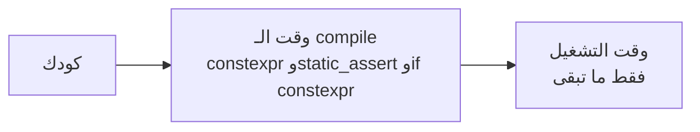

# الـ templates بعمق: constexpr وif constexpr والـ templates متغيرة المعاملات

## ‏constexpr: شغل يقوم به الـ compiler

function `constexpr` يمكن أن تعمل **أثناء الترجمة** عندما تكون مدخلاتها معروفة حينها. والنتيجة تُكتب داخل البرنامج مباشرة:

<!-- diagram -->


```cpp
#include <array>
#include <iostream>

constexpr long factorial(int n) {
    long r = 1;
    for (int i = 2; i <= n; ++i) r *= i;
    return r;
}

int main() {
    constexpr long f10 = factorial(10);        // computed by the compiler
    static_assert(factorial(5) == 120);        // checked while compiling
    std::array<int, factorial(4)> slots{};     // array size must be known at compile time
    std::cout << f10 << " " << slots.size() << "\n";

    int n = 6;
    std::cout << factorial(n) << "\n";         // also works at run time
    return 0;
}
```

```output
3628800 24
720
```

- `static_assert(condition)` توقف البناء لو كان الشرط خطأ. اختبار مجاني يعمل كلما ترجمت.
- `consteval` (من C++20) تذهب أبعد: الـ function **يجب** أن تعمل compile time.

## templates بقيم

معاملات الـ template يمكن أن تكون قيمًا، لا أنواعًا فقط. و`std::array<int, 24>` مثال على ذلك:

```cpp
#include <iostream>

template <int Sides>
struct Dice {
    static constexpr int max() { return Sides; }
    static constexpr double average() { return (Sides + 1) / 2.0; }
};

int main() {
    std::cout << Dice<6>::max() << " " << Dice<6>::average() << "\n";
    std::cout << Dice<20>::max() << " " << Dice<20>::average() << "\n";
    return 0;
}
```

```output
6 3.5
20 10.5
```

## ‏if constexpr: كود مختلف لأنواع مختلفة

داخل الـ template، تختار `if constexpr` فرعًا **compile time**. والفرع الذي لم يُختر لا يُترجم أصلًا لهذا النوع:

```cpp
#include <iostream>
#include <string>
#include <type_traits>

template <typename T>
std::string describe(const T& value) {
    if constexpr (std::is_integral_v<T>) {
        return "whole number " + std::to_string(value);
    } else if constexpr (std::is_floating_point_v<T>) {
        return "decimal " + std::to_string(value);
    } else {
        return "text \"" + std::string(value) + "\"";
    }
}

int main() {
    std::cout << describe(42) << "\n";
    std::cout << describe(2.5) << "\n";
    std::cout << describe("hello") << "\n";
    return 0;
}
```

```output
whole number 42
decimal 2.500000
text "hello"
```

مع `if` العادية كانت `std::to_string("hello")` ستفشل في الترجمة. ومع `if constexpr` هذا السطر غير موجود أصلًا في نسخة النص.

‏`<type_traits>` تسأل أسئلة عن الأنواع: `is_integral_v<T>` و`is_pointer_v<T>` و`is_same_v<A, B>` وغيرها كثير.

## الـ templates متغيرة المعاملات: أي عدد من المعاملات

`typename... Args` تقبل صفرًا أو أكثر من الأنواع. و**fold expression** يطبّق عملية على كل المعاملات، و`sizeof...(Args)` تخبرك بعددها:

```cpp
#include <iostream>

template <typename... Args>
auto sum(Args... args) {
    return (args + ... + 0);              // fold: a1 + (a2 + (... + 0))
}

template <typename... Args>
void print_all(const Args&... args) {
    std::cout << "(" << sizeof...(Args) << " values) ";
    ((std::cout << args << " "), ...);    // fold over the comma operator
    std::cout << "\n";
}

int main() {
    std::cout << sum(1, 2, 3, 4) << "\n";
    std::cout << sum(1.5, 2) << "\n";
    print_all("x =", 3, "and y =", 4.5);
    return 0;
}
```

```output
10
3.5
(4 values) x = 3 and y = 4.5 
```

بهذه الطريقة تمرر `std::make_unique<T>(args...)` و`std::vector::emplace_back(args...)` أي معاملات للـ constructor.

## الـ perfect forwarding

عندما يمرر template معاملاته إلى function أخرى، تحافظ `std::forward` على الـ lvalues كـ lvalues والـ rvalues كـ rvalues، فيظل النقل يحدث:

```cpp
template <typename T, typename... Args>
std::unique_ptr<T> make(Args&&... args) {
    return std::unique_ptr<T>(new T(std::forward<Args>(args)...));
}
```

‏`Args&&` داخل الـ template هي **forwarding reference**: ترتبط بأي شيء. واستخدمها مع `std::forward<Args>(args)`. ستحتاج هذا غالبًا في كود يشبه كود المكتبات.

## الخلاصة

- `constexpr` تجعل الـ compiler يقوم بالشغل؛ و`static_assert` تتحقق من الأشياء وقت البناء.
- `if constexpr` تختار الكود لكل نوع؛ و`<type_traits>` تسأل عن الأنواع.
- الـ templates متغيرة المعاملات والطي تأخذ أي عدد من المعاملات؛ و`std::forward` تمررها كما هي.

## فيديوهات اختيارية

الدرس أعلاه كامل وحده. هذه الفيديوهات للتعمق إن كنت تحب التعلم بالمشاهدة. الفيديوهات المكتوب بجانبها (بالإنجليزية) يمكنك تشغيل الترجمة لها (**CC**)، ثم **الإعدادات ← الترجمة ← ترجمة تلقائية ← العربية**.

**Templates in C++ (The Cherno) (بالإنجليزية)**

https://www.youtube.com/watch?v=I-hZkUa9mIs
