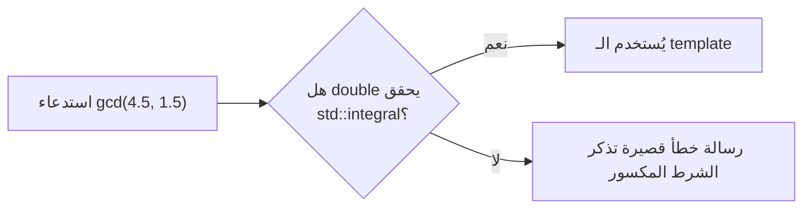

# الـ concepts: templates بقواعد واضحة

template مثل `largest(const std::vector<T>&)` يفترض بصمت أن `T` تدعم `<`. استدعه بنوع لا يدعمها، وتحصل على صفحات من الأخطاء من أعماق الـ template. و**الـ concepts** في C++20 تسمح لك بكتابة القواعد من البداية.

## استخدام الـ concepts القياسية

<!-- diagram -->


```cpp
#include <concepts>
#include <iostream>

template <std::integral T>
T gcd(T a, T b) {
    while (b != 0) {
        T t = a % b;
        a = b;
        b = t;
    }
    return a;
}

int main() {
    std::cout << gcd(48, 18) << "\n";
    std::cout << gcd(270L, 192L) << "\n";
    // gcd(4.5, 1.5);   // error: 'double' does not satisfy 'integral'
    return 0;
}
```

```output
6
6
```

كتابة `std::integral T` بدل `typename T` تقول: يجب أن يكون T نوع أعداد صحيحة. مرّر double فتقول رسالة الخطأ ذلك بالضبط، في سطر واحد.

concepts قياسية شائعة من `<concepts>`:

| الـ concept | معناه |
|---|---|
| `std::integral<T>` | نوع أعداد صحيحة |
| `std::floating_point<T>` | float وdouble... |
| `std::same_as<T, U>` | نفس النوع بالضبط |
| `std::convertible_to<T, U>` | T يمكن أن يتحول إلى U |
| `std::totally_ordered<T>` | يدعم < > <= >= == != |
| `std::invocable<F, Args...>` | يمكن استدعاء F بـ Args |

## أربع طرق لكتابة نفس القاعدة

```cpp
template <std::totally_ordered T>                 // 1. in the template list
T biggest(T a, T b) { return a < b ? b : a; }

template <typename T>
    requires std::totally_ordered<T>              // 2. a requires clause
T biggest2(T a, T b) { return a < b ? b : a; }

auto biggest3(std::totally_ordered auto a,        // 3. "abbreviated" template
              std::totally_ordered auto b) { return a < b ? b : a; }
```

(والرابعة `requires` بعد قائمة المعاملات.) الطريقة 1 هي الأشهر للقواعد البسيطة؛ والطريقة 3 مفيدة للـ functions القصيرة.

## كتابة مفهومك الخاص

تعبير `requires` يذكر ما يجب أن يُترجم:

```cpp
#include <concepts>
#include <iostream>
#include <string>
#include <vector>

template <typename T>
concept Shape = requires(const T& s) {
    { s.area() } -> std::convertible_to<double>;
    { s.name() } -> std::convertible_to<std::string>;
};

struct Square {
    double side;
    double area() const { return side * side; }
    std::string name() const { return "square"; }
};

struct Circle {
    double r;
    double area() const { return 3.14159 * r * r; }
    std::string name() const { return "circle"; }
};

template <Shape S>
void report(const S& s) {
    std::cout << s.name() << " with area " << s.area() << "\n";
}

int main() {
    report(Square{3});
    report(Circle{1});
    // report(42);   // error: 'int' does not satisfy 'Shape'
    return 0;
}
```

```output
square with area 9
circle with area 3.14159
```

لاحظ: لا class أساسي، ولا `virtual`. ‏Square وCircle فيهما الـ functions الصحيحة فقط. وهذا **تعدد أشكال compile time**: الـ compiler يكتب `report` منفصلة لكل نوع، بدون استدعاء virtual runtime. والثمن: لا تستطيع وضع Squares وCircles في `std::vector` واحد بهذه الطريقة. ولذلك ما زلت تحتاج الـ inheritance (تعدد أشكال runtime) أو `std::variant`.

## الاختيار بين الـ functions المتعددة

الـ concepts تختار أيضًا أنسب function:

```cpp
#include <concepts>
#include <iostream>
#include <string>

void show(std::integral auto x) { std::cout << "int-like: " << x << "\n"; }
void show(std::floating_point auto x) { std::cout << "decimal: " << x << "\n"; }
void show(const std::string& s) { std::cout << "text: " << s << "\n"; }

int main() {
    show(7);
    show(7.25);
    show(std::string("seven"));
    return 0;
}
```

```output
int-like: 7
decimal: 7.25
text: seven
```

## متى تستخدم الـ concepts

- في كل template تكتبه وسيستدعيه غيرك: تصبح الأخطاء مقروءة وتصبح القواعد توثيقًا.
- فضّل الـ concepts القياسية؛ واكتب مفاهيمك عندما تصف فكرة حقيقية في برنامجك (مثل `Shape`).
- لا تقيّد أكثر من اللازم: اطلب ما تستخدمه فعلًا.

## الخلاصة

- الـ concepts تذكر ما يحتاجه الـ template؛ والأخطاء حينها تسمّي القاعدة المكسورة.
- استخدم `<concepts>` ‏(integral وfloating_point وtotally_ordered...) أو اكتب `concept X = requires(...) {...};`.
- الـ concepts تعطي تعدد أشكال compile time بدون classes أساسية أو استدعاءات virtual.

## فيديوهات اختيارية

الدرس أعلاه كامل وحده. هذه الفيديوهات للتعمق إن كنت تحب التعلم بالمشاهدة. الفيديوهات المكتوب بجانبها (بالإنجليزية) يمكنك تشغيل الترجمة لها (**CC**)، ثم **الإعدادات ← الترجمة ← ترجمة تلقائية ← العربية**.

**Templates in C++ (The Cherno) (بالإنجليزية)**

https://www.youtube.com/watch?v=I-hZkUa9mIs
