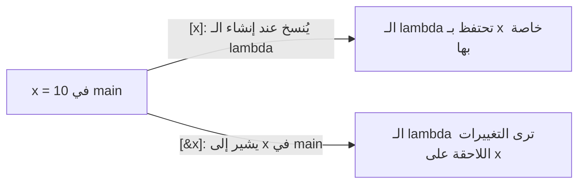

# lambdas والـ functions كقيم

استخدمت lambdas لتعطي `std::sort` قاعدة. وهذا الدرس يبيّن ما هي في الحقيقة، وما الذي تستطيع فعله بها أيضًا.

## ما هي lambda

الـ compiler يحوّل lambda إلى class صغير فيه `operator()`. والـ variables الملتقطة تصبح أعضاء فيه:

```cpp
int limit = 20;
auto under = [limit](int x) { return x < limit; };

// is roughly the same as:
struct Under {
    int limit;
    bool operator()(int x) const { return x < limit; }
};
Under under2{limit};
```

ولهذا lambdas سريعة: استدعاؤها استدعاء function عادي يستطيع الـ compiler دمجه في مكانه (inline).

## الالتقاط بالتفصيل

<!-- diagram -->


```cpp
#include <iostream>

int main() {
    int count = 0;
    int step = 5;

    auto by_value = [step]() { return step * 2; };            // a copy, taken now
    auto by_ref = [&count]() { ++count; };                     // the real variable
    auto everything = [=]() { return step + count; };          // copy all used variables
    auto counter = [n = 0]() mutable { return ++n; };          // its own variable

    step = 100;                     // by_value still has 5
    by_ref();
    by_ref();
    std::cout << by_value() << " " << count << " " << everything() << "\n";
    std::cout << counter() << counter() << counter() << "\n";
    return 0;
}
```

```output
10 2 5
123
```

- `[x]` تنسخ x عند **إنشاء** lambda؛ والتغييرات اللاحقة لا تؤثر فيها. ولهذا تعطي `everything()` القيمة 5: لقد نسخت step ‏(5) وcount ‏(0) قبل أن يتغيرا.
- `[&x]` تشير إلى x نفسها. والخطر: لو عاشت lambda أطول من x، فإنها تشير إلى variable ميت.
- `[=]` و`[&]` تلتقطان كل ما يُستخدم، بالنسخ أو بالـ reference. فضّل ذكر الأسماء: فهو أوضح في بيان ما تعتمد عليه lambda.
- `[n = 0]` تُنشئ variable جديدًا داخل lambda. و`mutable` تسمح لها بتغيير نسخها.
- داخل member function، تسمح `[this]` لـ lambda باستخدام أعضاء الـ object.

## lambdas العامة

استخدم معاملات `auto` فتعمل lambda مع أنواع كثيرة، مثل الـ template:

```cpp
#include <iostream>
#include <string>

int main() {
    auto twice = [](const auto& x) { return x + x; };
    std::cout << twice(21) << " " << twice(1.25) << " " << twice(std::string("ab")) << "\n";
    return 0;
}
```

```output
42 2.5 abab
```

## تخزين الـ functions: std::function

كل lambda لها نوع فريد خاص بها، فلا تستطيع وضع functions مختلفتين في vector واحد مباشرة. أما `std::function<R(Args...)>` فتستطيع حمل **أي شيء قابل للاستدعاء** بهذا الشكل:

```cpp
#include <functional>
#include <iostream>
#include <map>
#include <string>

int main() {
    std::map<std::string, std::function<double(double, double)>> ops{
        {"+", [](double a, double b) { return a + b; }},
        {"-", [](double a, double b) { return a - b; }},
        {"*", [](double a, double b) { return a * b; }},
        {"/", [](double a, double b) { return b != 0 ? a / b : 0.0; }},
    };
    for (const auto& [sym, fn] : ops) {
        std::cout << "12 " << sym << " 4 = " << fn(12, 4) << "\n";
    }
    return 0;
}
```

```output
12 * 4 = 48
12 + 4 = 16
12 - 4 = 8
12 / 4 = 3
```

(الخريطة ترتب المفاتيح حسب ترتيب الحروف: `*` تأتي قبل `+`.)

‏`std::function` تكلف أكثر قليلًا من استدعاء lambda مباشرة (قد تحجز ذاكرة وتستدعي عبر pointer). استخدمها عندما تحتاج **تخزين** functions من أنواع مختلفة: callbacks، ومعالجات الأحداث، وجداول الأوامر مثل هذا. أما لمجرد **تمرير** function إلى function أخرى، فمعامل template (أو `std::invocable auto`) أرخص.

## functions ترجع functions

```cpp
#include <functional>
#include <iostream>

auto make_discount(double percent) {
    return [percent](double price) { return price * (1 - percent / 100); };
}

int main() {
    auto summer = make_discount(20);
    auto members = make_discount(35);
    std::cout << summer(200) << " " << members(200) << "\n";
    return 0;
}
```

```output
160 130
```

lambda المرجعة تحمل نسختها الخاصة من `percent`. وهذا يعمل لأنها التقطته **بالقيمة**. والتقاط `percent` بالـ reference هنا خطأ: المعامل يموت عندما ترجع `make_discount`.

## lambdas المستدعاة فورًا

lambda تُستدعى في الحال طريقة أنيقة لتهيئة variable `const` بمنطق معقد:

```cpp
const std::string level = [&] {
    if (score >= 90) return "gold";
    if (score >= 70) return "silver";
    return "bronze";
}();
```

## الخلاصة

- lambda object فيه `operator()`؛ والـ variables الملتقطة أعضاؤه.
- `[x]` تنسخ عند الإنشاء، و`[&x]` تشير؛ وتجنب الالتقاط بالـ reference الذي يعيش أطول من الـ variable.
- `std::function` تخزّن أي شيء قابل للاستدعاء بشكل معين؛ والـ templates أرخص للتمرير.

## فيديوهات اختيارية

الدرس أعلاه كامل وحده. هذه الفيديوهات للتعمق إن كنت تحب التعلم بالمشاهدة. الفيديوهات المكتوب بجانبها (بالإنجليزية) يمكنك تشغيل الترجمة لها (**CC**)، ثم **الإعدادات ← الترجمة ← ترجمة تلقائية ← العربية**.

**Lambdas in C++ (The Cherno) (بالإنجليزية)**

https://www.youtube.com/watch?v=mWgmBBz0y8c
