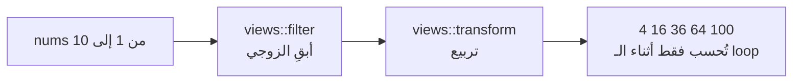

# الـ Ranges والـ Views

الخوارزميات في `<algorithm>` تحتاج مُكرِّرين: `std::sort(v.begin(), v.end())`. والـ **ranges** في C++20 تسمح لك بتمرير الحاوية نفسها، والـ **views** تسمح لك بربط الخطوات في pipelines سهلة القراءة.

## خوارزميات الـ ranges

```cpp
#include <algorithm>
#include <iostream>
#include <vector>

int main() {
    std::vector<int> v{5, 3, 9, 1, 7};
    std::ranges::sort(v);
    auto it = std::ranges::find(v, 7);
    std::cout << "7 is at index " << (it - v.begin()) << "\n";
    std::cout << "max " << std::ranges::max(v) << ", any even? "
              << std::ranges::any_of(v, [](int x) { return x % 2 == 0; }) << "\n";
    return 0;
}
```

```output
7 is at index 3
max 9, any even? 0
```

كل خوارزمية كلاسيكية لها نسخة `std::ranges::`. وهي تقبل أيضًا **projection**: عضوًا أو function يُنظر إليها بدل العنصر كله.

```cpp
#include <algorithm>
#include <iostream>
#include <string>
#include <vector>

struct Student {
    std::string name;
    int score;
};

int main() {
    std::vector<Student> cls{{"Mai", 78}, {"Ahmed", 91}, {"Rana", 85}};
    std::ranges::sort(cls, std::ranges::greater{}, &Student::score);   // sort by score, highest first
    for (const auto& s : cls) std::cout << s.name << " " << s.score << "\n";

    auto top = std::ranges::max_element(cls, {}, &Student::name);      // last name alphabetically
    std::cout << "last alphabetically: " << top->name << "\n";
    return 0;
}
```

```output
Ahmed 91
Rana 85
Mai 78
last alphabetically: Rana
```

`&Student::score` تقول "قارن بالدرجة". بدون حاجة لـ lambda.

## الـ Views: pipelines كسولة

الـ **view** نافذة رخيصة وكسولة على مدى. لا تنسخ أي شيء ولا تعمل أي شغل حتى تمر عليها بloop. واربط الـ views بـ `|`:

<!-- diagram -->


```cpp
#include <iostream>
#include <ranges>
#include <vector>

int main() {
    std::vector<int> nums{1, 2, 3, 4, 5, 6, 7, 8, 9, 10};

    auto even_squares = nums
        | std::views::filter([](int x) { return x % 2 == 0; })
        | std::views::transform([](int x) { return x * x; });

    for (int x : even_squares) std::cout << x << " ";
    std::cout << "\n";

    for (int x : nums | std::views::reverse | std::views::take(3)) std::cout << x << " ";
    std::cout << "\n";
    return 0;
}
```

```output
4 16 36 64 100 
10 9 8 
```

اقرأها من أعلى لأسفل: خذ nums، واحتفظ بالزوجية، وربّعها. لا تُنشأ vectors مؤقتة؛ كل رقم يمر في خط المعالجة كله واحدًا تلو الآخر.

## ‏Views مفيدة

| الـ View | ماذا تفعل |
|---|---|
| `views::filter(pred)` | تحتفظ بالعناصر التي يكون pred لها صحيحًا |
| `views::transform(f)` | تطبّق f على كل عنصر |
| `views::take(n)` / `views::drop(n)` | أول n / تخطَّ n |
| `views::reverse` | بالعكس |
| `views::iota(a, b)` | الأرقام a وa+1 و... حتى b-1 |
| `views::keys` / `views::values` | الأول / الثاني من الأزواج (الخرائط) |
| `views::split(sep)` | القطع بين الفواصل |

‏`iota` تصنع مدى من الأرقام بدون حاوية، ويمكن أن يكون بلا نهاية؛ و`take` توقفه:

```cpp
#include <iostream>
#include <ranges>

int main() {
    auto is_prime = [](int n) {
        if (n < 2) return false;
        for (int d = 2; d * d <= n; ++d)
            if (n % d == 0) return false;
        return true;
    };
    for (int p : std::views::iota(1) | std::views::filter(is_prime) | std::views::take(10))
        std::cout << p << " ";
    std::cout << "\n";
    return 0;
}
```

```output
2 3 5 7 11 13 17 19 23 29 
```

‏`std::views::iota(1)` تعدّ 1 و2 و3 و... للأبد. ولأن الـ views كسولة، لا يُفحص إلا عدد الأرقام المطلوب فقط.

## تحويل view إلى حاوية مرة أخرى

الـ view ليست حاوية. ولكي تحتفظ بالنتائج، انسخها إلى حاوية. في C++23 تكتب `std::ranges::to<std::vector>()`؛ وفي C++20 ابنِ الـ vector من begin وend الخاصة بالـ view:

```cpp
auto v = nums | std::views::filter(is_even);
std::vector<int> evens(v.begin(), v.end());
```

## تحذيران

- الـ view **تشير** إلى مصدرها. لو دُمّر الـ vector المصدر أو تغيّر حجمه، تنكسر الـ view. لا ترجع views لحاويات محلية.
- بعض الـ views (مثل `filter`) تتذكر شغلًا أثناء المرور عليها. مُرّ عليها كما تشاء، لكن لا تستخدم واحدة من خيطين في نفس الوقت.

## الخلاصة

- `std::ranges::sort(v)` و`find` و`max`... تأخذ الحاويات مباشرة وتقبل إسقاطات مثل `&Student::score`.
- الـ views تُربط بـ `|` وتعمل بكسل بدون نسخ؛ و`iota` مع `take` تتعامل حتى مع السلاسل التي لا تنتهي.
- انسخ الـ view إلى حاوية لتحتفظ بها؛ ولا تدعها تعيش أطول من مصدرها أبدًا.

## فيديوهات اختيارية

الدرس أعلاه كامل وحده. هذه الفيديوهات للتعمق إن كنت تحب التعلم بالمشاهدة. الفيديوهات المكتوب بجانبها (بالإنجليزية) يمكنك تشغيل الترجمة لها (**CC**)، ثم **الإعدادات ← الترجمة ← ترجمة تلقائية ← العربية**.

**C++20 Ranges in Practice (Tristan Brindle, CppCon 2020) (بالإنجليزية)**

https://www.youtube.com/watch?v=d_E-VLyUnzc
