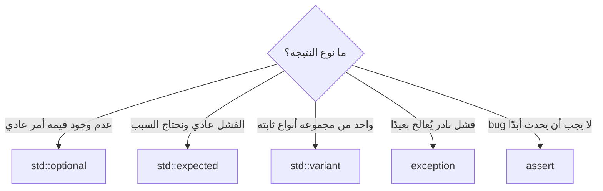

# معالجة الأخطاء: الـ exceptions وoptional وvariant وexpected

الأمور تسوء أحيانًا: ملف غير موجود، أو مدخلات خطأ، أو رقم لا يمكن قراءته. وC++ تعطيك عدة أدوات. واختيار الأداة الصحيحة أهم من الصياغة.

## الـ exceptions

ارمِ (`throw`) object خطأ؛ وأقرب `catch` مطابقة في سلسلة الاستدعاءات تتعامل معه. وكل ما بينهما تنظّفه الـ destructors (RAII)، فلا يتسرب شيء:

```cpp
#include <iostream>
#include <stdexcept>
#include <string>

double safe_divide(double a, double b) {
    if (b == 0) throw std::invalid_argument("division by zero");
    return a / b;
}

int parse_age(const std::string& s) {
    int age = std::stoi(s);                    // throws std::invalid_argument for "abc"
    if (age < 0 || age > 150) throw std::out_of_range("age " + s + " is not realistic");
    return age;
}

int main() {
    for (std::string input : {"34", "abc", "400"}) {
        try {
            int age = parse_age(input);       // if this throws, the next line never runs
            std::cout << "age " << age << "\n";
        } catch (const std::out_of_range& e) {
            std::cout << "range error: " << e.what() << "\n";
        } catch (const std::exception& e) {
            std::cout << "bad input: " << input << "\n";
        }
    }
    try {
        safe_divide(1, 0);
    } catch (const std::invalid_argument& e) {
        std::cout << "caught: " << e.what() << "\n";
    }
    return 0;
}
```

```output
age 34
bad input: abc
range error: age 400 is not realistic
caught: division by zero
```

- التقط **بreference const**، والنوع الأكثر تحديدًا أولًا. و`std::exception` هو أساس كل الأخطاء القياسية.
- `e.what()` تعطي الرسالة.
- استخدم الـ exceptions للأخطاء **النادرة** التي لا يستطيع المستدعي المباشر إصلاحها عادة: نفاد الذاكرة، أو ملف إعدادات تالف، أو خطأ برمجي في معامل.
- علّم الـ functions التي لا ترمي أبدًا بـ `noexcept` (النقل والـ destructors وswap).

## ‏std::optional: ربما توجد قيمة

عندما يكون "لا نتيجة" نتيجة عادية ومتوقعة، أرجع `std::optional<T>`:

```cpp
#include <iostream>
#include <map>
#include <optional>
#include <string>

std::optional<double> price_of(const std::map<std::string, double>& menu, const std::string& item) {
    auto it = menu.find(item);
    if (it == menu.end()) return std::nullopt;
    return it->second;
}

int main() {
    std::map<std::string, double> menu{{"tea", 15}, {"coffee", 30}};
    if (auto p = price_of(menu, "coffee")) std::cout << "coffee: " << *p << "\n";
    auto cake = price_of(menu, "cake");
    std::cout << "cake: " << (cake ? "on the menu" : "not on the menu") << "\n";
    std::cout << "cake or 0: " << cake.value_or(0) << "\n";
    return 0;
}
```

```output
coffee: 30
cake: not on the menu
cake or 0: 0
```

النوع نفسه يخبر المستدعي "قد يكون هذا فارغًا"، ولا يستطيع نسيان التحقق دون أن يكون ذلك واضحًا في الكود.

## ‏std::variant: واحد من عدة أنواع

‏`std::variant<A, B, C>` يحمل نوعًا واحدًا بالضبط من أنواعه في كل وقت. ومع `std::visit` تتعامل مع كل حالة:

```cpp
#include <iostream>
#include <string>
#include <variant>
#include <vector>

struct Cash { double amount; };
struct Card { double amount; std::string last4; };
struct Voucher { std::string code; };

using Payment = std::variant<Cash, Card, Voucher>;

template <class... Fs> struct overloaded : Fs... { using Fs::operator()...; };

int main() {
    std::vector<Payment> payments{Cash{50}, Card{120, "4421"}, Voucher{"EID25"}};
    for (const auto& p : payments) {
        std::visit(overloaded{
            [](const Cash& c) { std::cout << "cash " << c.amount << "\n"; },
            [](const Card& c) { std::cout << "card ending " << c.last4 << ": " << c.amount << "\n"; },
            [](const Voucher& v) { std::cout << "voucher " << v.code << "\n"; },
        }, p);
    }
    return 0;
}
```

```output
cash 50
card ending 4421: 120
voucher EID25
```

الأداة المساعدة `overloaded` تجمع عدة lambdas في object واحد؛ وهي نمط معروف من سطرين. لو نسيت حالة، لا يُترجم الكود. مجموعة مغلقة من البدائل بدون inheritance ولا pointers.

## ‏std::expected: قيمة أو خطأ (C++23)

‏`std::optional` تقول "لا شيء"، لكنها لا تقول **لماذا**. أما `std::expected<T, E>` فتحمل إما نتيجة أو خطأ يصف ما الذي حدث. ترجم بـ `-std=c++23` ‏(GCC 12 فأحدث، وClang 16 فأحدث، وMSVC الحديث):

```cpp
#include <expected>
#include <iostream>
#include <string>

enum class ParseError { empty, not_a_number, negative };

std::expected<int, ParseError> parse_quantity(const std::string& s) {
    if (s.empty()) return std::unexpected(ParseError::empty);
    int value = 0;
    for (char c : s) {
        if (c == '-') return std::unexpected(ParseError::negative);
        if (c < '0' || c > '9') return std::unexpected(ParseError::not_a_number);
        value = value * 10 + (c - '0');
    }
    return value;
}

std::string message(ParseError e) {
    switch (e) {
        case ParseError::empty: return "nothing typed";
        case ParseError::not_a_number: return "not a number";
        case ParseError::negative: return "can't be negative";
    }
    return "unknown";
}

int main() {
    for (std::string in : {"12", "", "3x", "-4"}) {
        auto q = parse_quantity(in);
        if (q) std::cout << "'" << in << "' -> " << *q << "\n";
        else std::cout << "'" << in << "' -> error: " << message(q.error()) << "\n";
    }
    return 0;
}
```

```output
'12' -> 12
'' -> error: nothing typed
'3x' -> error: not a number
'-4' -> error: can't be negative
```

## أيها متى؟

<!-- diagram -->


| الموقف | الأداة |
|---|---|
| "غير موجود" أو "لا قيمة" أمر عادي | `std::optional` |
| الفشل عادي والمستدعي يحتاج السبب (قراءة، تحقق من صحة) | `std::expected` |
| القيمة واحدة من مجموعة ثابتة من الأنواع | `std::variant` |
| فشل نادر لا يستطيع المستدعي التعامل معه قريبًا، أو constructor لا يستطيع النجاح | exception |
| خطأ برمجي لا يجب أن يحدث أبدًا | `assert` (يُتحقق منه في بناء التصحيح) |

## الخلاصة

- الـ exceptions تنتقل لأعلى إلى أقرب catch مطابقة؛ وRAII تنظّف في الطريق.
- `optional` = ربما قيمة؛ و`expected` = قيمة أو سبب؛ و`variant` = واحد من عدة أنواع، يُتعامل معه بـ `visit`.
- اختر حسب مدى عادية الفشل، وهل يحتاج المستدعي معرفة السبب.

## فيديوهات اختيارية

الدرس أعلاه كامل وحده. هذه الفيديوهات للتعمق إن كنت تحب التعلم بالمشاهدة. الفيديوهات المكتوب بجانبها (بالإنجليزية) يمكنك تشغيل الترجمة لها (**CC**)، ثم **الإعدادات ← الترجمة ← ترجمة تلقائية ← العربية**.

**Back to Basics: Exceptions (Klaus Iglberger, CppCon 2020) (بالإنجليزية)**

https://www.youtube.com/watch?v=0ojB8c0xUd8
