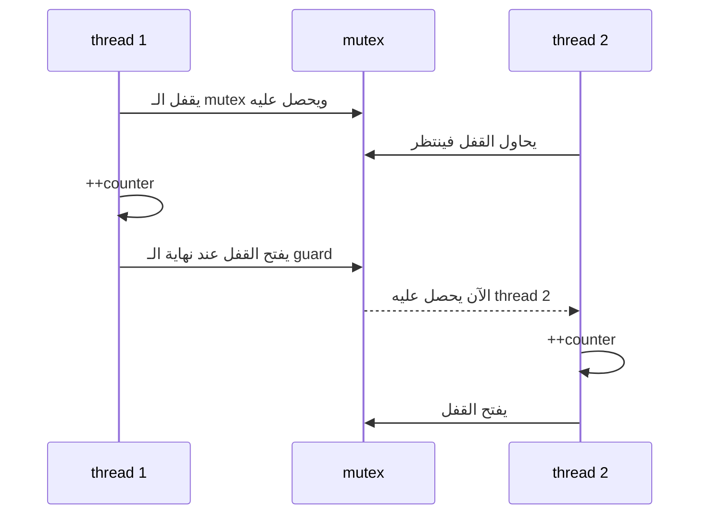

# الـ concurrency: الـ threads والـ mutex والـ atomics وasync

كمبيوترك فيه عدة أنوية (cores). و**الـ concurrency** يسمح لبرنامج واحد بعمل عدة أشياء في نفس الوقت. إنه قوي وسهل الخطأ فيه، لذلك هذا الدرس عن عمله بأمان.

## تشغيل الـ threads

```cpp
#include <iostream>
#include <thread>
#include <vector>

void work(int id, std::vector<int>& results) {
    long sum = 0;
    for (int i = 1; i <= 1000 * id; ++i) sum += i;
    results[id] = static_cast<int>(sum % 1000);
}

int main() {
    std::vector<int> results(4);
    {
        std::vector<std::jthread> threads;
        for (int id = 0; id < 4; ++id)
            threads.emplace_back(work, id, std::ref(results));
    }   // jthreads join (wait for their thread) here, automatically
    for (int r : results) std::cout << r << " ";
    std::cout << "\n";
    return 0;
}
```

```output
0 500 0 500 
```

- `std::jthread` (من C++20) يشغّل thread ينفّذ function بالمعاملات المعطاة، و**ينتظره (join)** في مدمّره. أما `std::thread` الأقدم فيجب انتظاره يدويًا، وإلا يتوقف البرنامج.
- `std::ref(results)` تمرر reference؛ فمعاملات الـ thread تُنسخ في غير ذلك.
- كل thread يكتب في خانته **الخاصة**، فلا يتداخلون.

## data races

عندما يلمس خيطان نفس البيانات ويكتب أحدهما على الأقل، بدون تنسيق، فهذا **data race**: سلوك غير محدد. والنتائج تخطئ عشوائيًا، وغالبًا على بعض الأجهزة فقط.

```cpp
int counter = 0;
// in 4 threads:  for (...) ++counter;     // WRONG: a data race
```

`++counter` في الحقيقة قراءة ثم جمع ثم كتابة. قد يقرأ خيطان نفس القيمة القديمة ويكتب كلاهما القديمة + 1. ترجم بـ `-fsanitize=thread` فيُبلَّغ عن السباق.

## ‏std::mutex: واحد في كل مرة

الـ mutex يسمح لـ thread واحد فقط بدخول جزء من الكود في كل مرة. اقفله بحارس RAII لكي يُفك دائمًا:

<!-- diagram -->


```cpp
#include <iostream>
#include <mutex>
#include <thread>
#include <vector>

int main() {
    long counter = 0;
    std::mutex m;
    {
        std::vector<std::jthread> threads;
        for (int t = 0; t < 4; ++t) {
            threads.emplace_back([&] {
                for (int i = 0; i < 100000; ++i) {
                    std::scoped_lock lock(m);    // locked until the end of this block
                    ++counter;
                }
            });
        }
    }
    std::cout << counter << "\n";
    return 0;
}
```

```output
400000
```

`std::scoped_lock` يقفل في مُنشئه ويفك في مدمّره، حتى لو رُمي exception. ويستطيع أيضًا lock عدة mutexes مرة واحدة بدون deadlock.

## ‏std::atomic: قيم مشتركة بسيطة

لرقم واحد أو علامة، `std::atomic` أبسط وأسرع من الـ mutex:

```cpp
#include <atomic>
#include <iostream>
#include <thread>
#include <vector>

int main() {
    std::atomic<long> counter{0};
    {
        std::vector<std::jthread> threads;
        for (int t = 0; t < 4; ++t)
            threads.emplace_back([&] {
                for (int i = 0; i < 100000; ++i) ++counter;   // one indivisible step
            });
    }
    std::cout << counter.load() << "\n";
    return 0;
}
```

```output
400000
```

استخدم الـ atomics للعدادات والعلامات. ولأي شيء أكبر (تحديث خريطة، أو إبقاء قيمتين متسقتين)، استخدم mutex.

## ‏std::async: شغّل مهمة واحصل على النتيجة لاحقًا

غالبًا لا تريد إدارة الـ threads أصلًا؛ تريد "احسب هذا في الخلفية وأعطني الإجابة":

```cpp
#include <future>
#include <iostream>
#include <numeric>
#include <vector>

long sum_range(const std::vector<int>& v, std::size_t from, std::size_t to) {
    return std::accumulate(v.begin() + from, v.begin() + to, 0L);
}

int main() {
    std::vector<int> data(1'000'000);
    std::iota(data.begin(), data.end(), 1);       // 1, 2, ..., 1000000

    std::size_t half = data.size() / 2;
    auto first = std::async(std::launch::async, sum_range, std::cref(data), 0, half);
    long second = sum_range(data, half, data.size());   // this thread does the other half

    std::cout << first.get() + second << "\n";          // get() waits for the result
    return 0;
}
```

```output
500000500000
```

‏`std::async` ترجع `std::future`. و`get()` تنتظر المهمة وترجع قيمتها، أو تعيد رمي exception رمته المهمة.

## قواعد تبعدك عن المشاكل

1. **شارك أقل قدر ممكن.** أعطِ كل thread بياناته الخاصة واجمع النتائج في النهاية (كما في الأعلى).
2. عندما تضطر للمشاركة، احمِ **كل** الوصول إلى البيانات بـ **نفس** الـ mutex، أو استخدم atomics.
3. أمسك الـ locks لفترة قصيرة. ولا تستدعِ كودًا غير معروف (callbacks، أو إدخال وإخراج) وأنت ممسك بlock.
4. اقفل عدة mutexes معًا بـ `std::scoped_lock(a, b)` واحد لتجنب الـ deadlock.
5. اختبر بـ `-fsanitize=thread` ‏(ThreadSanitizer). إنه يجد سباقات قد تظهر مرة في الشهر في بيئة التشغيل الحقيقية.

## الخلاصة

- `std::jthread` يشغّل function على نواة أخرى وينتظرها تلقائيًا.
- البيانات المشتركة تحتاج `std::mutex` (مع `std::scoped_lock`) أو `std::atomic`.
- `std::async` مع `future.get()` أبسط طريقة لتشغيل شغل في الخلفية.

## فيديوهات اختيارية

الدرس أعلاه كامل وحده. هذه الفيديوهات للتعمق إن كنت تحب التعلم بالمشاهدة. الفيديوهات المكتوب بجانبها (بالإنجليزية) يمكنك تشغيل الترجمة لها (**CC**)، ثم **الإعدادات ← الترجمة ← ترجمة تلقائية ← العربية**.

**Threads in C++ (The Cherno) (بالإنجليزية)**

https://www.youtube.com/watch?v=wXBcwHwIt_I
