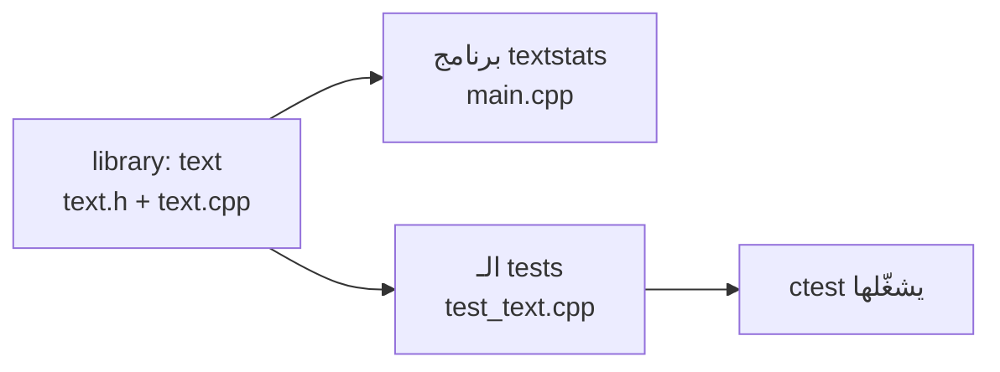

# الاختبار والأدوات وتنظيم مشروع حقيقي

الكود الذي لا تستطيع اختباره كود تخاف من تغييره. وهذا الدرس يجهّز مشروعًا بالطريقة التي تعمل بها فرق C++ المحترفة: مكتبات واختبارات وتحذيرات وsanitizers وتنسيق.

## الاختبار بدون إطار عمل

أبسط اختبار برنامج يتحقق من النتائج ويفشل بصوت عالٍ:

```cpp
#include <iostream>
#include <string>

int word_count(const std::string& s) {
    int count = 0;
    bool in_word = false;
    for (char c : s) {
        if (c == ' ') in_word = false;
        else if (!in_word) { in_word = true; ++count; }
    }
    return count;
}

int failures = 0;
void check(bool ok, const std::string& what) {
    if (!ok) { ++failures; std::cout << "FAIL: " << what << "\n"; }
}

int main() {
    check(word_count("") == 0, "empty string");
    check(word_count("hello") == 1, "one word");
    check(word_count("  two   words ") == 2, "extra spaces");
    check(word_count("a b c d") == 4, "single letters");
    std::cout << (failures == 0 ? "all tests passed\n" : "some tests failed\n");
    return failures == 0 ? 0 : 1;
}
```

```output
all tests passed
```

رمز الخروج مهم: 0 معناه نجاح، وأي شيء آخر معناه فشل. أدوات البناء وخدمات CI ‏(مثل GitHub Actions) تستخدمه لتقرر هل البناء أخضر.

## أطر الاختبار

المشاريع الحقيقية تستخدم إطار عمل يعطي مخرجات أجمل واختبارات صغيرة كثيرة بأسماء وأدوات مساعدة. والأشهر هما **GoogleTest** و**Catch2**. واختبار Catch2 يبدو هكذا:

```cpp
#include <catch2/catch_test_macros.hpp>
#include "text.h"

TEST_CASE("word_count counts words") {
    REQUIRE(word_count("") == 0);
    REQUIRE(word_count("hello") == 1);
    REQUIRE(word_count("  two   words ") == 2);
}
```

عندما يفشل تحقق، يطبع الملف والسطر والقيمتين.

## تنظيم المشروع

<!-- diagram -->


```text
textstats/
  CMakeLists.txt
  src/
    text.h          library: the code worth testing
    text.cpp
    main.cpp        a small program that uses the library
  tests/
    test_text.cpp
```

الفكرة الأساسية: ضع المنطق الحقيقي في **مكتبة**، واجعل البرنامج والاختبارات يستخدمانها معًا.

```cmake
cmake_minimum_required(VERSION 3.20)
project(textstats CXX)
set(CMAKE_CXX_STANDARD 20)
set(CMAKE_CXX_STANDARD_REQUIRED ON)

add_library(text src/text.cpp)
target_include_directories(text PUBLIC src)
target_compile_options(text PRIVATE -Wall -Wextra -Wpedantic)

add_executable(textstats src/main.cpp)
target_link_libraries(textstats PRIVATE text)

# Tests: fetch Catch2 automatically the first time
include(FetchContent)
FetchContent_Declare(Catch2 GIT_REPOSITORY https://github.com/catchorg/Catch2.git GIT_TAG v3.5.4)
FetchContent_MakeAvailable(Catch2)

add_executable(tests tests/test_text.cpp)
target_link_libraries(tests PRIVATE text Catch2::Catch2WithMain)

enable_testing()
add_test(NAME unit COMMAND tests)
```

ابنِ وشغّل الاختبارات:

```bash
cmake -S . -B build
cmake --build build
ctest --test-dir build --output-on-failure
```

‏`target_link_libraries(... PRIVATE text)` تُحضر أيضًا مجلد التضمين الخاص بـ `text`، لأنه عُلّم بـ `PUBLIC`. وهكذا يمرر CMake الإعدادات بين الأهداف.

## أدوات تستحق التجهيز مرة واحدة

| الأداة | ماذا تفعل | كيف |
|---|---|---|
| التحذيرات كأخطاء | تمنع تراكم التحذيرات | `-Werror` في بناءات CI |
| ‏AddressSanitizer / UBSan | أخطاء الذاكرة والسلوك غير المحدد | `-fsanitize=address,undefined` |
| ‏ThreadSanitizer | data races | `-fsanitize=thread` (بناء منفصل) |
| ‏clang-format | تنسيق موحّد | ملف `.clang-format`، والتنسيق عند الحفظ |
| ‏clang-tidy | يجد أنماط الأخطاء ويقترح أسلوبًا حديثًا | `clang-tidy src/*.cpp -- -std=c++20` |

الـ sanitizers تجعل البرنامج أبطأ (من 2 إلى 5 مرات)، فاستخدمها في بناءات الاختبار، لا فيما تسلّمه للمستخدمين.

## بناء sanitizer بإعدادات CMake الجاهزة (presets)

بدل تذكّر أوامر طويلة، اكتبها مرة واحدة في `CMakePresets.json`:

```json
{
  "version": 3,
  "configurePresets": [
    { "name": "debug", "binaryDir": "build/debug",
      "cacheVariables": { "CMAKE_BUILD_TYPE": "Debug",
        "CMAKE_CXX_FLAGS": "-fsanitize=address,undefined -fno-omit-frame-pointer" } },
    { "name": "release", "binaryDir": "build/release",
      "cacheVariables": { "CMAKE_BUILD_TYPE": "Release" } }
  ]
}
```

ثم `cmake --preset debug` و`cmake --build build/debug`. ومحررات مثل VS Code وCLion تعرض الإعدادات الجاهزة في قائمة.

## ماذا تختبر

- الحالات العادية، ثم الأطراف: مدخل فارغ، وعنصر واحد، وقيم كبيرة جدًا، وأرقام سالبة.
- كل خطأ تصلحه: اكتب اختبارًا يفشل أولًا، ثم أصلح الكود. لن يعود الخطأ بصمت.
- السلوك، لا تفاصيل التنفيذ، لكي تعيد هيكلة الكود بحرية.

## الخلاصة

- الاختبار كود يتحقق من النتائج ويرجع رمز خروج غير صفري عند الفشل.
- ضع المنطق في مكتبة؛ واربط البرنامج والاختبارات بها؛ وشغّل بـ `ctest`.
- اجعل بناءات الـ sanitizers والتحذيرات جزءًا من روتينك؛ ودع الأدوات تنسّق الكود وتفحصه.

## فيديوهات اختيارية

الدرس أعلاه كامل وحده. هذه الفيديوهات للتعمق إن كنت تحب التعلم بالمشاهدة. الفيديوهات المكتوب بجانبها (بالإنجليزية) يمكنك تشغيل الترجمة لها (**CC**)، ثم **الإعدادات ← الترجمة ← ترجمة تلقائية ← العربية**.

**Debugging: GDB tutorial (Chris Bourke) (بالإنجليزية)**

https://www.youtube.com/watch?v=bWH-nL7v5F4
