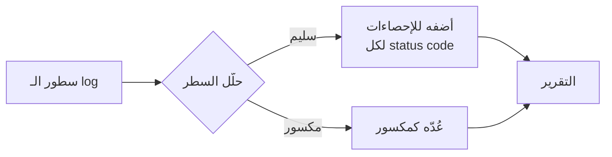

# مشروع: محلل سجلات متوازٍ

لنجمع القطع المتقدمة: move semantics والـ ranges و`std::expected` و`std::span` والمهام المتوازية. ستبني أداة تقرأ أسطر سجلات خادم ويب، وتحللها بالتوازي، وتعرض إحصائيات.

## المدخلات

كل سطر يبدو هكذا (الطريقة، والمسار، ورمز الحالة، وزمن الاستجابة بالمللي ثانية):

<!-- diagram -->


```text
GET /home 200 35
POST /login 401 12
GET /products 200 88
```

بعض الأسطر تالفة؛ ويجب أن تعدّها الأداة لا أن تتوقف بسببها.

## الكود

```cpp
#include <algorithm>
#include <expected>
#include <future>
#include <iostream>
#include <map>
#include <ranges>
#include <span>
#include <sstream>
#include <string>
#include <vector>

struct Entry {
    std::string method;
    std::string path;
    int status = 0;
    int ms = 0;
};

enum class LineError { too_few_fields, bad_number };

std::expected<Entry, LineError> parse_line(const std::string& line) {
    std::istringstream in(line);
    Entry e;
    std::string status, ms;
    if (!(in >> e.method >> e.path >> status >> ms)) return std::unexpected(LineError::too_few_fields);
    try {
        e.status = std::stoi(status);
        e.ms = std::stoi(ms);
    } catch (const std::exception&) {
        return std::unexpected(LineError::bad_number);
    }
    return e;
}

struct Stats {
    long lines = 0;
    long broken = 0;
    long total_ms = 0;
    std::map<int, long> by_status;
    std::map<std::string, long> by_path;

    void add(const Stats& other) {                 // combine results from another thread
        lines += other.lines;
        broken += other.broken;
        total_ms += other.total_ms;
        for (const auto& [k, v] : other.by_status) by_status[k] += v;
        for (const auto& [k, v] : other.by_path) by_path[k] += v;
    }
};

Stats analyze(std::span<const std::string> lines) {
    Stats s;
    for (const auto& line : lines) {
        ++s.lines;
        auto e = parse_line(line);
        if (!e) { ++s.broken; continue; }
        s.total_ms += e->ms;
        ++s.by_status[e->status];
        ++s.by_path[e->path];
    }
    return s;
}

Stats analyze_parallel(const std::vector<std::string>& lines, std::size_t parts) {
    std::vector<std::future<Stats>> jobs;
    std::size_t chunk = (lines.size() + parts - 1) / parts;
    for (std::size_t start = 0; start < lines.size(); start += chunk) {
        std::size_t len = std::min(chunk, lines.size() - start);
        std::span<const std::string> piece(lines.data() + start, len);
        jobs.push_back(std::async(std::launch::async, analyze, piece));
    }
    Stats total;
    for (auto& j : jobs) total.add(j.get());       // each thread had its own Stats: no locks
    return total;
}

int main() {
    std::vector<std::string> base{
        "GET /home 200 35", "POST /login 401 12", "GET /products 200 88",
        "GET /home 200 41", "garbage line", "GET /cart 500 230",
        "POST /login 200 19", "GET /products 200 72", "GET /home 304 3", "GET /cart two 10",
    };
    std::vector<std::string> lines;
    for (int i = 0; i < 1000; ++i)                 // pretend it's a big log
        lines.insert(lines.end(), base.begin(), base.end());

    Stats s = analyze_parallel(lines, 4);

    std::cout << "lines: " << s.lines << ", broken: " << s.broken << "\n";
    std::cout << "average time: " << s.total_ms / (s.lines - s.broken) << " ms\n";
    for (const auto& [code, n] : s.by_status) std::cout << "status " << code << ": " << n << "\n";

    std::vector<std::pair<std::string, long>> paths(s.by_path.begin(), s.by_path.end());
    std::ranges::stable_sort(paths, std::ranges::greater{}, &std::pair<std::string, long>::second);
    std::cout << "busiest:";
    for (const auto& [path, n] : paths | std::views::take(2)) std::cout << " " << path << " (" << n << ")";
    std::cout << "\n";
    return 0;
}
```

```output
lines: 10000, broken: 2000
average time: 62 ms
status 200: 5000
status 304: 1000
status 401: 1000
status 500: 1000
busiest: /home (3000) /login (2000)
```

## أشياء لاحظها

- `parse_line` ترجع `std::expected`: السطر التالف مدخل عادي، لا حدث استثنائي. و`try` بداخلها تحوّل فقط exceptions `std::stoi` إلى قيمة خطأ عند الحدود.
- `std::span<const std::string>` نافذة رخيصة على جزء من vector: pointer وطول، بدون نسخ. وكل thread يأخذ قطعته.
- كل thread يملأ `Stats` **الخاصة** به؛ والـ thread الرئيسي يجمعها. لا mutex في أي مكان: أكثر أنواع الـ concurrency أمانًا.
- `std::async` ترجع futures؛ و`get()` تنتظر وترجع النتيجة المنقولة.
- الترتيب يستخدم خوارزمية ranges مع projection و`views::take`.

تفصيلة دقيقة في الترتيب: `/login` و`/products` يظهر كل منهما 2000 مرة. و`stable_sort` تحافظ على ترتيب العناصر المتعادلة كما كان (الترتيب الأبجدي للخريطة)، فيأتي `/login` أولًا في كل مرة. أما `sort` العادية فقد تضع أيًا منهما أولًا.

## دورك

1. قسّمه إلى مكتبة (`log.h` و`log.cpp`) و`main.cpp`؛ واكتب اختبارات Catch2 أو اختبارات بسيطة لـ `parse_line` تغطي الأسطر الصحيحة، والحقول الناقصة، والأرقام الخطأ.
2. اقرأ الأسطر من ملف يُعطى في سطر الأوامر (`argv[1]`) بدل العينة المكتوبة في الكود.
3. أضف زمن الاستجابة عند المئين 95 (رتّب الأزمنة، وخذ القيمة عند 95%).
4. قِس: احسب زمن `analyze` مقابل `analyze_parallel` بـ `std::chrono::steady_clock` لمليون سطر و1 و2 و4 و8 أجزاء. واشرح ما تراه.
5. ابنِ بـ `-fsanitize=thread` وتأكد من عدم وجود data races. ثم شارك عن قصد `Stats` واحدة بين الـ threads بدون lock وشاهد ThreadSanitizer يبلّغ عنها.

## إلى أين بعد ذلك

أنت تعرف الآن الأدوات الأساسية لـ C++ الحديثة. خطوات جيدة تالية: اقرأ *A Tour of C++* لـ Bjarne Stroustrup (مخترع اللغة)، وتصفح C++ Core Guidelines، وساهم في مشروع C++ مفتوح المصدر. أو أكمل مسار الأنظمة بـ **Rust**، التي تجعل الـ compiler يتحقق من قواعد الملكية وأمان الـ threads التي كنت تتبعها هنا بيدك.

## الخلاصة

- استخدم `expected` للفشل العادي، و`span` للنوافذ الرخيصة، والـ futures للشغل المتوازي.
- أعطِ كل thread بياناته الخاصة واجمع في النهاية؛ لا حاجة لـ locks.
- اختبر المحلل، وقِس التسريع، وشغّل ThreadSanitizer.

## فيديوهات اختيارية

الدرس أعلاه كامل وحده. هذه الفيديوهات للتعمق إن كنت تحب التعلم بالمشاهدة. الفيديوهات المكتوب بجانبها (بالإنجليزية) يمكنك تشغيل الترجمة لها (**CC**)، ثم **الإعدادات ← الترجمة ← ترجمة تلقائية ← العربية**.

**Threads in C++ (The Cherno) (بالإنجليزية)**

https://www.youtube.com/watch?v=wXBcwHwIt_I

**C++20 Ranges in Practice (Tristan Brindle, CppCon 2020) (بالإنجليزية)**

https://www.youtube.com/watch?v=d_E-VLyUnzc
