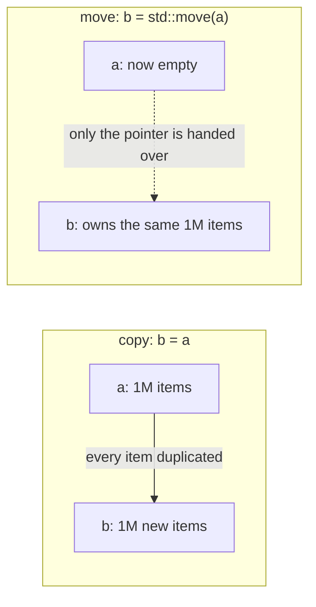

# Move semantics

This course continues from *C++ for beginners*. You should be comfortable with classes, references, `std::vector`, `std::unique_ptr` and lambdas.

The first big idea of modern C++: instead of **copying** an object that's about to disappear, **steal** its insides. That's a **move**.

## The cost of copying

A `std::vector<std::string>` with a million names owns a big block of memory. Copying it means allocating another big block and copying every string. If the original is about to be thrown away anyway, all that work is wasted.

```cpp
#include <iostream>
#include <string>
#include <utility>
#include <vector>

int main() {
    std::vector<std::string> a{"one", "two", "three"};

    std::vector<std::string> b = a;              // copy: a still has its items
    std::vector<std::string> c = std::move(a);   // move: c takes a's memory

    std::cout << "b has " << b.size() << ", c has " << c.size()
              << ", a has " << a.size() << "\n";
    return 0;
}
```

```output
b has 3, c has 3, a has 0
```

The move just handed over the pointer to the memory block; no strings were copied. After a move, the source is left "valid but unspecified". For standard types that means you may assign it a new value or destroy it, but don't count on what it holds.

## lvalues and rvalues

- An **lvalue** has a name and lives on: `a`, `names[2]`, `*p`.
- An **rvalue** is a temporary about to vanish: `make_list()`, `x + y`, `std::string("hi")`.

Moving from rvalues is always safe: nobody can look at them again. `std::move(a)` does **not** move anything by itself. It's a cast that says "treat `a` as an rvalue; I'm done with it". The move happens when something takes it.

## rvalue references: T&&

A function can take an rvalue reference, `T&&`, which binds only to things you can move from. That's how a class says "here is how to move me":

<!-- diagram -->


```cpp
#include <cstring>
#include <iostream>
#include <utility>

class Buffer {
public:
    explicit Buffer(std::size_t n) : size_(n), data_(new char[n]) {
        std::cout << "allocate " << n << "\n";
    }
    ~Buffer() { delete[] data_; }

    Buffer(const Buffer& other) : size_(other.size_), data_(new char[other.size_]) {    // copy
        std::memcpy(data_, other.data_, size_);
        std::cout << "copy " << size_ << "\n";
    }
    Buffer(Buffer&& other) noexcept                                                  // move
        : size_(std::exchange(other.size_, 0)), data_(std::exchange(other.data_, nullptr)) {
        std::cout << "move " << size_ << "\n";
    }
    Buffer& operator=(const Buffer&) = delete;    // keep the example short
    Buffer& operator=(Buffer&&) = delete;

    std::size_t size() const { return size_; }

private:
    std::size_t size_;
    char* data_;
};

int main() {
    Buffer a(1024);
    Buffer b = a;               // copy constructor
    Buffer c = std::move(a);    // move constructor
    std::cout << "a " << a.size() << ", b " << b.size() << ", c " << c.size() << "\n";
    return 0;
}
```

```output
allocate 1024
copy 1024
move 1024
a 0, b 1024, c 1024
```

- `std::exchange(x, v)` sets x to v and returns the old value. Perfect for "take it and leave the source empty".
- `noexcept` promises the move won't throw. `std::vector` only uses your move when growing if it's `noexcept`; otherwise it copies to stay safe. **Always mark moves noexcept.**
- The moved-from `a` must still be safe to destroy: its pointer is `nullptr`, and `delete[] nullptr` does nothing.

## Moves you get for free

You rarely write `std::move` when returning:

```cpp
std::vector<int> make_big() {
    std::vector<int> v(1'000'000, 7);
    return v;          // no copy: built in place or moved automatically
}
```

Writing `return std::move(v);` here is actually worse: it can block the compiler from building `v` directly in the caller's space.

Useful places for `std::move`:

- passing a local you no longer need into a function or container: `list.push_back(std::move(name));`
- moving a member out: `return std::move(data_);` from a function that gives up ownership
- transferring a `unique_ptr`

## Taking parameters you'll keep: pass by value, then move

When a constructor stores a string, take it by value and move it into the member:

```cpp
#include <iostream>
#include <string>
#include <utility>

class Person {
public:
    explicit Person(std::string name) : name_(std::move(name)) {}
    const std::string& name() const { return name_; }

private:
    std::string name_;
};

int main() {
    std::string n = "Habiba";
    Person a(n);                    // n is copied once into the parameter, then moved
    Person b(std::string("Adel"));  // the temporary becomes the parameter, then is moved
    std::cout << a.name() << " " << b.name() << " " << n << "\n";
    return 0;
}
```

```output
Habiba Adel Habiba
```

One constructor handles both cases well: callers with an lvalue pay one copy, callers with an rvalue pay only moves.

## Summary

- A move takes an object's resources instead of copying them; the source is left valid but unspecified.
- `std::move` is only a cast; `T&&` parameters receive things you may move from.
- Mark move operations `noexcept`; don't `std::move` a local in a return statement.

## Optional videos

The lesson above is complete on its own. These videos go deeper, if you like learning by watching.

**lvalues and rvalues in C++ (The Cherno)**

https://www.youtube.com/watch?v=fbYknr-HPYE

**Move semantics in C++ (The Cherno)**

https://www.youtube.com/watch?v=ehMg6zvXuMY
