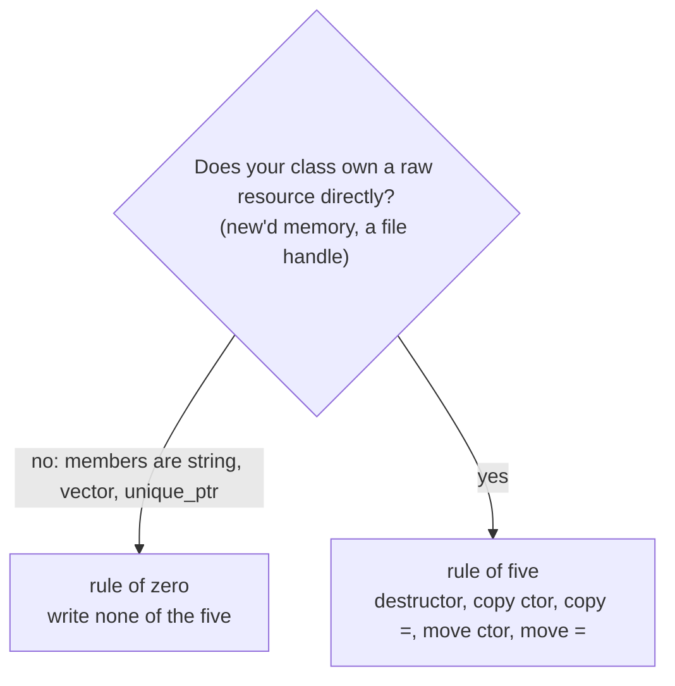

# The rule of zero, three and five

Every class has five special operations that control copying, moving and destruction:

```text
~T()                       destructor
T(const T&)                copy constructor
T& operator=(const T&)     copy assignment
T(T&&)                     move constructor
T& operator=(T&&)          move assignment
```

The compiler writes them for you when it can. The question is when you should write your own.

## The rule of zero (the one you want)

> If your class doesn't directly manage a resource, write **none** of the five.

<!-- diagram -->


```cpp
#include <iostream>
#include <memory>
#include <string>
#include <utility>
#include <vector>

class Playlist {
public:
    explicit Playlist(std::string name) : name_(std::move(name)) {}
    void add(std::string song) { songs_.push_back(std::move(song)); }
    std::size_t size() const { return songs_.size(); }
    const std::string& name() const { return name_; }

private:
    std::string name_;
    std::vector<std::string> songs_;
};

int main() {
    Playlist a("road trip");
    a.add("song 1");
    a.add("song 2");
    Playlist b = a;                 // copy: compiler-written, copies each member
    Playlist c = std::move(a);      // move: compiler-written, moves each member
    b.add("song 3");
    std::cout << b.size() << " " << c.size() << "\n";
    return 0;
}
```

```output
3 2
```

The string and vector already know how to copy, move and clean up, so the compiler-written versions do the right thing. Nothing to write, nothing to get wrong.

To make a class move-only, hold a move-only member such as `std::unique_ptr`. The copy operations then become deleted automatically.

## The rule of five (when you must)

> If you write **any** of the destructor, copy or move operations, think about **all five**.

A class that owns a raw resource needs them all. If you write a destructor that frees memory but leave the compiler's copy constructor, two objects end up pointing at the same memory, and both free it: a double free.

A complete example using **copy-and-swap**, a neat way to write both assignments safely:

```cpp
#include <algorithm>
#include <iostream>
#include <utility>

class IntArray {
public:
    explicit IntArray(std::size_t n = 0) : n_(n), p_(n ? new int[n]{} : nullptr) {}
    ~IntArray() { delete[] p_; }

    IntArray(const IntArray& o) : IntArray(o.n_) { std::copy(o.p_, o.p_ + n_, p_); }
    IntArray(IntArray&& o) noexcept : n_(std::exchange(o.n_, 0)), p_(std::exchange(o.p_, nullptr)) {}

    IntArray& operator=(IntArray o) noexcept {     // by value: copies or moves into o
        swap(*this, o);                             // take o's insides; o cleans up our old ones
        return *this;
    }
    friend void swap(IntArray& a, IntArray& b) noexcept {
        std::swap(a.n_, b.n_);
        std::swap(a.p_, b.p_);
    }

    int& operator[](std::size_t i) { return p_[i]; }
    std::size_t size() const { return n_; }

private:
    std::size_t n_;
    int* p_;
};

int main() {
    IntArray a(3);
    a[0] = 10;
    IntArray b;
    b = a;              // copy assignment
    b[0] = 99;
    IntArray c;
    c = std::move(b);   // move assignment
    std::cout << a[0] << " " << c[0] << " " << b.size() << "\n";
    return 0;
}
```

```output
10 99 0
```

Even though this works, in real code you'd write `std::vector<int>` and follow the rule of zero. Write the five only for genuinely new resource types: a file handle from a C library, a GPU buffer, a socket.

## The old rule of three

Before C++11 there was no move, so the rule was about three (destructor, copy constructor, copy assignment). You'll still see it named in older books. Same idea.

## Saying what you mean with = default and = delete

```cpp
class Connection {
public:
    Connection(const Connection&) = delete;             // can't be copied
    Connection& operator=(const Connection&) = delete;
    Connection(Connection&&) noexcept = default;        // can be moved
    Connection& operator=(Connection&&) noexcept = default;
    ~Connection() = default;
};
```

Writing them out like this documents the class's behaviour in a few lines.

## Value semantics

Modern C++ code passes most objects around **by value** (copies and moves), like ints, rather than through pointers. Types that behave like values are easy to reason about: no shared state, no question of who deletes what. The rule of zero is what makes that cheap and safe.

## Summary

- Rule of zero: let members manage resources; write none of the five.
- Rule of five: if you manage a raw resource, write all five (copy-and-swap helps).
- `= delete` and `= default` state clearly what a type can do.

## Optional videos

The lesson above is complete on its own. These videos go deeper, if you like learning by watching.

**std::move and the move assignment operator (The Cherno)**

https://www.youtube.com/watch?v=OWNeCTd7yQE

**Smart pointers in C++: unique_ptr, shared_ptr, weak_ptr (The Cherno)**

https://www.youtube.com/watch?v=UOB7-B2MfwA
