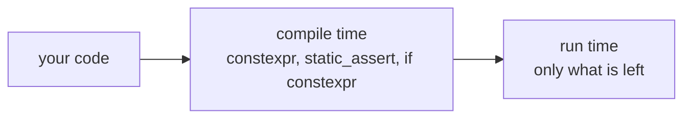

# Templates in depth: constexpr, if constexpr and variadic templates

## constexpr: work done by the compiler

A `constexpr` function can run **while compiling** when its inputs are known then. The result is baked into the program:

<!-- diagram -->


```cpp
#include <array>
#include <iostream>

constexpr long factorial(int n) {
    long r = 1;
    for (int i = 2; i <= n; ++i) r *= i;
    return r;
}

int main() {
    constexpr long f10 = factorial(10);        // computed by the compiler
    static_assert(factorial(5) == 120);        // checked while compiling
    std::array<int, factorial(4)> slots{};     // array size must be known at compile time
    std::cout << f10 << " " << slots.size() << "\n";

    int n = 6;
    std::cout << factorial(n) << "\n";         // also works at run time
    return 0;
}
```

```output
3628800 24
720
```

- `static_assert(condition)` stops the build if the condition is false. A free test that runs every time you compile.
- `consteval` (C++20) goes further: the function **must** run at compile time.

## Templates with values

Template parameters can be values, not only types. `std::array<int, 24>` is one:

```cpp
#include <iostream>

template <int Sides>
struct Dice {
    static constexpr int max() { return Sides; }
    static constexpr double average() { return (Sides + 1) / 2.0; }
};

int main() {
    std::cout << Dice<6>::max() << " " << Dice<6>::average() << "\n";
    std::cout << Dice<20>::max() << " " << Dice<20>::average() << "\n";
    return 0;
}
```

```output
6 3.5
20 10.5
```

## if constexpr: different code for different types

Inside a template, `if constexpr` picks a branch **at compile time**. The branch not taken isn't even compiled for that type:

```cpp
#include <iostream>
#include <string>
#include <type_traits>

template <typename T>
std::string describe(const T& value) {
    if constexpr (std::is_integral_v<T>) {
        return "whole number " + std::to_string(value);
    } else if constexpr (std::is_floating_point_v<T>) {
        return "decimal " + std::to_string(value);
    } else {
        return "text \"" + std::string(value) + "\"";
    }
}

int main() {
    std::cout << describe(42) << "\n";
    std::cout << describe(2.5) << "\n";
    std::cout << describe("hello") << "\n";
    return 0;
}
```

```output
whole number 42
decimal 2.500000
text "hello"
```

With a normal `if`, `std::to_string("hello")` would fail to compile. With `if constexpr` that line never exists in the text version.

`<type_traits>` asks questions about types: `is_integral_v<T>`, `is_pointer_v<T>`, `is_same_v<A, B>` and many more.

## Variadic templates: any number of arguments

`typename... Args` accepts zero or more types. A **fold expression** applies an operator across all of them, and `sizeof...(Args)` tells you how many there are:

```cpp
#include <iostream>

template <typename... Args>
auto sum(Args... args) {
    return (args + ... + 0);              // fold: a1 + (a2 + (... + 0))
}

template <typename... Args>
void print_all(const Args&... args) {
    std::cout << "(" << sizeof...(Args) << " values) ";
    ((std::cout << args << " "), ...);    // fold over the comma operator
    std::cout << "\n";
}

int main() {
    std::cout << sum(1, 2, 3, 4) << "\n";
    std::cout << sum(1.5, 2) << "\n";
    print_all("x =", 3, "and y =", 4.5);
    return 0;
}
```

```output
10
3.5
(4 values) x = 3 and y = 4.5 
```

This is how `std::make_unique<T>(args...)` and `std::vector::emplace_back(args...)` forward any constructor arguments.

## Perfect forwarding

When a template passes its arguments on to another function, `std::forward` keeps lvalues as lvalues and rvalues as rvalues, so moves still happen:

```cpp
template <typename T, typename... Args>
std::unique_ptr<T> make(Args&&... args) {
    return std::unique_ptr<T>(new T(std::forward<Args>(args)...));
}
```

`Args&&` in a template is a **forwarding reference**: it binds to anything. Pair it with `std::forward<Args>(args)`. You'll mostly need this in library-style code.

## Summary

- `constexpr` lets the compiler do work; `static_assert` checks things at build time.
- `if constexpr` picks code per type; `<type_traits>` asks questions about types.
- Variadic templates and folds take any number of arguments; `std::forward` passes them on unchanged.

## Optional videos

The lesson above is complete on its own. These videos go deeper, if you like learning by watching.

**Templates in C++ (The Cherno)**

https://www.youtube.com/watch?v=I-hZkUa9mIs
