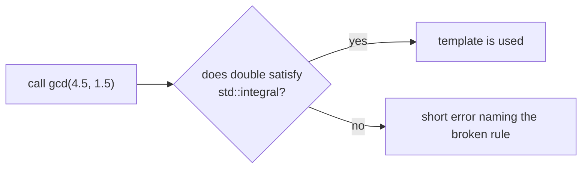

# Concepts: templates with clear rules

A template like `largest(const std::vector<T>&)` silently assumes `T` supports `<`. Call it with a type that doesn't, and you get pages of errors from deep inside the template. **Concepts** (C++20) let you state the rules up front.

## Using standard concepts

<!-- diagram -->


```cpp
#include <concepts>
#include <iostream>

template <std::integral T>
T gcd(T a, T b) {
    while (b != 0) {
        T t = a % b;
        a = b;
        b = t;
    }
    return a;
}

int main() {
    std::cout << gcd(48, 18) << "\n";
    std::cout << gcd(270L, 192L) << "\n";
    // gcd(4.5, 1.5);   // error: 'double' does not satisfy 'integral'
    return 0;
}
```

```output
6
6
```

Writing `std::integral T` instead of `typename T` says: T must be a whole-number type. Pass a double and the error message says exactly that, in one line.

Common standard concepts from `<concepts>`:

| Concept | Means |
|---|---|
| `std::integral<T>` | a whole-number type |
| `std::floating_point<T>` | float, double... |
| `std::same_as<T, U>` | exactly the same type |
| `std::convertible_to<T, U>` | T can turn into U |
| `std::totally_ordered<T>` | supports < > <= >= == != |
| `std::invocable<F, Args...>` | F can be called with Args |

## Four ways to write the same rule

```cpp
template <std::totally_ordered T>                 // 1. in the template list
T biggest(T a, T b) { return a < b ? b : a; }

template <typename T>
    requires std::totally_ordered<T>              // 2. a requires clause
T biggest2(T a, T b) { return a < b ? b : a; }

auto biggest3(std::totally_ordered auto a,        // 3. "abbreviated" template
              std::totally_ordered auto b) { return a < b ? b : a; }
```

(The fourth is a trailing `requires` after the parameter list.) Style 1 is the most common for simple rules; style 3 is handy for short functions.

## Writing your own concept

A `requires` expression lists what must compile:

```cpp
#include <concepts>
#include <iostream>
#include <string>
#include <vector>

template <typename T>
concept Shape = requires(const T& s) {
    { s.area() } -> std::convertible_to<double>;
    { s.name() } -> std::convertible_to<std::string>;
};

struct Square {
    double side;
    double area() const { return side * side; }
    std::string name() const { return "square"; }
};

struct Circle {
    double r;
    double area() const { return 3.14159 * r * r; }
    std::string name() const { return "circle"; }
};

template <Shape S>
void report(const S& s) {
    std::cout << s.name() << " with area " << s.area() << "\n";
}

int main() {
    report(Square{3});
    report(Circle{1});
    // report(42);   // error: 'int' does not satisfy 'Shape'
    return 0;
}
```

```output
square with area 9
circle with area 3.14159
```

Notice: no base class, no `virtual`. Square and Circle just have the right functions. This is **compile-time polymorphism**: the compiler writes a separate `report` for each type, with no virtual call at run time. The cost: you can't put Squares and Circles in one `std::vector` this way. For that you still need inheritance (run-time polymorphism) or `std::variant`.

## Choosing between overloads

Concepts also pick the best overload:

```cpp
#include <concepts>
#include <iostream>
#include <string>

void show(std::integral auto x) { std::cout << "int-like: " << x << "\n"; }
void show(std::floating_point auto x) { std::cout << "decimal: " << x << "\n"; }
void show(const std::string& s) { std::cout << "text: " << s << "\n"; }

int main() {
    show(7);
    show(7.25);
    show(std::string("seven"));
    return 0;
}
```

```output
int-like: 7
decimal: 7.25
text: seven
```

## When to use concepts

- On every template you write that others will call: the errors become readable and the rules become documentation.
- Prefer standard concepts; write your own when they describe a real idea in your program (like `Shape`).
- Don't over-constrain: require what you actually use.

## Summary

- Concepts state what a template needs; errors then name the broken rule.
- Use `<concepts>` (integral, floating_point, totally_ordered...) or write `concept X = requires(...) {...};`.
- Concepts give compile-time polymorphism without base classes or virtual calls.

## Optional videos

The lesson above is complete on its own. These videos go deeper, if you like learning by watching.

**Templates in C++ (The Cherno)**

https://www.youtube.com/watch?v=I-hZkUa9mIs
