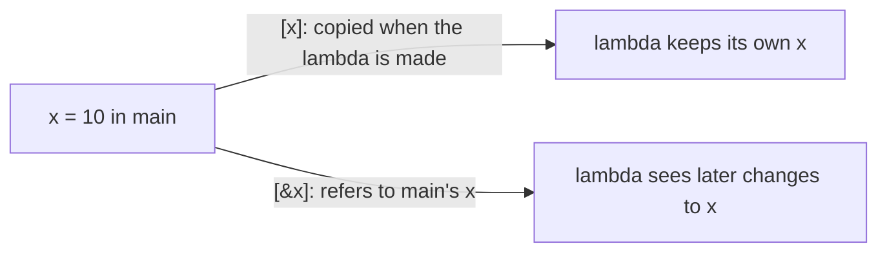

# Lambdas and functions as values

You've used lambdas to give `std::sort` a rule. This lesson shows what they really are and what else you can do with them.

## What a lambda is

The compiler turns a lambda into a small class with an `operator()`. Captured variables become its members:

```cpp
int limit = 20;
auto under = [limit](int x) { return x < limit; };

// is roughly the same as:
struct Under {
    int limit;
    bool operator()(int x) const { return x < limit; }
};
Under under2{limit};
```

That's why lambdas are fast: calling one is an ordinary function call the compiler can inline.

## Captures in detail

<!-- diagram -->


```cpp
#include <iostream>

int main() {
    int count = 0;
    int step = 5;

    auto by_value = [step]() { return step * 2; };            // a copy, taken now
    auto by_ref = [&count]() { ++count; };                     // the real variable
    auto everything = [=]() { return step + count; };          // copy all used variables
    auto counter = [n = 0]() mutable { return ++n; };          // its own variable

    step = 100;                     // by_value still has 5
    by_ref();
    by_ref();
    std::cout << by_value() << " " << count << " " << everything() << "\n";
    std::cout << counter() << counter() << counter() << "\n";
    return 0;
}
```

```output
10 2 5
123
```

- `[x]` copies x when the lambda is **created**; later changes don't affect it. That's why `everything()` gives 5: it copied step (5) and count (0) before either changed.
- `[&x]` refers to x itself. Danger: if the lambda outlives x, it refers to a dead variable.
- `[=]` and `[&]` capture everything used, by copy or by reference. Prefer listing names: it's clearer what the lambda depends on.
- `[n = 0]` creates a new variable inside the lambda. `mutable` lets the lambda change its copies.
- Inside a member function, `[this]` lets the lambda use the object's members.

## Generic lambdas

Use `auto` parameters and a lambda works with many types, like a template:

```cpp
#include <iostream>
#include <string>

int main() {
    auto twice = [](const auto& x) { return x + x; };
    std::cout << twice(21) << " " << twice(1.25) << " " << twice(std::string("ab")) << "\n";
    return 0;
}
```

```output
42 2.5 abab
```

## Storing functions: std::function

Every lambda has its own unique type, so you can't put two different lambdas in one vector directly. `std::function<R(Args...)>` can hold **anything callable** with that signature:

```cpp
#include <functional>
#include <iostream>
#include <map>
#include <string>

int main() {
    std::map<std::string, std::function<double(double, double)>> ops{
        {"+", [](double a, double b) { return a + b; }},
        {"-", [](double a, double b) { return a - b; }},
        {"*", [](double a, double b) { return a * b; }},
        {"/", [](double a, double b) { return b != 0 ? a / b : 0.0; }},
    };
    for (const auto& [sym, fn] : ops) {
        std::cout << "12 " << sym << " 4 = " << fn(12, 4) << "\n";
    }
    return 0;
}
```

```output
12 * 4 = 48
12 + 4 = 16
12 - 4 = 8
12 / 4 = 3
```

(The map keeps keys in character order: `*` comes before `+`.)

`std::function` costs a little more than calling a lambda directly (it may allocate and calls through a pointer). Use it when you need to **store** functions of different kinds: callbacks, event handlers, command tables like this one. To just **pass** a function to another function, a template parameter (or `std::invocable auto`) is cheaper.

## Functions that return functions

```cpp
#include <functional>
#include <iostream>

auto make_discount(double percent) {
    return [percent](double price) { return price * (1 - percent / 100); };
}

int main() {
    auto summer = make_discount(20);
    auto members = make_discount(35);
    std::cout << summer(200) << " " << members(200) << "\n";
    return 0;
}
```

```output
160 130
```

The returned lambda carries its own copy of `percent`. This works because it captured **by value**. Capturing `percent` by reference here would be a bug: the parameter dies when `make_discount` returns.

## Immediately invoked lambdas

A lambda called right away is a neat way to initialize a `const` variable with complicated logic:

```cpp
const std::string level = [&] {
    if (score >= 90) return "gold";
    if (score >= 70) return "silver";
    return "bronze";
}();
```

## Summary

- A lambda is an object with `operator()`; captures are its members.
- `[x]` copies at creation, `[&x]` refers; avoid reference captures that outlive the variable.
- `std::function` stores any callable with a given signature; templates are cheaper for passing.

## Optional videos

The lesson above is complete on its own. These videos go deeper, if you like learning by watching.

**Lambdas in C++ (The Cherno)**

https://www.youtube.com/watch?v=mWgmBBz0y8c
