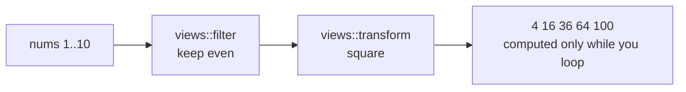

# Ranges and views

The algorithms in `<algorithm>` need two iterators: `std::sort(v.begin(), v.end())`. C++20's **ranges** let you pass the container itself, and **views** let you chain steps into readable pipelines.

## Range algorithms

```cpp
#include <algorithm>
#include <iostream>
#include <vector>

int main() {
    std::vector<int> v{5, 3, 9, 1, 7};
    std::ranges::sort(v);
    auto it = std::ranges::find(v, 7);
    std::cout << "7 is at index " << (it - v.begin()) << "\n";
    std::cout << "max " << std::ranges::max(v) << ", any even? "
              << std::ranges::any_of(v, [](int x) { return x % 2 == 0; }) << "\n";
    return 0;
}
```

```output
7 is at index 3
max 9, any even? 0
```

Every classic algorithm has a `std::ranges::` version. They also accept a **projection**: a member or function to look at instead of the whole item.

```cpp
#include <algorithm>
#include <iostream>
#include <string>
#include <vector>

struct Student {
    std::string name;
    int score;
};

int main() {
    std::vector<Student> cls{{"Mai", 78}, {"Ahmed", 91}, {"Rana", 85}};
    std::ranges::sort(cls, std::ranges::greater{}, &Student::score);   // sort by score, highest first
    for (const auto& s : cls) std::cout << s.name << " " << s.score << "\n";

    auto top = std::ranges::max_element(cls, {}, &Student::name);      // last name alphabetically
    std::cout << "last alphabetically: " << top->name << "\n";
    return 0;
}
```

```output
Ahmed 91
Rana 85
Mai 78
last alphabetically: Rana
```

`&Student::score` says "compare by score". No lambda needed.

## Views: lazy pipelines

A **view** is a cheap, lazy window onto a range. It doesn't copy anything and does no work until you loop over it. Chain views with `|`:

<!-- diagram -->


```cpp
#include <iostream>
#include <ranges>
#include <vector>

int main() {
    std::vector<int> nums{1, 2, 3, 4, 5, 6, 7, 8, 9, 10};

    auto even_squares = nums
        | std::views::filter([](int x) { return x % 2 == 0; })
        | std::views::transform([](int x) { return x * x; });

    for (int x : even_squares) std::cout << x << " ";
    std::cout << "\n";

    for (int x : nums | std::views::reverse | std::views::take(3)) std::cout << x << " ";
    std::cout << "\n";
    return 0;
}
```

```output
4 16 36 64 100 
10 9 8 
```

Read it top to bottom: take nums, keep the even ones, square them. No temporary vectors are created; each number flows through the whole pipeline one at a time.

## Useful views

| View | Does |
|---|---|
| `views::filter(pred)` | keeps items where pred is true |
| `views::transform(f)` | applies f to each item |
| `views::take(n)` / `views::drop(n)` | first n / skip n |
| `views::reverse` | backwards |
| `views::iota(a, b)` | the numbers a, a+1, ..., b-1 |
| `views::keys` / `views::values` | first / second of pairs (maps) |
| `views::split(sep)` | pieces between separators |

`iota` makes ranges of numbers without a container, and can even be endless; `take` stops it:

```cpp
#include <iostream>
#include <ranges>

int main() {
    auto is_prime = [](int n) {
        if (n < 2) return false;
        for (int d = 2; d * d <= n; ++d)
            if (n % d == 0) return false;
        return true;
    };
    for (int p : std::views::iota(1) | std::views::filter(is_prime) | std::views::take(10))
        std::cout << p << " ";
    std::cout << "\n";
    return 0;
}
```

```output
2 3 5 7 11 13 17 19 23 29 
```

`std::views::iota(1)` counts 1, 2, 3, ... forever. Because views are lazy, only as many numbers as needed are ever checked.

## Turning a view back into a container

A view is not a container. To keep the results, copy them into one. In C++23 that's `std::ranges::to<std::vector>()`; in C++20 build the vector from the view's begin and end:

```cpp
auto v = nums | std::views::filter(is_even);
std::vector<int> evens(v.begin(), v.end());
```

## Two warnings

- A view **refers** to its source. If the source vector is destroyed or changed in size, the view is broken. Don't return views of local containers.
- Some views (like `filter`) remember work as you iterate. Loop over them freely, but don't use one from two threads at once.

## Summary

- `std::ranges::sort(v)`, `find`, `max`... take containers directly and accept projections like `&Student::score`.
- Views chain with `|` and do lazy work without copies; `iota` + `take` handles even endless sequences.
- Copy a view into a container to keep it; never let a view outlive its source.

## Optional videos

The lesson above is complete on its own. These videos go deeper, if you like learning by watching.

**C++20 Ranges in Practice (Tristan Brindle, CppCon 2020)**

https://www.youtube.com/watch?v=d_E-VLyUnzc
