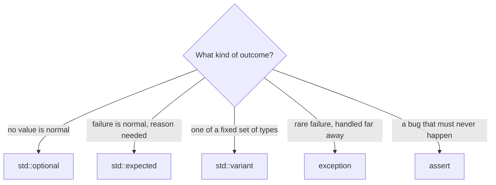

# Handling errors: exceptions, optional, variant and expected

Things go wrong: a file is missing, input is bad, a number doesn't parse. C++ gives you several tools. Picking the right one matters more than the syntax.

## Exceptions

`throw` an error object; the nearest matching `catch` up the call chain handles it. Everything in between is cleaned up by destructors (RAII), so nothing leaks:

```cpp
#include <iostream>
#include <stdexcept>
#include <string>

double safe_divide(double a, double b) {
    if (b == 0) throw std::invalid_argument("division by zero");
    return a / b;
}

int parse_age(const std::string& s) {
    int age = std::stoi(s);                    // throws std::invalid_argument for "abc"
    if (age < 0 || age > 150) throw std::out_of_range("age " + s + " is not realistic");
    return age;
}

int main() {
    for (std::string input : {"34", "abc", "400"}) {
        try {
            int age = parse_age(input);       // if this throws, the next line never runs
            std::cout << "age " << age << "\n";
        } catch (const std::out_of_range& e) {
            std::cout << "range error: " << e.what() << "\n";
        } catch (const std::exception& e) {
            std::cout << "bad input: " << input << "\n";
        }
    }
    try {
        safe_divide(1, 0);
    } catch (const std::invalid_argument& e) {
        std::cout << "caught: " << e.what() << "\n";
    }
    return 0;
}
```

```output
age 34
bad input: abc
range error: age 400 is not realistic
caught: division by zero
```

- Catch **by const reference**, most specific type first. `std::exception` is the base of all standard errors.
- `e.what()` gives the message.
- Use exceptions for errors that are **rare** and that the immediate caller usually can't fix: out of memory, a broken config file, a programming bug in an argument.
- Mark functions that never throw `noexcept` (moves, destructors, swaps).

## std::optional: maybe a value

When "no result" is a normal, expected outcome, return `std::optional<T>`:

```cpp
#include <iostream>
#include <map>
#include <optional>
#include <string>

std::optional<double> price_of(const std::map<std::string, double>& menu, const std::string& item) {
    auto it = menu.find(item);
    if (it == menu.end()) return std::nullopt;
    return it->second;
}

int main() {
    std::map<std::string, double> menu{{"tea", 15}, {"coffee", 30}};
    if (auto p = price_of(menu, "coffee")) std::cout << "coffee: " << *p << "\n";
    auto cake = price_of(menu, "cake");
    std::cout << "cake: " << (cake ? "on the menu" : "not on the menu") << "\n";
    std::cout << "cake or 0: " << cake.value_or(0) << "\n";
    return 0;
}
```

```output
coffee: 30
cake: not on the menu
cake or 0: 0
```

The type itself tells the caller "this might be empty", and they can't forget to check without it being obvious in the code.

## std::variant: one of several types

A `std::variant<A, B, C>` holds exactly one of its types at a time. With `std::visit` you handle each case:

```cpp
#include <iostream>
#include <string>
#include <variant>
#include <vector>

struct Cash { double amount; };
struct Card { double amount; std::string last4; };
struct Voucher { std::string code; };

using Payment = std::variant<Cash, Card, Voucher>;

template <class... Fs> struct overloaded : Fs... { using Fs::operator()...; };

int main() {
    std::vector<Payment> payments{Cash{50}, Card{120, "4421"}, Voucher{"EID25"}};
    for (const auto& p : payments) {
        std::visit(overloaded{
            [](const Cash& c) { std::cout << "cash " << c.amount << "\n"; },
            [](const Card& c) { std::cout << "card ending " << c.last4 << ": " << c.amount << "\n"; },
            [](const Voucher& v) { std::cout << "voucher " << v.code << "\n"; },
        }, p);
    }
    return 0;
}
```

```output
cash 50
card ending 4421: 120
voucher EID25
```

The `overloaded` helper combines several lambdas into one object; it's a well-known two-line pattern. If you forget a case, the code doesn't compile. A closed set of alternatives without inheritance or pointers.

## std::expected: a value or an error (C++23)

`std::optional` says "nothing", but not **why**. `std::expected<T, E>` holds either a result or an error describing what went wrong. Compile with `-std=c++23` (GCC 12+, Clang 16+, recent MSVC):

```cpp
#include <expected>
#include <iostream>
#include <string>

enum class ParseError { empty, not_a_number, negative };

std::expected<int, ParseError> parse_quantity(const std::string& s) {
    if (s.empty()) return std::unexpected(ParseError::empty);
    int value = 0;
    for (char c : s) {
        if (c == '-') return std::unexpected(ParseError::negative);
        if (c < '0' || c > '9') return std::unexpected(ParseError::not_a_number);
        value = value * 10 + (c - '0');
    }
    return value;
}

std::string message(ParseError e) {
    switch (e) {
        case ParseError::empty: return "nothing typed";
        case ParseError::not_a_number: return "not a number";
        case ParseError::negative: return "can't be negative";
    }
    return "unknown";
}

int main() {
    for (std::string in : {"12", "", "3x", "-4"}) {
        auto q = parse_quantity(in);
        if (q) std::cout << "'" << in << "' -> " << *q << "\n";
        else std::cout << "'" << in << "' -> error: " << message(q.error()) << "\n";
    }
    return 0;
}
```

```output
'12' -> 12
'' -> error: nothing typed
'3x' -> error: not a number
'-4' -> error: can't be negative
```

## Which one when?

<!-- diagram -->


| Situation | Tool |
|---|---|
| "Not found" or "no value" is normal | `std::optional` |
| Failure is normal and the caller needs the reason (parsing, validation) | `std::expected` |
| A value is one of a fixed set of types | `std::variant` |
| Rare failure the caller can't handle nearby, or a constructor can't succeed | exception |
| A bug that should never happen | `assert` (checked in debug builds) |

## Summary

- Exceptions travel up to the nearest matching catch; RAII cleans up on the way.
- `optional` = maybe a value; `expected` = value or reason; `variant` = one of several types, handled with `visit`.
- Pick by how normal the failure is and whether the caller needs to know why.

## Optional videos

The lesson above is complete on its own. These videos go deeper, if you like learning by watching.

**Back to Basics: Exceptions (Klaus Iglberger, CppCon 2020)**

https://www.youtube.com/watch?v=0ojB8c0xUd8
