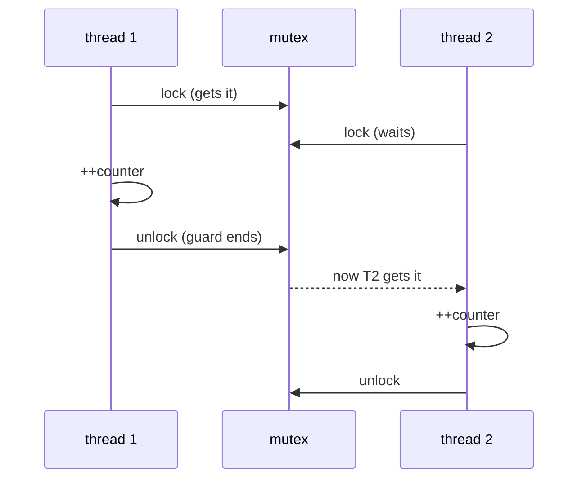

# Concurrency: threads, mutexes, atomics and async

Your computer has several cores. **Concurrency** lets one program do several things at the same time. It's powerful and easy to get wrong, so this lesson is about doing it safely.

## Starting threads

```cpp
#include <iostream>
#include <thread>
#include <vector>

void work(int id, std::vector<int>& results) {
    long sum = 0;
    for (int i = 1; i <= 1000 * id; ++i) sum += i;
    results[id] = static_cast<int>(sum % 1000);
}

int main() {
    std::vector<int> results(4);
    {
        std::vector<std::jthread> threads;
        for (int id = 0; id < 4; ++id)
            threads.emplace_back(work, id, std::ref(results));
    }   // jthreads join (wait for their thread) here, automatically
    for (int r : results) std::cout << r << " ";
    std::cout << "\n";
    return 0;
}
```

```output
0 500 0 500 
```

- `std::jthread` (C++20) starts a thread running a function with the given arguments, and **joins** it in its destructor. The older `std::thread` must be joined by hand, or the program aborts.
- `std::ref(results)` passes a reference; thread arguments are copied otherwise.
- Each thread writes to its **own** slot, so they don't interfere.

## Data races

When two threads touch the same data and at least one writes, without coordination, that's a **data race**: undefined behavior. Results go wrong at random, often only on some machines.

```cpp
int counter = 0;
// in 4 threads:  for (...) ++counter;     // WRONG: a data race
```

`++counter` is really read, add, write. Two threads can read the same old value and both write old + 1. Compile with `-fsanitize=thread` and the race is reported.

## std::mutex: one at a time

A mutex lets only one thread into a section of code at a time. Lock it with an RAII guard so it's always unlocked:

<!-- diagram -->


```cpp
#include <iostream>
#include <mutex>
#include <thread>
#include <vector>

int main() {
    long counter = 0;
    std::mutex m;
    {
        std::vector<std::jthread> threads;
        for (int t = 0; t < 4; ++t) {
            threads.emplace_back([&] {
                for (int i = 0; i < 100000; ++i) {
                    std::scoped_lock lock(m);    // locked until the end of this block
                    ++counter;
                }
            });
        }
    }
    std::cout << counter << "\n";
    return 0;
}
```

```output
400000
```

`std::scoped_lock` locks in its constructor and unlocks in its destructor, even if an exception is thrown. It can also lock several mutexes at once without deadlocking.

## std::atomic: simple shared values

For a single number or flag, `std::atomic` is simpler and faster than a mutex:

```cpp
#include <atomic>
#include <iostream>
#include <thread>
#include <vector>

int main() {
    std::atomic<long> counter{0};
    {
        std::vector<std::jthread> threads;
        for (int t = 0; t < 4; ++t)
            threads.emplace_back([&] {
                for (int i = 0; i < 100000; ++i) ++counter;   // one indivisible step
            });
    }
    std::cout << counter.load() << "\n";
    return 0;
}
```

```output
400000
```

Use atomics for counters and flags. For anything bigger (updating a map, keeping two values consistent), use a mutex.

## std::async: run a task, get the result later

Often you don't want to manage threads at all; you want "compute this in the background and give me the answer":

```cpp
#include <future>
#include <iostream>
#include <numeric>
#include <vector>

long sum_range(const std::vector<int>& v, std::size_t from, std::size_t to) {
    return std::accumulate(v.begin() + from, v.begin() + to, 0L);
}

int main() {
    std::vector<int> data(1'000'000);
    std::iota(data.begin(), data.end(), 1);       // 1, 2, ..., 1000000

    std::size_t half = data.size() / 2;
    auto first = std::async(std::launch::async, sum_range, std::cref(data), 0, half);
    long second = sum_range(data, half, data.size());   // this thread does the other half

    std::cout << first.get() + second << "\n";          // get() waits for the result
    return 0;
}
```

```output
500000500000
```

`std::async` returns a `std::future`. `get()` waits for the task and returns its value, or rethrows an exception the task threw.

## Rules that keep you out of trouble

1. **Share as little as possible.** Give each thread its own data and combine results at the end (as above).
2. When you must share, protect **all** access to the data with the **same** mutex, or use atomics.
3. Hold locks briefly. Never call unknown code (callbacks, I/O) while holding a lock.
4. Lock several mutexes together with one `std::scoped_lock(a, b)` to avoid deadlocks.
5. Test with `-fsanitize=thread` (ThreadSanitizer). It finds races that may show up once a month in production.

## Summary

- `std::jthread` runs a function on another core and joins automatically.
- Shared data needs a `std::mutex` (with `std::scoped_lock`) or `std::atomic`.
- `std::async` + `future.get()` is the simplest way to run work in the background.

## Optional videos

The lesson above is complete on its own. These videos go deeper, if you like learning by watching.

**Threads in C++ (The Cherno)**

https://www.youtube.com/watch?v=wXBcwHwIt_I
