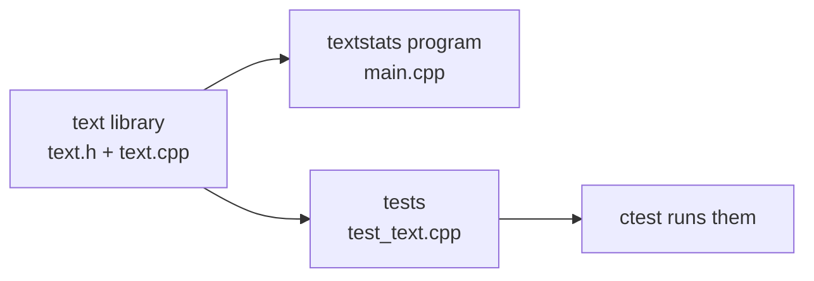

# Testing, tooling and a real project layout

Code you can't test is code you're afraid to change. This lesson sets up a project the way professional C++ teams do: libraries, tests, warnings, sanitizers and formatting.

## Testing without a framework

The simplest test is a program that checks results and fails loudly:

```cpp
#include <iostream>
#include <string>

int word_count(const std::string& s) {
    int count = 0;
    bool in_word = false;
    for (char c : s) {
        if (c == ' ') in_word = false;
        else if (!in_word) { in_word = true; ++count; }
    }
    return count;
}

int failures = 0;
void check(bool ok, const std::string& what) {
    if (!ok) { ++failures; std::cout << "FAIL: " << what << "\n"; }
}

int main() {
    check(word_count("") == 0, "empty string");
    check(word_count("hello") == 1, "one word");
    check(word_count("  two   words ") == 2, "extra spaces");
    check(word_count("a b c d") == 4, "single letters");
    std::cout << (failures == 0 ? "all tests passed\n" : "some tests failed\n");
    return failures == 0 ? 0 : 1;
}
```

```output
all tests passed
```

The exit code matters: 0 means success, anything else means failure. Build tools and CI services (like GitHub Actions) use it to decide if the build is green.

## Test frameworks

Real projects use a framework that gives nicer output, many small named tests and helpers. The two most popular are **GoogleTest** and **Catch2**. A Catch2 test looks like this:

```cpp
#include <catch2/catch_test_macros.hpp>
#include "text.h"

TEST_CASE("word_count counts words") {
    REQUIRE(word_count("") == 0);
    REQUIRE(word_count("hello") == 1);
    REQUIRE(word_count("  two   words ") == 2);
}
```

When a check fails, it prints the file, the line and both values.

## A project layout

<!-- diagram -->


```text
textstats/
  CMakeLists.txt
  src/
    text.h          library: the code worth testing
    text.cpp
    main.cpp        a small program that uses the library
  tests/
    test_text.cpp
```

The key idea: put the real logic in a **library**, and make both the program and the tests use it.

```cmake
cmake_minimum_required(VERSION 3.20)
project(textstats CXX)
set(CMAKE_CXX_STANDARD 20)
set(CMAKE_CXX_STANDARD_REQUIRED ON)

add_library(text src/text.cpp)
target_include_directories(text PUBLIC src)
target_compile_options(text PRIVATE -Wall -Wextra -Wpedantic)

add_executable(textstats src/main.cpp)
target_link_libraries(textstats PRIVATE text)

# Tests: fetch Catch2 automatically the first time
include(FetchContent)
FetchContent_Declare(Catch2 GIT_REPOSITORY https://github.com/catchorg/Catch2.git GIT_TAG v3.5.4)
FetchContent_MakeAvailable(Catch2)

add_executable(tests tests/test_text.cpp)
target_link_libraries(tests PRIVATE text Catch2::Catch2WithMain)

enable_testing()
add_test(NAME unit COMMAND tests)
```

Build and run the tests:

```bash
cmake -S . -B build
cmake --build build
ctest --test-dir build --output-on-failure
```

`target_link_libraries(... PRIVATE text)` also brings in `text`'s include folder, because it was marked `PUBLIC`. That's how CMake passes settings between targets.

## Tools worth setting up once

| Tool | What it does | How |
|---|---|---|
| Warnings as errors | stops warnings piling up | `-Werror` in CI builds |
| AddressSanitizer / UBSan | memory bugs, undefined behavior | `-fsanitize=address,undefined` |
| ThreadSanitizer | data races | `-fsanitize=thread` (separate build) |
| clang-format | consistent formatting | a `.clang-format` file, format on save |
| clang-tidy | finds bug patterns, suggests modern style | `clang-tidy src/*.cpp -- -std=c++20` |

Sanitizers make the program slower (2 to 5 times), so use them in test builds, not in what you ship.

## Making a sanitizer build with CMake presets

Instead of remembering long commands, write them once in `CMakePresets.json`:

```json
{
  "version": 3,
  "configurePresets": [
    { "name": "debug", "binaryDir": "build/debug",
      "cacheVariables": { "CMAKE_BUILD_TYPE": "Debug",
        "CMAKE_CXX_FLAGS": "-fsanitize=address,undefined -fno-omit-frame-pointer" } },
    { "name": "release", "binaryDir": "build/release",
      "cacheVariables": { "CMAKE_BUILD_TYPE": "Release" } }
  ]
}
```

Then `cmake --preset debug` and `cmake --build build/debug`. Editors like VS Code and CLion show presets in a menu.

## What to test

- Normal cases, then the edges: empty input, one item, very large values, negative numbers.
- Every bug you fix: write a test that fails first, then fix the code. The bug can't come back silently.
- Behaviour, not implementation details, so you can refactor freely.

## Summary

- A test is code that checks results and returns a non-zero exit code on failure.
- Put logic in a library; link both the app and the tests to it; run with `ctest`.
- Keep sanitizer and warning builds in your routine; let tools format and lint the code.

## Optional videos

The lesson above is complete on its own. These videos go deeper, if you like learning by watching.

**Debugging: GDB tutorial (Chris Bourke)**

https://www.youtube.com/watch?v=bWH-nL7v5F4
