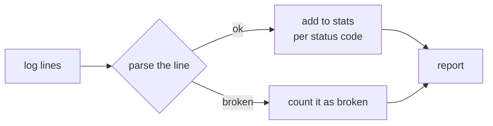

# Project: a parallel log analyzer

Let's combine the advanced pieces: move semantics, ranges, `std::expected`, `std::span` and parallel tasks. You'll build a tool that reads web server log lines, parses them in parallel and reports statistics.

## The input

Each line looks like this (method, path, status code, response time in ms):

<!-- diagram -->


```text
GET /home 200 35
POST /login 401 12
GET /products 200 88
```

Some lines are broken; the tool must count them, not crash.

## The code

```cpp
#include <algorithm>
#include <expected>
#include <future>
#include <iostream>
#include <map>
#include <ranges>
#include <span>
#include <sstream>
#include <string>
#include <vector>

struct Entry {
    std::string method;
    std::string path;
    int status = 0;
    int ms = 0;
};

enum class LineError { too_few_fields, bad_number };

std::expected<Entry, LineError> parse_line(const std::string& line) {
    std::istringstream in(line);
    Entry e;
    std::string status, ms;
    if (!(in >> e.method >> e.path >> status >> ms)) return std::unexpected(LineError::too_few_fields);
    try {
        e.status = std::stoi(status);
        e.ms = std::stoi(ms);
    } catch (const std::exception&) {
        return std::unexpected(LineError::bad_number);
    }
    return e;
}

struct Stats {
    long lines = 0;
    long broken = 0;
    long total_ms = 0;
    std::map<int, long> by_status;
    std::map<std::string, long> by_path;

    void add(const Stats& other) {                 // combine results from another thread
        lines += other.lines;
        broken += other.broken;
        total_ms += other.total_ms;
        for (const auto& [k, v] : other.by_status) by_status[k] += v;
        for (const auto& [k, v] : other.by_path) by_path[k] += v;
    }
};

Stats analyze(std::span<const std::string> lines) {
    Stats s;
    for (const auto& line : lines) {
        ++s.lines;
        auto e = parse_line(line);
        if (!e) { ++s.broken; continue; }
        s.total_ms += e->ms;
        ++s.by_status[e->status];
        ++s.by_path[e->path];
    }
    return s;
}

Stats analyze_parallel(const std::vector<std::string>& lines, std::size_t parts) {
    std::vector<std::future<Stats>> jobs;
    std::size_t chunk = (lines.size() + parts - 1) / parts;
    for (std::size_t start = 0; start < lines.size(); start += chunk) {
        std::size_t len = std::min(chunk, lines.size() - start);
        std::span<const std::string> piece(lines.data() + start, len);
        jobs.push_back(std::async(std::launch::async, analyze, piece));
    }
    Stats total;
    for (auto& j : jobs) total.add(j.get());       // each thread had its own Stats: no locks
    return total;
}

int main() {
    std::vector<std::string> base{
        "GET /home 200 35", "POST /login 401 12", "GET /products 200 88",
        "GET /home 200 41", "garbage line", "GET /cart 500 230",
        "POST /login 200 19", "GET /products 200 72", "GET /home 304 3", "GET /cart two 10",
    };
    std::vector<std::string> lines;
    for (int i = 0; i < 1000; ++i)                 // pretend it's a big log
        lines.insert(lines.end(), base.begin(), base.end());

    Stats s = analyze_parallel(lines, 4);

    std::cout << "lines: " << s.lines << ", broken: " << s.broken << "\n";
    std::cout << "average time: " << s.total_ms / (s.lines - s.broken) << " ms\n";
    for (const auto& [code, n] : s.by_status) std::cout << "status " << code << ": " << n << "\n";

    std::vector<std::pair<std::string, long>> paths(s.by_path.begin(), s.by_path.end());
    std::ranges::stable_sort(paths, std::ranges::greater{}, &std::pair<std::string, long>::second);
    std::cout << "busiest:";
    for (const auto& [path, n] : paths | std::views::take(2)) std::cout << " " << path << " (" << n << ")";
    std::cout << "\n";
    return 0;
}
```

```output
lines: 10000, broken: 2000
average time: 62 ms
status 200: 5000
status 304: 1000
status 401: 1000
status 500: 1000
busiest: /home (3000) /login (2000)
```

## Things to notice

- `parse_line` returns `std::expected`: a broken line is normal input, not an exceptional event. The `try` inside only turns `std::stoi`'s exceptions into an error value at the boundary.
- `std::span<const std::string>` is a cheap view of part of a vector: a pointer and a length, no copy. Each thread gets its own piece.
- Each thread fills its **own** `Stats`; the main thread combines them. No mutex anywhere: the safest kind of concurrency.
- `std::async` returns futures; `get()` waits and gives back the moved result.
- The ranking uses a range algorithm with a projection and `views::take`.

There's a subtle detail in the sort: `/login` and `/products` both appear 2000 times. `stable_sort` keeps tied items in their earlier order (the map's alphabetical order), so `/login` comes first every time. Plain `sort` could put either first.

## Your turn

1. Split it into a library (`log.h`, `log.cpp`) and `main.cpp`; write Catch2 or plain tests for `parse_line` covering good lines, too few fields and bad numbers.
2. Read the lines from a file given on the command line (`argv[1]`) instead of the built-in sample.
3. Add the 95th percentile response time (sort the times, take the value at 95%).
4. Measure: time `analyze` vs `analyze_parallel` with `std::chrono::steady_clock` for 1 million lines and 1, 2, 4 and 8 parts. Explain what you see.
5. Build with `-fsanitize=thread` and confirm there are no data races. Then deliberately share one `Stats` between threads without a lock and watch ThreadSanitizer report it.

## Where to go next

You now know the main tools of modern C++. Good next steps: read *A Tour of C++* by Bjarne Stroustrup (the language's creator), browse the C++ Core Guidelines, and contribute to an open-source C++ project. Or continue the systems path with **Rust**, which makes the compiler check the ownership and thread-safety rules you've been following by hand here.

## Summary

- Use `expected` for normal failures, `span` for cheap views, futures for parallel work.
- Give each thread its own data and combine at the end; no locks needed.
- Test the parser, measure the speed-up, and run ThreadSanitizer.

## Optional videos

The lesson above is complete on its own. These videos go deeper, if you like learning by watching.

**Threads in C++ (The Cherno)**

https://www.youtube.com/watch?v=wXBcwHwIt_I

**C++20 Ranges in Practice (Tristan Brindle, CppCon 2020)**

https://www.youtube.com/watch?v=d_E-VLyUnzc
