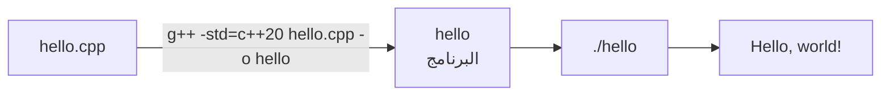

# أول برنامج لك بلغة C++

‏C++ هي اللغة التي وراء محركات الألعاب والمتصفحات وقواعد البيانات وأنظمة التداول، وكثير من البرامج التي يجب أن تكون سريعة. بدأت باسم "C مع الـ classes" ثم كبرت لتصبح لغة حديثة ضخمة. ستتعلم الطريقة الحديثة من البداية: `std::string` و`std::vector` والـ references والـ smart pointers، لا حيل C القديمة.

لو أخذت كورس C فستجد أشياء كثيرة مألوفة. ولو لم تأخذه فلا مشكلة.

## ما تحتاجه

- **Linux / WSL:** `sudo apt install g++ cmake gdb`
- **ماك:** شغّل `xcode-select --install` في Terminal (يعطيك `clang++` ويعمل بنفس الطريقة)
- **ويندوز:** ثبّت Visual Studio Community مع "Desktop development with C++"، أو استخدم WSL
- **للتجربة فقط:** compiler على الإنترنت مثل godbolt.org (اختر C++ وفعّل "Execute")

أي محرر نصوص يصلح. وVS Code مع إضافة C/C++ اختيار مجاني جيد.

## أهلًا يا عالم

احفظ هذا باسم `hello.cpp`:

```cpp
#include <iostream>

int main() {
    std::cout << "Hello, world!\n";
    return 0;
}
```

```output
Hello, world!
```

ترجمه وشغّله:

```bash
g++ -std=c++20 -Wall -Wextra hello.cpp -o hello
./hello
```

- `-std=c++20` يستخدم إصدار 2020 من اللغة. كل ما في هذا الكورس يعمل به.
- `-Wall -Wextra` تشغّلان التحذيرات. استخدمهما دائمًا؛ التحذيرات تقارير أخطاء مجانية.

## سطرًا بسطر

- `#include <iostream>` تُحضر الإدخال والإخراج.
- `int main()` هي نقطة بداية البرنامج. وإرجاع 0 معناه "كل شيء تمام".
- `std::cout` هي الشاشة ("character output"). و`<<` ترسل الأشياء إليها.
- `std::` معناها "من الـ standard library". كل ما تعطيك إياه اللغة موجود في `std`.
- `"\n"` تنهي السطر. وسترى أيضًا `std::endl` التي تنهي السطر **وتفرّغ** المخرجات؛ وهي أبطأ ونادرًا ما تحتاجها.

<!-- diagram -->


## طباعة عدة أشياء

يمكن ربط `<<` في سلسلة، وهي تعرف كيف تطبع الأرقام أيضًا:

```cpp
#include <iostream>

int main() {
    std::cout << "Cups sold: " << 42 << "\n";
    std::cout << "Price: " << 3.5 << " each\n";
    std::cout << "Total: " << 42 * 3.5 << "\n";
    return 0;
}
```

```output
Cups sold: 42
Price: 3.5 each
Total: 147
```

لا توجد رموز تنسيق مثل `%d`: نوع كل قيمة يحدد طريقة طباعتها.

## التعليقات

```cpp
// a comment to the end of the line
/* a comment that can
   span several lines */
```

## عن `using namespace std;`

دروس كثيرة تكتب `using namespace std;` في الأعلى لتكتب `cout` بدل `std::cout`. هذا مقبول في برنامج صغير جدًا، لكنه في الكود الحقيقي يُدخل مئات الأسماء إلى برنامجك ويسبب تعارضات. هذا الكورس يكتب `std::` كل مرة. إنها عادة جيدة، وستتوقف عن ملاحظتها بعد يوم.

## عندما لا يُترجَم الكود

رسائل أخطاء C++ قد تكون طويلة. اقرأ الخطأ **الأول** فقط، وأصلحه، ثم ترجم من جديد. أشهر أخطاء المبتدئين:

- `expected ';'`: فاصلة منقوطة ناقصة، غالبًا في السطر **السابق** للسطر المذكور.
- `'cout' was not declared in this scope`: نسيت `std::` أو `#include <iostream>`.
- `undefined reference to main`: كتبت `main` خطأ.

## الخلاصة

- ترجم بـ `g++ -std=c++20 -Wall -Wextra file.cpp -o name`.
- `std::cout << ... << "\n";` تطبع؛ وكل اسم قياسي يبدأ بـ `std::`.
- أصلح الخطأ الأول أولًا.

## فيديوهات اختيارية

الدرس أعلاه كامل وحده. هذه الفيديوهات للتعمق إن كنت تحب التعلم بالمشاهدة. الفيديوهات المكتوب بجانبها (بالإنجليزية) يمكنك تشغيل الترجمة لها (**CC**)، ثم **الإعدادات ← الترجمة ← ترجمة تلقائية ← العربية**.

**‏#01 [c++] - Introduction (عادل نسيم)**

https://www.youtube.com/watch?v=z1FdInL8sjg

**‏#02 [c++] - First project in c++ (عادل نسيم)**

https://www.youtube.com/watch?v=xo1R1nYM4aw

**Welcome to C++ (The Cherno) (بالإنجليزية)**

https://www.youtube.com/watch?v=18c3MTX0PK0

**How C++ Works (The Cherno) (بالإنجليزية)**

https://www.youtube.com/watch?v=SfGuIVzE_Os
