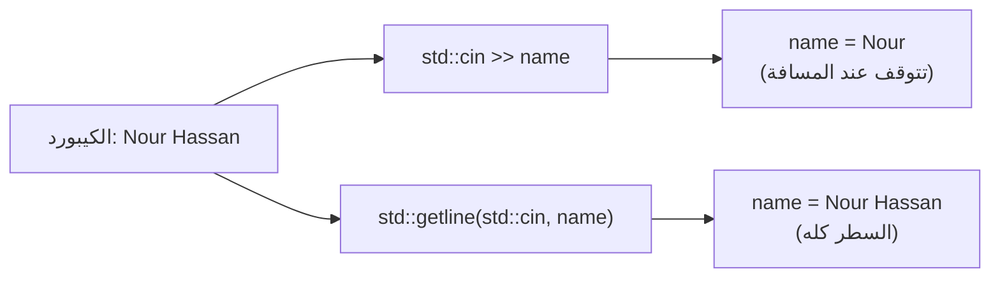

# الـ variables والنصوص والإدخال

## الأنواع الأساسية

```cpp
int count = 12;            // whole numbers
double price = 4.75;       // numbers with a decimal point
bool open = true;          // true or false
char grade = 'A';          // one character, single quotes
```

فضّل **التهيئة بالأقواس المعقوصة**: `int count{12};`. فهي ترفض أن تفقد بيانات بصمت:

```cpp
int a = 3.9;    // compiles (with a warning); a becomes 3
int b{3.9};     // error: narrowing from double to int
```

## auto

`auto` تجعل الـ compiler يستنتج النوع من القيمة:

```cpp
auto n = 10;        // int
auto ratio = 0.25;  // double
```

استخدمها عندما يكون النوع واضحًا أو طويلًا جدًا في الكتابة.

## const

`const` معناها أن القيمة لا تتغير بعد ضبطها. استخدمها كلما استطعت؛ فهي تمنع الأخطاء وتخبر القارئ بما هو ثابت.

```cpp
const double tax_rate = 0.14;
```

## std::string

نصوص C++ تكبر حسب الحاجة وتعرف طولها بنفسها. لا arrays حروف، ولا `strcpy`:

```cpp
#include <iostream>
#include <string>

int main() {
    std::string first = "Nour";
    std::string last = "Hassan";
    std::string full = first + " " + last;

    std::cout << full << "\n";
    std::cout << "Length: " << full.size() << "\n";
    std::cout << "First letter: " << full[0] << "\n";
    std::cout << "Has 'Has'? " << (full.find("Has") != std::string::npos) << "\n";

    full += "!";
    std::cout << full << "\n";
    return 0;
}
```

```output
Nour Hassan
Length: 11
First letter: N
Has 'Has'? 1
Nour Hassan!
```

`find` ترجع الموضع، أو القيمة الخاصة `std::string::npos` عندما لا يوجد النص. وقيم `bool` تُطبع 1 و0 (أضف `std::cout << std::boolalpha;` مرة واحدة لتُطبع `true` و`false`).

## الإدخال بـ std::cin

`std::cin >>` تقرأ كلمة واحدة أو رقمًا، متجاهلة المسافات:

<!-- diagram -->


<!-- stdin: 3\n12.5\n -->
```cpp
#include <iostream>

int main() {
    int qty{};
    double price{};
    std::cout << "How many? ";
    std::cin >> qty;
    std::cout << "Price each? ";
    std::cin >> price;
    std::cout << "\nTotal: " << qty * price << "\n";
    return 0;
}
```

```output
How many? Price each? 
Total: 37.5
```

(عندما تشغّله بنفسك، يظهر ما تكتبه بعد كل سؤال.)

## قراءة سطر كامل

`>>` تتوقف عند أول مسافة، فالاسم "Nour Hassan" سيعطي "Nour" فقط. استخدم `std::getline` للأسطر الكاملة:

<!-- stdin: Nour Hassan\n -->
```cpp
#include <iostream>
#include <string>

int main() {
    std::string name;
    std::cout << "Your full name: ";
    std::getline(std::cin, name);
    std::cout << "\nWelcome, " << name << "!\n";
    return 0;
}
```

```output
Your full name: 
Welcome, Nour Hassan!
```

فخ كلاسيكي: بعد `std::cin >> age;` يبقى زر Enter منتظرًا، فتقرأ `getline` التالية سطرًا فارغًا. أصلح ذلك باستدعاء `std::cin.ignore();` قبل `getline`، أو اقرأ كل شيء بـ `getline`.

## التحويل

```cpp
int n = std::stoi("42");          // text to int
double d = std::stod("3.14");     // text to double
std::string s = std::to_string(7); // number to text
```

## القسمة الصحيحة مرة أخرى

مثل C، قسمة int على int تعطي int: `7 / 2` تساوي 3. اجعل أحد الطرفين double لتحصل على 3.5: `7 / 2.0`، أو `static_cast<double>(a) / b`. و`static_cast` هي طريقة C++ لتحويل الأنواع عن قصد، وهي سهلة البحث عنها وأصعب في سوء الاستخدام من `(double)a` الخاصة بـ C.

## الخلاصة

- int وdouble وbool وchar؛ فضّل التهيئة بـ `{}`؛ واجعل `const` كل ما لا يتغير.
- `std::string` تُجمع بـ `+`، ولها `.size()` و`.find()`.
- `std::cin >>` تقرأ الكلمات والأرقام؛ و`std::getline` تقرأ أسطرًا كاملة.

## فيديوهات اختيارية

الدرس أعلاه كامل وحده. هذه الفيديوهات للتعمق إن كنت تحب التعلم بالمشاهدة. الفيديوهات المكتوب بجانبها (بالإنجليزية) يمكنك تشغيل الترجمة لها (**CC**)، ثم **الإعدادات ← الترجمة ← ترجمة تلقائية ← العربية**.

**ICPC Mansoura، المستوى 0، الجلسة 2: الـ arrays والـ strings**

https://www.youtube.com/watch?v=5WSO-jcLpCM

**Variables in C++ (The Cherno) (بالإنجليزية)**

https://www.youtube.com/watch?v=zB9RI8_wExo
