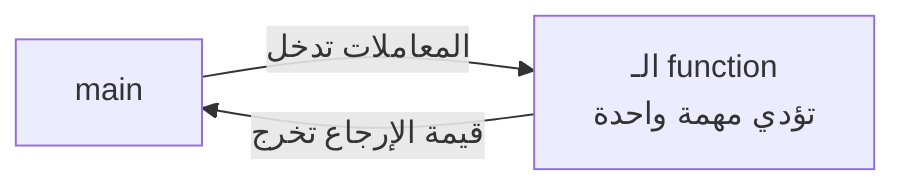

# القرارات والـ loops والـ functions

لو كنت تعرف أي لغة شبيهة بـ C فسيمر هذا الدرس بسرعة: C++ تستخدم نفس `if` و`switch` و`while` و`for`.

## if / else

```cpp
#include <iostream>

int main() {
    int score = 73;
    if (score >= 85) {
        std::cout << "Excellent\n";
    } else if (score >= 65) {
        std::cout << "Pass\n";
    } else {
        std::cout << "Try again\n";
    }
    return 0;
}
```

```output
Pass
```

المقارنات: `==  !=  <  <=  >  >=`. والربط: `&&` (و)، و`||` (أو)، و`!` (ليس). والخطأ الكلاسيكي: `=` تخزّن و`==` تقارن. ومع `-Wall` يحذّرك الـ compiler من `if (x = 5)`.

## switch

لمقارنة قيمة واحدة باختيارات ثابتة:

```cpp
switch (day) {
    case 5:
    case 6:
        std::cout << "Weekend\n";
        break;
    default:
        std::cout << "Work day\n";
}
```

بدون `break` يكمل التنفيذ في الحالة التالية.

## الـ loops

```cpp
#include <iostream>

int main() {
    for (int i = 1; i <= 5; ++i) {
        std::cout << i << " squared is " << i * i << "\n";
    }

    int balance = 1000;
    int months = 0;
    while (balance > 0) {
        balance -= 300;
        ++months;
    }
    std::cout << "Money lasts " << months << " months\n";
    return 0;
}
```

```output
1 squared is 1
2 squared is 4
3 squared is 9
4 squared is 16
5 squared is 25
Money lasts 4 months
```

`break` تخرج من الـ loop؛ و`continue` تقفز إلى الدورة التالية.

## الـ functions

للـ function نوع إرجاع واسم ومعاملات:

<!-- diagram -->


```cpp
#include <iostream>
#include <string>

double with_tax(double price, double rate) {
    return price * (1 + rate);
}

std::string grade(int score) {
    if (score >= 85) return "A";
    if (score >= 65) return "B";
    return "C";
}

void greet(const std::string& name) {   // void: returns nothing
    std::cout << "Hi, " << name << "!\n";
}

int main() {
    std::cout << with_tax(100, 0.14) << "\n";
    std::cout << grade(91) << grade(70) << grade(12) << "\n";
    greet("Omar");
    return 0;
}
```

```output
114
ABC
Hi, Omar!
```

`const std::string&` في `greet` هي **reference**، وستُشرح في الدرس القادم. الآن يكفي أن تعرف: إنها الطريقة المعتادة لتمرير النصوص بدون نسخها.

يجب **الإعلان** عن الـ function قبل استخدامها. إما أن تعرّفها فوق `main`، أو تضع إعلانًا (السطر الأول متبوعًا بـ `;`) في الأعلى:

```cpp
double with_tax(double price, double rate);   // declaration
```

## المعاملات الافتراضية والـ overloading

يمكن أن تكون للمعاملات قيم افتراضية، ويمكن لعدة functions أن تشترك في الاسم لو اختلفت معاملاتها:

```cpp
#include <iostream>

double area(double side) { return side * side; }               // square
double area(double w, double h) { return w * h; }              // rectangle

void line(int width = 10, char ch = '-') {
    for (int i = 0; i < width; ++i) std::cout << ch;
    std::cout << "\n";
}

int main() {
    std::cout << area(3) << " " << area(3, 4) << "\n";
    line();
    line(5, '*');
    return 0;
}
```

```output
9 12
----------
*****
```

الـ compiler يختار `area` الصحيحة من المعاملات التي تمررها. وهذا اسمه **الـ overloading**.

## الخلاصة

- if/else وswitch وfor وwhile تعمل كما في C.
- الـ functions: نوع إرجاع واسم ومعاملات؛ أعلن عنها قبل استخدامها.
- المعاملات الافتراضية والـ overloading تجعل استدعاء الـ functions أسهل.

## فيديوهات اختيارية

الدرس أعلاه كامل وحده. هذه الفيديوهات للتعمق إن كنت تحب التعلم بالمشاهدة. الفيديوهات المكتوب بجانبها (بالإنجليزية) يمكنك تشغيل الترجمة لها (**CC**)، ثم **الإعدادات ← الترجمة ← ترجمة تلقائية ← العربية**.

**‏#11 [c++] - Switch Statement (عادل نسيم)**

https://www.youtube.com/watch?v=-MTeqw7gZf0

**‏#19 [c++] - Function part 2 (عادل نسيم)**

https://www.youtube.com/watch?v=pRVrMNd694I

**Conditions and branches in C++ (The Cherno) (بالإنجليزية)**

https://www.youtube.com/watch?v=qEgCT87KOfc

**Functions in C++ (The Cherno) (بالإنجليزية)**

https://www.youtube.com/watch?v=V9zuox47zr0
