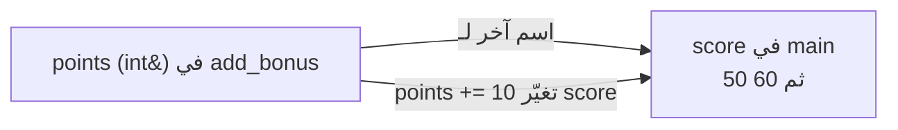

# الـ references وconst

الـ references من أكبر الفروق بين C وC++. فهي تسمح للـ functions بالعمل على متغيراتك مباشرة، بدون pointers.

## التمرير بالقيمة ينسخ

```cpp
#include <iostream>

void add_bonus(int points) {
    points += 10;               // changes the copy only
}

int main() {
    int score = 50;
    add_bonus(score);
    std::cout << score << "\n";
    return 0;
}
```

```output
50
```

## الـ references: اسم آخر لنفس الـ variable

يُعلن عن الـ reference بـ `&` بعد النوع. وهو لا يحمل نسخة؛ بل **هو** الأصل باسم آخر.

<!-- diagram -->


```cpp
#include <iostream>

void add_bonus(int& points) {   // int& = reference to int
    points += 10;               // changes the caller's variable
}

int main() {
    int score = 50;
    add_bonus(score);
    std::cout << score << "\n";

    int& alias = score;
    alias = 99;
    std::cout << score << "\n";
    return 0;
}
```

```output
60
99
```

قواعد الـ references:

- يجب ضبط الـ reference عند إنشائه: `int& r;` خطأ.
- لا يمكن أبدًا تغييره ليشير إلى شيء آخر.
- لا يمكن أن يكون "فارغًا" (null). لذلك هو أكثر أمانًا من الـ pointer عندما يجب أن يكون الشيء موجودًا.

## إرجاع عدة نتائج

استخدام شائع: دع الـ function تملأ أكثر من إجابة.

```cpp
#include <iostream>
#include <vector>

void min_max(const std::vector<int>& v, int& lo, int& hi) {
    lo = hi = v[0];
    for (int x : v) {
        if (x < lo) lo = x;
        if (x > hi) hi = x;
    }
}

int main() {
    std::vector<int> temps{31, 27, 35, 29, 33};
    int lo{}, hi{};
    min_max(temps, lo, hi);
    std::cout << "min " << lo << ", max " << hi << "\n";
    return 0;
}
```

```output
min 27, max 35
```

(ستقابل `std::vector` جيدًا في الوحدة 3. إنها قائمة تكبر.)

## const references: سريعة وآمنة

نسخ نص كبير أو vector فيه مليون رقم بطيء. وreference `const` يمرر الأصل بدون نسخ **ويعد** بعدم تغييره:

```cpp
void print_report(const std::vector<int>& data);   // no copy, read only
```

القاعدة البسيطة التي يتبعها أغلب مبرمجي C++:

| ما تمرره | الطريقة |
|---|---|
| الأشياء الصغيرة (int وdouble وchar وbool) | بالقيمة: `int x` |
| الأشياء الكبيرة التي تقرؤها فقط (string وvector وكلاساتك) | `const T&` |
| الأشياء التي يجب أن تغيّرها الـ function | `T&` |

## const في كل مكان

`const` تحمي أي variable:

```cpp
const int max_users = 100;
max_users = 200;        // error: assignment of read-only variable
```

لو جعلت الأشياء `const` افتراضيًا، يكتشف الـ compiler مجموعات كاملة من الأخطاء بدلًا منك، ويعرف القارئ من نظرة ما الذي يتغير وما الذي لا يتغير.

## كلمة عن الـ pointers

ما زالت C++ فيها pointers C (`int* p = &x;` و`*p = 5;`). ستحتاجها مع بعض المكتبات والكود منخفض المستوى، والـ smart pointers في الوحدة 5 مبنية عليها. لكن لتمرير الأشياء إلى الـ functions، فضّل الـ references.

## فخ: الـ references المعلّقة

لا ترجع أبدًا reference إلى variable محلي. الـ variable يُدمَّر عند انتهاء الـ function، ويشير الـ reference إلى لا شيء:

```cpp
int& bad() {
    int x = 5;
    return x;      // warning: reference to local variable returned
}
```

مع `-Wall` يحذّرك الـ compiler. أرجع بالقيمة بدلًا من ذلك: `int good() { return 5; }`. وإرجاع string أو vector بالقيمة رخيص في C++ الحديثة (النتيجة تُنقل أو تُبنى في مكانها، لا تُنسخ).

## الخلاصة

- `T&` اسم آخر لـ variable موجود؛ والتغييرات تذهب إلى الأصل.
- مرّر الأشياء الكبيرة التي تُقرأ فقط كـ `const T&`، والصغيرة بالقيمة.
- استخدم `const` افتراضيًا؛ ولا ترجع reference إلى variable محلي.

## فيديوهات اختيارية

الدرس أعلاه كامل وحده. هذه الفيديوهات للتعمق إن كنت تحب التعلم بالمشاهدة. الفيديوهات المكتوب بجانبها (بالإنجليزية) يمكنك تشغيل الترجمة لها (**CC**)، ثم **الإعدادات ← الترجمة ← ترجمة تلقائية ← العربية**.

**References in C++ (The Cherno) (بالإنجليزية)**

https://www.youtube.com/watch?v=IzoFn3dfsPA

**Const in C++ (The Cherno) (بالإنجليزية)**

https://www.youtube.com/watch?v=4fJBrditnJU
