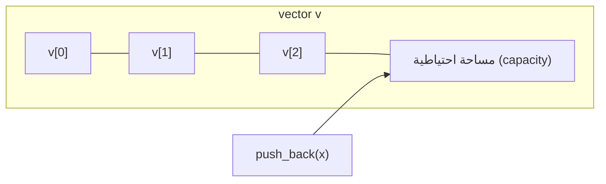

# ‏std::vector: قوائم تكبر

الـ arrays في C حجمها ثابت ولا تعرف طولها. وفي C++ تستخدم دائمًا تقريبًا `std::vector` بدلًا منها.

## إنشاء vector واستخدامه

<!-- diagram -->


```cpp
#include <iostream>
#include <vector>

int main() {
    std::vector<int> scores{70, 85, 92};

    scores.push_back(64);           // add to the end
    std::cout << "Count: " << scores.size() << "\n";
    std::cout << "First: " << scores[0] << ", last: " << scores.back() << "\n";

    scores[1] = 88;                 // change one
    for (int s : scores) {          // visit each one
        std::cout << s << " ";
    }
    std::cout << "\n";
    return 0;
}
```

```output
Count: 4
First: 70, last: 64
70 88 92 64 
```

- `std::vector<int>` تعني "vector من الأعداد الصحيحة". والنوع بين الأقواس الزاوية يمكن أن يكون أي شيء: `std::vector<std::string>` أو `std::vector<double>`.
- `push_back` تضيف في النهاية؛ والـ vector يكبر حسب الحاجة.
- `size()` تعطي عدد العناصر.

## loop range-for

`for (int s : scores)` تُقرأ "لكل s في scores". أقصر من loop الفهرس ولا يمكن أن تخرج عن الحدود.

لكي **تغيّر** العناصر داخل الـ loop استخدم reference؛ ولقراءة العناصر الكبيرة بدون نسخ استخدم const reference:

```cpp
#include <iostream>
#include <string>
#include <vector>

int main() {
    std::vector<double> prices{10, 20, 30};
    for (double& p : prices) {
        p *= 1.10;                  // raise each price by 10%
    }
    for (double p : prices) std::cout << p << " ";
    std::cout << "\n";

    std::vector<std::string> names{"Ali", "Mona", "Karim"};
    for (const std::string& n : names) {
        std::cout << n << " has " << n.size() << " letters\n";
    }
    return 0;
}
```

```output
11 22 33 
Ali has 3 letters
Mona has 4 letters
Karim has 5 letters
```

## loops الفهرس عندما تحتاج الموضع

```cpp
for (std::size_t i = 0; i < names.size(); ++i) {
    std::cout << i + 1 << ". " << names[i] << "\n";
}
```

`size()` ترجع نوعًا بدون إشارة (`std::size_t`). واستخدام `int i` يعطي تحذيرًا عن مقارنة قيمة بإشارة بقيمة بدون إشارة؛ و`std::size_t` يُسكت الـ compiler.

## وصول آمن بـ .at()

`v[10]` على vector فيه 4 عناصر سلوك غير محدد، كما في C. أما `.at(10)` فتتحقق وترمي خطأ تستطيع رؤيته:

```cpp
#include <iostream>
#include <stdexcept>
#include <vector>

int main() {
    std::vector<int> v{1, 2, 3};
    try {
        std::cout << v.at(10) << "\n";
    } catch (const std::out_of_range& e) {
        std::cout << "Oops: index out of range\n";
    }
    return 0;
}
```

```output
Oops: index out of range
```

`try` / `catch` تتعامل مع **الـ exceptions**، وهي طريقة C++ في الإبلاغ عن الأخطاء. ستستخدمها أكثر في الكورس المتقدم.

## عمليات مفيدة أخرى

```cpp
v.pop_back();              // remove the last item
v.insert(v.begin(), 5);    // insert at the front
v.erase(v.begin() + 1);    // remove the item at index 1
v.clear();                 // remove everything
v.empty();                 // true if there are no items
std::vector<int> zeros(10, 0);   // 10 items, all 0 (note: round brackets)
```

`v.begin()` هي **iterator**: موضع داخل الـ vector. functions كثيرة تأخذ مواضع مثل `v.begin()` و`v.end()` (بعد آخر عنصر بخطوة). والدرس القادم يستخدمها كثيرًا.

## vector من vectors

جدول، مثل جدول بيانات صغير:

```cpp
#include <iostream>
#include <vector>

int main() {
    std::vector<std::vector<int>> grid{
        {1, 2, 3},
        {4, 5, 6},
    };
    int total = 0;
    for (const auto& row : grid)
        for (int x : row)
            total += x;
    std::cout << "rows " << grid.size() << ", total " << total << "\n";
    return 0;
}
```

```output
rows 2, total 21
```

`const auto&` تجعل الـ compiler يكتب النوع الطويل بدلًا منك.

## الخلاصة

- `std::vector<T>` يكبر بـ push_back ويعرف حجمه.
- range-for: `T x` لقراءة العناصر الصغيرة، و`T& x` للتغيير، و`const T& x` لقراءة الكبيرة.
- `.at(i)` تتحقق من الحدود؛ و`[i]` لا تتحقق.

## فيديوهات اختيارية

الدرس أعلاه كامل وحده. هذه الفيديوهات للتعمق إن كنت تحب التعلم بالمشاهدة. الفيديوهات المكتوب بجانبها (بالإنجليزية) يمكنك تشغيل الترجمة لها (**CC**)، ثم **الإعدادات ← الترجمة ← ترجمة تلقائية ← العربية**.

**ICPC Mansoura، المستوى 0، الجلسة 5: STL الجزء 1**

https://www.youtube.com/watch?v=dMlhdQuqH38

**Dynamic arrays in C++: std::vector (The Cherno) (بالإنجليزية)**

https://www.youtube.com/watch?v=PocJ5jXv8No
