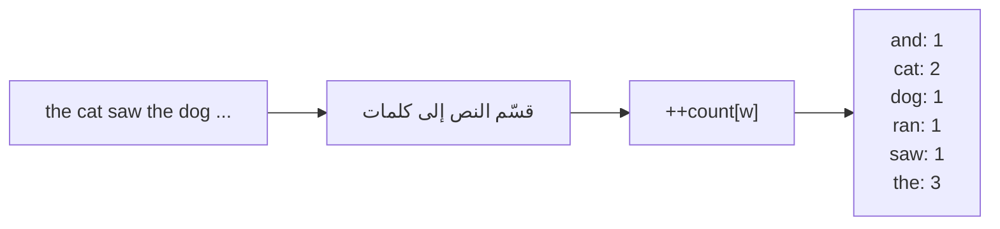

# الخرائط (maps) ومكتبة الخوارزميات

## ‏std::map: ابحث عن الأشياء بالمفتاح

الخريطة تخزّن أزواج **مفتاح ← قيمة**، مرتبة حسب المفتاح. مثل القاموس في بايثون.

```cpp
#include <iostream>
#include <map>
#include <string>

int main() {
    std::map<std::string, double> price{
        {"tea", 15},
        {"coffee", 30},
    };
    price["juice"] = 25;            // add a new key
    price["tea"] = 18;              // change an existing one

    std::cout << "Coffee costs " << price["coffee"] << "\n";

    for (const auto& [item, p] : price) {   // visits keys in sorted order
        std::cout << item << ": " << p << "\n";
    }

    if (price.contains("cake")) std::cout << "We have cake\n";
    else std::cout << "No cake\n";
    return 0;
}
```

```output
Coffee costs 30
coffee: 30
juice: 25
tea: 18
No cake
```

- `const auto& [item, p]` تفك كل زوج إلى اسمين.
- `contains` (من C++20) تتحقق من وجود مفتاح. انتبه: `price["cake"]` ستُنشئ "cake" بقيمة 0 لمجرد قراءتها.

## عدّ الكلمات

الخرائط تجعل العدّ سهلًا، لأن الرقم غير الموجود يبدأ من 0:

<!-- diagram -->


```cpp
#include <iostream>
#include <map>
#include <sstream>
#include <string>

int main() {
    std::string text = "the cat saw the dog and the cat ran";
    std::map<std::string, int> count;
    std::istringstream words(text);
    std::string w;
    while (words >> w) {
        ++count[w];
    }
    for (const auto& [word, n] : count) {
        std::cout << word << " " << n << "\n";
    }
    return 0;
}
```

```output
and 1
cat 2
dog 1
ran 1
saw 1
the 3
```

`std::istringstream` تسمح لك بالقراءة من نص بـ `>>`، تمامًا مثل القراءة من `std::cin`.

و`std::unordered_map` تؤدي نفس المهمة، وغالبًا أسرع، لكنها لا تحافظ على ترتيب المفاتيح.

## ‏<algorithm>: لا تكتب الـ loop بنفسك

الـ standard library فيها functions جاهزة ومُختبرة جيدًا للمهام الشائعة. وهي تعمل على **مدى (range)** يُعطى كموضعين: `begin()` و`end()`.

```cpp
#include <algorithm>
#include <iostream>
#include <numeric>
#include <vector>

int main() {
    std::vector<int> v{42, 7, 19, 88, 3, 19};

    std::sort(v.begin(), v.end());
    for (int x : v) std::cout << x << " ";
    std::cout << "\n";

    int total = std::accumulate(v.begin(), v.end(), 0);
    auto biggest = *std::max_element(v.begin(), v.end());
    auto nineteens = std::count(v.begin(), v.end(), 19);
    std::cout << "total " << total << ", max " << biggest << ", 19s " << nineteens << "\n";

    auto it = std::find(v.begin(), v.end(), 88);
    if (it != v.end()) std::cout << "found 88 at index " << (it - v.begin()) << "\n";
    return 0;
}
```

```output
3 7 19 19 42 88 
total 178, max 88, 19s 2
found 88 at index 5
```

`find` و`max_element` ترجعان iterator (موضعًا)؛ و`*it` تعطي القيمة الموجودة فيه، و`v.end()` معناها "غير موجود".

## lambdas: functions صغيرة تُكتب في مكانها

خوارزميات كثيرة تأخذ قاعدة. و**lambda** function بدون اسم تُكتب في المكان الذي تحتاجها فيه بالضبط:

```cpp
#include <algorithm>
#include <iostream>
#include <string>
#include <vector>

int main() {
    std::vector<int> v{42, 7, 19, 88, 3, 19};

    auto big = std::count_if(v.begin(), v.end(), [](int x) { return x > 18; });
    std::cout << big << " numbers above 18\n";

    std::sort(v.begin(), v.end(), [](int a, int b) { return a > b; });  // largest first
    for (int x : v) std::cout << x << " ";
    std::cout << "\n";

    std::vector<std::string> names{"Yasmin", "Ali", "Mohamed", "Ola"};
    std::stable_sort(names.begin(), names.end(),   // stable: equal lengths keep their order
              [](const std::string& a, const std::string& b) { return a.size() < b.size(); });
    for (const auto& n : names) std::cout << n << " ";
    std::cout << "\n";

    int limit = 20;
    auto under = std::count_if(v.begin(), v.end(), [limit](int x) { return x < limit; });
    std::cout << under << " under " << limit << "\n";
    return 0;
}
```

```output
4 numbers above 18
88 42 19 19 7 3 
Ali Ola Yasmin Mohamed 
4 under 20
```

استخدمنا `stable_sort` للأسماء لأن "Ali" و"Ola" لهما نفس الطول؛ و`sort` العادية قد تضع العناصر المتساوية بأي ترتيب.

أجزاء lambda: `[captures](parameters) { body }`. الأقواس المربعة تذكر الـ variables الخارجية التي يمكن للامدا استخدامها: `[limit]` تنسخ limit إلى الداخل؛ و`[&limit]` تستخدمه بالـ reference.

## الخلاصة

- `std::map<K, V>`: أزواج مفتاح وقيمة مرتبة؛ `contains` تتحقق؛ و`m[k]` تُنشئ المفاتيح غير الموجودة.
- `<algorithm>`: sort وstable_sort وfind وcount وcount_if وmax_element؛ و`<numeric>`: accumulate.
- lambdas مثل `[](int x) { return x > 18; }` تعطي الخوارزميات قواعدها.

## فيديوهات اختيارية

الدرس أعلاه كامل وحده. هذه الفيديوهات للتعمق إن كنت تحب التعلم بالمشاهدة. الفيديوهات المكتوب بجانبها (بالإنجليزية) يمكنك تشغيل الترجمة لها (**CC**)، ثم **الإعدادات ← الترجمة ← ترجمة تلقائية ← العربية**.

**ICPC Mansoura، المستوى 0، الجلسة 6: STL الجزء 2**

https://www.youtube.com/watch?v=QMXVmnbjU4M

**Maps in C++: std::map and std::unordered_map (The Cherno) (بالإنجليزية)**

https://www.youtube.com/watch?v=KiB0vRi2wlc

**Lambdas in C++ (The Cherno) (بالإنجليزية)**

https://www.youtube.com/watch?v=mWgmBBz0y8c
