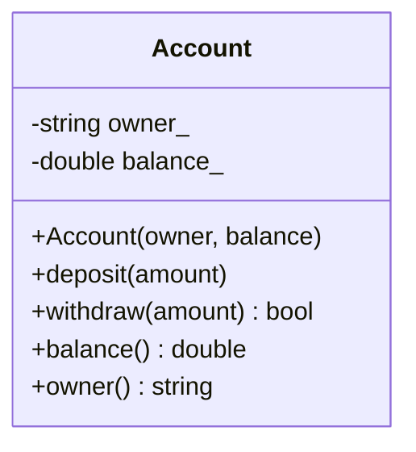

# الـ classes: أنواعك الخاصة

**الـ class** يجمع البيانات والـ functions التي تعمل عليها في نوع جديد واحد. `std::string` و`std::vector` classes؛ والآن ستكتب كلاساتك.

## أول class

```cpp
#include <iostream>
#include <string>

class Account {
public:
    Account(std::string owner, double balance)
        : owner_(owner), balance_(balance) {}       // constructor

    void deposit(double amount) {
        if (amount > 0) balance_ += amount;
    }

    bool withdraw(double amount) {
        if (amount <= 0 || amount > balance_) return false;
        balance_ -= amount;
        return true;
    }

    double balance() const { return balance_; }
    const std::string& owner() const { return owner_; }

private:
    std::string owner_;
    double balance_;
};

int main() {
    Account acc("Salma", 500);
    acc.deposit(250);
    if (!acc.withdraw(1000)) std::cout << "Not enough money\n";
    acc.withdraw(100);
    std::cout << acc.owner() << " has " << acc.balance() << "\n";
    return 0;
}
```

```output
Not enough money
Salma has 650
```

## الأجزاء

- **الأعضاء (members)**: البيانات (`owner_` و`balance_`) والـ functions (`deposit` و`withdraw`...). كثيرون ينهون أسماء أعضاء البيانات بـ `_` ليسهل تمييزها.
- الأعضاء **public** يستطيع أي أحد استخدامها. والأعضاء **private** تستخدمها functions الـ class نفسه فقط.
- **الـ constructor** له اسم الـ class وليس له نوع إرجاع. ويعمل عند إنشاء object. والجزء الذي بعد `:` هو **قائمة تهيئة الأعضاء** التي تضبط الأعضاء مباشرة.
- `acc.deposit(250)` تستدعي member function على الـ object `acc`.

<!-- diagram -->


## لماذا private؟

لأن الـ class يستطيع حينها **حماية قواعده**. لا أحد من الخارج يستطيع كتابة `acc.balance_ = -1000000;`. الطريقة الوحيدة لتغيير الرصيد هي عبر `deposit` و`withdraw` اللتين تتحققان من المبالغ. وهذا اسمه **الـ encapsulation**، وهو السبب الرئيسي لوجود الـ classes.

## member functions const

`double balance() const` تعد بأن الـ function لن تغيّر الـ object. ولا تستطيع استدعاء إلا الـ functions const على object const أو عبر const reference:

```cpp
void show(const Account& a) {
    std::cout << a.balance();   // OK: balance() is const
    a.deposit(5);               // error: deposit() isn't const
}
```

علّم كل function تقرأ فقط بـ `const`. نسيان ذلك خطأ شائع جدًا عند المبتدئين، ولا تلاحظه إلا عندما يحاول أحد استخدام كلاسك عبر `const&`.

## struct

`struct` مثل `class` تمامًا، إلا أن الأعضاء فيها public افتراضيًا. وبالعرف، تُستخدم `struct` لحزم البيانات البسيطة التي ليس لها قواعد تحتاج حماية:

```cpp
#include <iostream>
#include <string>
#include <vector>

struct Product {
    std::string name;
    double price;
    int stock;
};

int main() {
    std::vector<Product> shop{
        {"pen", 7.5, 120},
        {"notebook", 25, 40},
    };
    shop.push_back({"ruler", 10, 0});

    double value = 0;
    for (const auto& p : shop) {
        value += p.price * p.stock;
        if (p.stock == 0) std::cout << p.name << " is sold out\n";
    }
    std::cout << "Stock value: " << value << "\n";
    return 0;
}
```

```output
ruler is sold out
Stock value: 1900
```

## عدة constructors وقيم افتراضية

```cpp
#include <iostream>

class Timer {
public:
    Timer() = default;                       // starts at 0
    explicit Timer(int seconds) : seconds_(seconds) {}

    void tick() { ++seconds_; }
    int minutes() const { return seconds_ / 60; }
    int seconds() const { return seconds_ % 60; }

private:
    int seconds_ = 0;                        // default value
};

int main() {
    Timer a;
    Timer b(125);
    a.tick();
    std::cout << a.minutes() << ":" << a.seconds() << "\n";
    std::cout << b.minutes() << ":" << b.seconds() << "\n";
    return 0;
}
```

```output
0:1
2:5
```

- `= default` تطلب من الـ compiler كتابة الـ constructor العادي.
- `int seconds_ = 0;` تعطي العضو قيمة افتراضية يستخدمها كل constructor لا يضبطه.
- `explicit` تمنع التحويلات غير المقصودة مثل `Timer t = 5;`. استخدمها مع الـ constructors التي تأخذ معاملًا واحدًا.

## الخلاصة

- الـ class يجمع البيانات والـ functions؛ والبيانات الخاصة تحمي قواعده.
- الـ constructors تجهّز الـ objects؛ استخدم قائمة التهيئة `: a_(a)`.
- علّم member functions التي تقرأ فقط بـ `const`؛ واستخدم `struct` للبيانات البسيطة.

## فيديوهات اختيارية

الدرس أعلاه كامل وحده. هذه الفيديوهات للتعمق إن كنت تحب التعلم بالمشاهدة. الفيديوهات المكتوب بجانبها (بالإنجليزية) يمكنك تشغيل الترجمة لها (**CC**)، ثم **الإعدادات ← الترجمة ← ترجمة تلقائية ← العربية**.

**ICPC Mansoura، المستوى 0، الجلسة 3: الـ functions والـ struct**

https://www.youtube.com/watch?v=NJEulgn-O0s

**Classes in C++ (The Cherno) (بالإنجليزية)**

https://www.youtube.com/watch?v=2BP8NhxjrO0

**Const in C++ (The Cherno) (بالإنجليزية)**

https://www.youtube.com/watch?v=4fJBrditnJU
