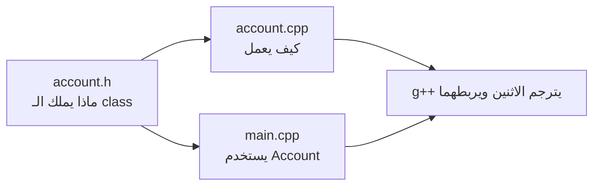

# المزيد عن الـ classes: العمليات وstatic وتقسيم الملفات

## طباعة أنواعك الخاصة

لكي تعمل `std::cout << obj`، اكتب function `operator<<`:

```cpp
#include <iostream>

struct Money {
    long piasters;              // store money as whole units: no rounding errors
};

std::ostream& operator<<(std::ostream& out, const Money& m) {
    out << m.piasters / 100 << "." << (m.piasters % 100 < 10 ? "0" : "") << m.piasters % 100 << " EGP";
    return out;
}

Money operator+(Money a, Money b) { return {a.piasters + b.piasters}; }
bool operator<(Money a, Money b) { return a.piasters < b.piasters; }

int main() {
    Money tea{1550}, cake{4005};
    Money total = tea + cake;
    std::cout << total << "\n";
    std::cout << (tea < cake ? "tea is cheaper\n" : "cake is cheaper\n");
    return 0;
}
```

```output
55.55 EGP
tea is cheaper
```

هذا هو **الـ operator overloading**: إعطاء `+` و`<` و`<<` وأخواتها معنى لنوعك. استخدمه فقط عندما يكون المعنى واضحًا (جمع المال، مقارنة التواريخ). و`operator<<` ترجع الـ stream لتستطيع السلسلة `std::cout << a << b`.

لماذا `long piasters` وليس `double pounds`؟ الـ double لا يستطيع تخزين أغلب الكسور العشرية بدقة (`0.1 + 0.2` لا تساوي `0.3` بالضبط). وللمال، خزّن وحدات صحيحة (قروش).

## مقارنة كل شيء مرة واحدة

تستطيع C++20 كتابة المقارنات الست كلها بدلًا منك بـ `operator<=>` (ولقبها سفينة الفضاء):

```cpp
#include <compare>
#include <iostream>

struct Date {
    int year, month, day;
    auto operator<=>(const Date&) const = default;   // compares year, then month, then day
};

int main() {
    Date a{2026, 3, 15}, b{2026, 11, 2};
    std::cout << (a < b) << (a == b) << (a >= b) << "\n";
    return 0;
}
```

```output
100
```

## الأعضاء static: مشتركة بين كل الـ objects

عضو البيانات `static` ينتمي للـ class، لا لكل object:

```cpp
#include <iostream>
#include <string>

class Ticket {
public:
    Ticket() : number_(++issued_) {}
    int number() const { return number_; }
    static int issued() { return issued_; }

private:
    int number_;
    static inline int issued_ = 0;     // one counter for the whole class
};

int main() {
    Ticket a, b, c;
    std::cout << "c is ticket " << c.number() << "\n";
    std::cout << Ticket::issued() << " tickets issued\n";
    return 0;
}
```

```output
c is ticket 3
3 tickets issued
```

`static inline` تسمح لك بضبط القيمة الأولى داخل الـ class مباشرة (من C++17 فما بعد). والـ functions static تُستدعى على الـ class: `Ticket::issued()`.

## تقسيم الـ class إلى ملفات

البرامج الحقيقية تضع كل class في ملفين:

<!-- diagram -->


- **header file** `account.h` فيه إعلان الـ class (ما الذي فيه)
- **ملف المصدر** `account.cpp` فيه أجسام الـ functions (كيف تعمل)

```cpp
// account.h
#pragma once
#include <string>

class Account {
public:
    Account(std::string owner, double balance);
    void deposit(double amount);
    double balance() const;

private:
    std::string owner_;
    double balance_;
};
```

```cpp
// account.cpp
#include "account.h"

Account::Account(std::string owner, double balance)
    : owner_(owner), balance_(balance) {}

void Account::deposit(double amount) {
    if (amount > 0) balance_ += amount;
}

double Account::balance() const { return balance_; }
```

<!-- skip -->
```cpp
// main.cpp
#include <iostream>
#include "account.h"

int main() {
    Account a("Hany", 100);
    a.deposit(50);
    std::cout << a.balance() << "\n";
    return 0;
}
```

```bash
g++ -std=c++20 -Wall -Wextra main.cpp account.cpp -o bank
./bank
```

```text
150
```

- `#pragma once` تمنع تضمين header file مرتين (مثل include guards في C، لكن أقصر).
- `Account::deposit` معناها "function deposit التي تتبع Account".
- `#include "account.h"` بعلامات التنصيص تبحث في مجلدك؛ و`<...>` تبحث في مجلدات النظام.

الوحدة 6 تبيّن كيف يبني CMake المشاريع متعددة الملفات لكي لا تكتب كل ملف بيدك.

## الخلاصة

- حمّل العمليات تحميلًا زائدًا عندما يكون المعنى واضحًا؛ و`operator<<` تجعل نوعك قابلًا للطباعة.
- `= default` مع `operator<=>` تعطيك كل المقارنات.
- الأعضاء static مشتركة؛ وheader files تُعلن وملفات .cpp تُعرّف.

## فيديوهات اختيارية

الدرس أعلاه كامل وحده. هذه الفيديوهات للتعمق إن كنت تحب التعلم بالمشاهدة. الفيديوهات المكتوب بجانبها (بالإنجليزية) يمكنك تشغيل الترجمة لها (**CC**)، ثم **الإعدادات ← الترجمة ← ترجمة تلقائية ← العربية**.

**Operators and operator overloading in C++ (The Cherno) (بالإنجليزية)**

https://www.youtube.com/watch?v=mS9755gF66w

**Static in C++ (The Cherno) (بالإنجليزية)**

https://www.youtube.com/watch?v=f3FVU-iwNuA
