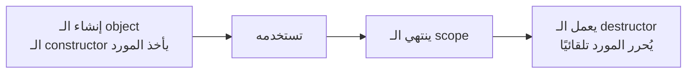

# الـ destructors وRAII والـ smart pointers

هذا الدرس هو قلب C++. إنه الطريقة التي تدير بها برامج C++ الذاكرة والملفات بأمان بدون جامع قمامة (garbage collector).

## الـ destructors

**الـ destructor** يعمل تلقائيًا عندما يُدمَّر الـ object. واسمه `~` ثم اسم الـ class:

```cpp
#include <iostream>
#include <string>

class Noisy {
public:
    explicit Noisy(std::string name) : name_(name) { std::cout << "hello " << name_ << "\n"; }
    ~Noisy() { std::cout << "bye " << name_ << "\n"; }

private:
    std::string name_;
};

int main() {
    Noisy a("a");
    {
        Noisy b("b");
        std::cout << "inside the block\n";
    }                                   // b is destroyed here
    std::cout << "end of main\n";
    return 0;
}                                       // a is destroyed here
```

```output
hello a
hello b
inside the block
bye b
end of main
bye a
```

الـ object المحلي يُدمَّر عندما تنتهي كتلته `{ }`، دائمًا، حتى لو خرجنا منها مبكرًا بـ `return` أو بexception.

## RAII

‏**RAII** ("Resource Acquisition Is Initialization") اسم مخيف لفكرة بسيطة:

<!-- diagram -->


> احصل على المورد في الـ constructor. وأرجعه في الـ destructor.

وحينها لا يمكن أن تنسى إرجاعه أبدًا. والـ standard library مبنية بهذه الطريقة:

- `std::string` و`std::vector` تحرران ذاكرتهما في مدمّراتهما.
- `std::ofstream` و`std::ifstream` تغلقان ملفهما في مدمّراتهما.
- `std::lock_guard` يفك lock الـ mutex في مدمّره.

```cpp
#include <fstream>
#include <iostream>
#include <string>

int main() {
    {
        std::ofstream out("notes.txt");     // opens the file
        out << "buy milk\n" << "call Sara\n";
    }                                       // closed here, automatically

    std::ifstream in("notes.txt");
    std::string line;
    int n = 0;
    while (std::getline(in, line)) {
        std::cout << ++n << ": " << line << "\n";
    }
    return 0;
}
```

```output
1: buy milk
2: call Sara
```

لا `fclose` ولا `free`. وهذه هي الفكرة كلها.

## ‏new وdelete (ولماذا ستتجنبهما)

`new` تُنشئ object في الـ heap وتعطيك pointer؛ و`delete` تدمّره. انسَ الـ delete فتتسرب الذاكرة؛ واحذف مرتين فيتوقف البرنامج. في C++ الحديثة لا تكتبهما بنفسك تقريبًا أبدًا. بل تستخدم **الـ smart pointers**.

## ‏std::unique_ptr: مالك واحد

الـ `unique_ptr` يملك object في الـ heap ويحذفه في مدمّره:

```cpp
#include <iostream>
#include <memory>
#include <string>

struct Image {
    std::string file;
    explicit Image(std::string f) : file(f) { std::cout << "load " << file << "\n"; }
    ~Image() { std::cout << "free " << file << "\n"; }
};

int main() {
    auto img = std::make_unique<Image>("cat.png");
    std::cout << "showing " << img->file << "\n";

    std::unique_ptr<Image> other = std::move(img);   // ownership moves; img is now empty
    std::cout << (img ? "img still owns it\n" : "img is empty\n");
    return 0;
}                                                    // other deletes the Image here
```

```output
load cat.png
showing cat.png
img is empty
free cat.png
```

- `std::make_unique<T>(args)` تُنشئ الـ object ومالكه في خطوة واحدة.
- `->` تصل إلى الأعضاء عبر pointer.
- الـ unique_ptr **لا يمكن نسخه** (مالكان سيحذفان مرتين)، بل **يُنقل** فقط بـ `std::move`.

## ‏std::shared_ptr: ملكية مشتركة

عندما يجب أن تتشارك عدة أجزاء من البرنامج object واحدًا ولا يكون واضحًا من ينتهي أخيرًا، استخدم `std::shared_ptr`. فهو يعدّ المُلّاك ويحذف الـ object عندما يذهب آخرهم:

```cpp
#include <iostream>
#include <memory>

int main() {
    auto a = std::make_shared<int>(42);
    {
        auto b = a;                               // two owners now
        std::cout << "owners: " << a.use_count() << "\n";
    }
    std::cout << "owners: " << a.use_count() << "\n";
    return 0;
}
```

```output
owners: 2
owners: 1
```

فضّل `unique_ptr`. ولا تلجأ إلى `shared_ptr` إلا عندما تكون الملكية مشتركة فعلًا؛ فهو أبطأ ويصعّب معرفة من يملك ماذا.

## قاعدة الصفر

لو كانت كل أعضاء كلاسك أشياء تنظّف بعد نفسها (نصوص، vectors، smart pointers)، فلا تكتب destructor أصلًا. الـ destructor الذي يصنعه الـ compiler يدمّر كل عضو، وكل عضو ينظّف نفسه. وهذه **قاعدة الصفر (rule of zero)**، ويجب أن تتبعها أغلب كلاساتك.

## الخلاصة

- الـ destructors تعمل تلقائيًا عندما تخرج الـ objects من نطاقها.
- ‏RAII: احصل على المورد في الـ constructor وحرّره في الـ destructor. الملفات والذاكرة تنظّف نفسها.
- استخدم `std::make_unique` (مالك واحد) أو `std::make_shared` (مشترك)، ولا تستخدم `new`/`delete` الخام أبدًا.

## فيديوهات اختيارية

الدرس أعلاه كامل وحده. هذه الفيديوهات للتعمق إن كنت تحب التعلم بالمشاهدة. الفيديوهات المكتوب بجانبها (بالإنجليزية) يمكنك تشغيل الترجمة لها (**CC**)، ثم **الإعدادات ← الترجمة ← ترجمة تلقائية ← العربية**.

**Destructors in C++ (The Cherno) (بالإنجليزية)**

https://www.youtube.com/watch?v=D8cWquReFqw

**Smart pointers in C++: unique_ptr, shared_ptr, weak_ptr (The Cherno) (بالإنجليزية)**

https://www.youtube.com/watch?v=UOB7-B2MfwA
