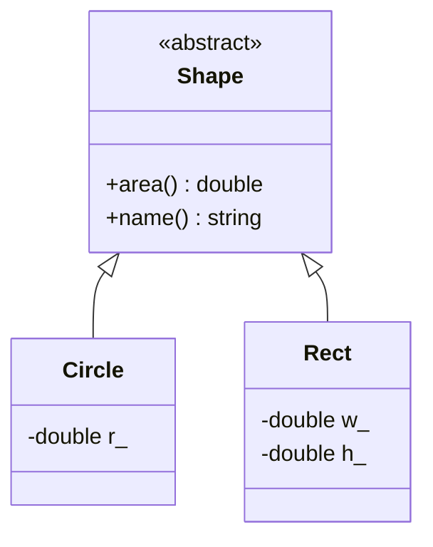

# الـ inheritance وpolymorphism

أحيانًا تكون عدة أنواع أشكالًا من شيء عام واحد: الدوائر والمستطيلات أشكال هندسية؛ والدفع نقدًا وبالبطاقة طرق دفع. والـ inheritance تسمح لك بكتابة كود للشيء العام وجعل كل نوع يتصرف بطريقته.

## class أساسي وclasses مشتقة

<!-- diagram -->


```cpp
#include <iostream>
#include <memory>
#include <string>
#include <vector>

class Shape {
public:
    virtual ~Shape() = default;
    virtual double area() const = 0;              // every shape must say how
    virtual std::string name() const = 0;
};

class Circle : public Shape {
public:
    explicit Circle(double r) : r_(r) {}
    double area() const override { return 3.14159 * r_ * r_; }
    std::string name() const override { return "circle"; }

private:
    double r_;
};

class Rect : public Shape {
public:
    Rect(double w, double h) : w_(w), h_(h) {}
    double area() const override { return w_ * h_; }
    std::string name() const override { return "rectangle"; }

private:
    double w_, h_;
};

int main() {
    std::vector<std::unique_ptr<Shape>> shapes;
    shapes.push_back(std::make_unique<Circle>(1.0));
    shapes.push_back(std::make_unique<Rect>(3, 4));
    shapes.push_back(std::make_unique<Circle>(2.0));

    double total = 0;
    for (const auto& s : shapes) {
        std::cout << s->name() << ": " << s->area() << "\n";
        total += s->area();
    }
    std::cout << "total: " << total << "\n";
    return 0;
}
```

```output
circle: 3.14159
rectangle: 12
circle: 12.5664
total: 27.708
```

## ماذا يفعل كل جزء

- `class Circle : public Shape` معناها أن Circle **هي** Shape وفيها كل ما في Shape.
- `virtual` معناها "الـ class المشتق يستطيع استبدال هذه". وعندما تستدعي `s->area()` عبر pointer `Shape`، تنظر C++ إلى الـ object **الحقيقي** وتشغّل نسخة Circle أو Rect. وهذا هو **polymorphism**.
- `= 0` تجعل الـ function **افتراضية خالصة (pure virtual)**: ‏Shape لا تقول كيف؛ بل يجب على كل class مشتق أن يقول. والـ class الذي فيه function افتراضية خالصة **مجرد (abstract)**: لا تستطيع إنشاء `Shape` عادية.
- `override` تطلب من الـ compiler التحقق من أنك تستبدل فعلًا function في الـ class الأساسي. اكتب اسمًا خطأ فتحصل على compile error بدل خطأ صامت. اكتبها دائمًا.
- `virtual ~Shape() = default;` ضرورية عندما تحذف objects مشتقة عبر pointer للـ class الأساسي (وهذا ما يفعله unique_ptr). وبدونها لا يُدمَّر إلا جزء Shape.

## استدعاء نسخة الـ class الأساسي

يستطيع الـ class المشتق إعادة استخدام كود الأساسي والإضافة إليه:

```cpp
#include <iostream>
#include <string>

class Employee {
public:
    Employee(std::string name, double salary) : name_(name), salary_(salary) {}
    virtual ~Employee() = default;
    virtual double monthly_pay() const { return salary_; }
    const std::string& name() const { return name_; }

private:
    std::string name_;
    double salary_;
};

class SalesPerson : public Employee {
public:
    SalesPerson(std::string name, double salary, double sales)
        : Employee(name, salary), sales_(sales) {}          // build the base part first
    double monthly_pay() const override {
        return Employee::monthly_pay() + sales_ * 0.05;     // base pay + 5% commission
    }

private:
    double sales_;
};

void pay_slip(const Employee& e) {                          // works for any Employee
    std::cout << e.name() << ": " << e.monthly_pay() << "\n";
}

int main() {
    Employee a("Reem", 9000);
    SalesPerson b("Tarek", 7000, 60000);
    pay_slip(a);
    pay_slip(b);
    return 0;
}
```

```output
Reem: 9000
Tarek: 10000
```

polymorphism يعمل عبر **الـ references والـ pointers**. لو كانت `pay_slip` تأخذ `Employee e` بالقيمة، لنسخت جزء Employee فقط ("التقطيع" slicing) ولأخذ طارق 7000 فقط.

## متى لا تستخدم الـ inheritance

الـ inheritance تُستخدم أكثر من اللازم غالبًا. اسأل: هل النوع الجديد فعلًا **نوع من** الأساسي، ويمكن استخدامه في أي مكان يُستخدم فيه الأساسي؟ لو كان فقط **يملك** شيئًا أو **يستخدمه**، فاجعله عضوًا بدلًا من ذلك ("الـ composition" composition). السيارة **فيها** محرك؛ وليست محركًا.

استخدم الـ inheritance عندما تحتاج سلوكيات مختلفة خلف واجهة واحدة، مثل الأشكال أعلاه، واجعل التسلسلات قصيرة.

## الخلاصة

- `class D : public B` تجعل D نوعًا من B؛ و`virtual` مع `override` تعطيان كل نوع سلوكه.
- الـ functions الافتراضية الخالصة (`= 0`) تصنع واجهة مجردة؛ وأعطها destructor افتراضيًا.
- استخدم pointers أو references الـ class الأساسي لـ polymorphism؛ وفضّل الـ composition عندما تكون العلاقة "فيه".

## فيديوهات اختيارية

الدرس أعلاه كامل وحده. هذه الفيديوهات للتعمق إن كنت تحب التعلم بالمشاهدة. الفيديوهات المكتوب بجانبها (بالإنجليزية) يمكنك تشغيل الترجمة لها (**CC**)، ثم **الإعدادات ← الترجمة ← ترجمة تلقائية ← العربية**.

**Inheritance in C++ (The Cherno) (بالإنجليزية)**

https://www.youtube.com/watch?v=X8nYM8wdNRE

**Virtual functions in C++ (The Cherno) (بالإنجليزية)**

https://www.youtube.com/watch?v=oIV2KchSyGQ
