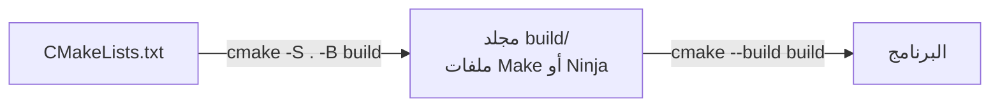

# الـ templates والبناء بـ CMake

## templates الـ functions

استخدمت `std::vector<int>` و`std::vector<std::string>`: قطعة كود واحدة تعمل مع أنواع كثيرة. وهذا هو **الـ template**، وتستطيع كتابة قوالبك:

```cpp
#include <iostream>
#include <string>
#include <vector>

template <typename T>
T largest(const std::vector<T>& items) {
    T best = items[0];
    for (const T& x : items)
        if (best < x) best = x;
    return best;
}

int main() {
    std::vector<int> nums{4, 19, 7};
    std::vector<std::string> words{"pear", "apple", "zucchini", "fig"};
    std::cout << largest(nums) << "\n";
    std::cout << largest(words) << "\n";
    return 0;
}
```

```output
19
zucchini
```

`template <typename T>` تقول "T نوع سيُملأ لاحقًا". وعندما تستدعي `largest(nums)` يرى الـ compiler أن `T = int` ويكتب لك نسخة للـ int؛ ومع `words` يكتب نسخة للنصوص. والشرط الوحيد أن تعمل `<` مع T. والنصوص تُقارن أبجديًا، فتفوز "zucchini".

## templates الـ classes

```cpp
#include <iostream>
#include <string>

template <typename T>
class Pair {
public:
    Pair(T a, T b) : a_(a), b_(b) {}
    T first() const { return a_; }
    T second() const { return b_; }
    void swap() { T tmp = a_; a_ = b_; b_ = tmp; }

private:
    T a_, b_;
};

int main() {
    Pair<int> p(1, 2);
    p.swap();
    std::cout << p.first() << " " << p.second() << "\n";

    Pair<std::string> names("Ali", "Huda");
    std::cout << names.first() << " & " << names.second() << "\n";
    return 0;
}
```

```output
2 1
Ali & Huda
```

الـ templates عادة توضع كاملة في header files، لأن الـ compiler يحتاج الكود كاملًا لصنع كل نسخة.

ستستخدم الـ templates غالبًا (الـ standard library كلها) أكثر مما تكتبها. والكورس المتقدم يتعمق فيها، بما في ذلك **المفاهيم (concepts)** في C++20 لقواعد ورسائل أخطاء أوضح.

## لماذا أداة بناء؟

مع ثلاثة ملفات تستطيع كتابة `g++ main.cpp account.cpp shop.cpp -o app`. ومع ثلاثين ملفًا ومكتبات واختبارات وcompilers مختلفة على ويندوز وLinux، تحتاج أداة. والأداة القياسية لـ C++ هي **CMake**.

<!-- diagram -->


مجلد مشروع:

```text
bank/
  CMakeLists.txt
  src/
    main.cpp
    account.cpp
    account.h
```

الملف `CMakeLists.txt`:

```cmake
cmake_minimum_required(VERSION 3.20)
project(bank CXX)

set(CMAKE_CXX_STANDARD 20)
set(CMAKE_CXX_STANDARD_REQUIRED ON)

add_executable(bank src/main.cpp src/account.cpp)

if(NOT MSVC)
  target_compile_options(bank PRIVATE -Wall -Wextra)
endif()
```

ابنِه:

```bash
cmake -S . -B build        # set up a build folder (once)
cmake --build build        # compile; run again after every change
./build/bank
```

- `-S .` هو مجلد المصدر، و`-B build` هو مجلد البناء. كل الملفات المولّدة تبقى في `build/`، فيظل مصدرك نظيفًا (وتضيف `build/` إلى `.gitignore`).
- نفس `CMakeLists.txt` يعمل على ويندوز مع Visual Studio، وعلى ماك وLinux. وVS Code (مع إضافة CMake Tools) وCLion وVisual Studio كلها تفتح مشاريع CMake مباشرة.

## بناء التصحيح وبناء الإصدار

```bash
cmake -S . -B build -DCMAKE_BUILD_TYPE=Debug     # debug info, no optimizing: for gdb
cmake -S . -B build-rel -DCMAKE_BUILD_TYPE=Release   # optimized: for speed
```

## اصطياد أخطاء الذاكرة: الـ sanitizers

أضف هذا أثناء التطوير على Linux أو ماك، وستوقف كثير من أخطاء الذاكرة البرنامج بتقرير واضح بدل أن تفسد البيانات بصمت:

```cmake
target_compile_options(bank PRIVATE -fsanitize=address,undefined)
target_link_options(bank PRIVATE -fsanitize=address,undefined)
```

## الخلاصة

- `template <typename T>` تكتب الكود مرة واحدة لأنواع كثيرة؛ والـ templates تُوضع في header files.
- ‏CMake يصف المشروع مرة واحدة ويبنيه على كل نظام.
- `cmake -S . -B build` ثم `cmake --build build`؛ واستخدم بناء Debug والـ sanitizers أثناء التطوير.

## فيديوهات اختيارية

الدرس أعلاه كامل وحده. هذه الفيديوهات للتعمق إن كنت تحب التعلم بالمشاهدة. الفيديوهات المكتوب بجانبها (بالإنجليزية) يمكنك تشغيل الترجمة لها (**CC**)، ثم **الإعدادات ← الترجمة ← ترجمة تلقائية ← العربية**.

**Templates in C++ (The Cherno) (بالإنجليزية)**

https://www.youtube.com/watch?v=I-hZkUa9mIs
