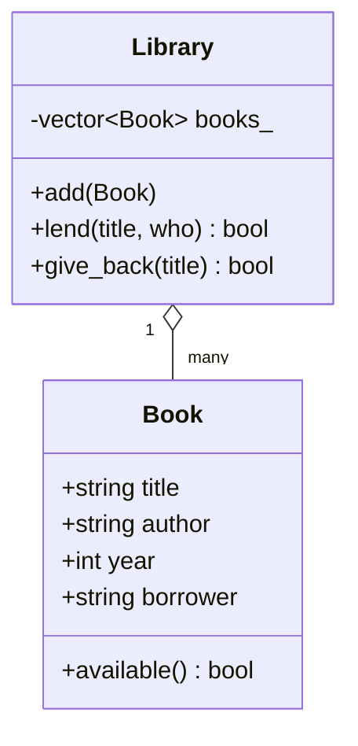

# مشروع: مدير مكتبة صغير

لنجمع كل شيء معًا: الـ classes والـ vectors والخرائط والخوارزميات وlambdas والـ smart pointers والملفات. ستبني نظامًا صغيرًا لإدارة الكتب المستعارة.

## ماذا يفعل

- يحتفظ بقائمة كتب (العنوان، والمؤلف، والسنة، ومن استعاره إن وُجد).
- يُعير الكتب ويستردها بالعنوان، مع التحقق.
- يعرض الكتب مرتبة، ويبيّن من معه ماذا.
- يحفظ في ملف نصي ويحمّل منه.

<!-- diagram -->


## الكود

```cpp
#include <algorithm>
#include <fstream>
#include <iostream>
#include <map>
#include <optional>
#include <sstream>
#include <string>
#include <vector>

struct Book {
    std::string title;
    std::string author;
    int year = 0;
    std::string borrower;          // empty: on the shelf

    bool available() const { return borrower.empty(); }
};

class Library {
public:
    void add(Book b) { books_.push_back(std::move(b)); }

    bool lend(const std::string& title, const std::string& who) {
        Book* b = find(title);
        if (!b || !b->available()) return false;
        b->borrower = who;
        return true;
    }

    bool give_back(const std::string& title) {
        Book* b = find(title);
        if (!b || b->available()) return false;
        b->borrower.clear();
        return true;
    }

    void list() const {
        std::vector<const Book*> sorted;
        for (const auto& b : books_) sorted.push_back(&b);
        std::sort(sorted.begin(), sorted.end(),
                  [](const Book* a, const Book* b) { return a->year < b->year; });
        for (const Book* b : sorted) {
            std::cout << b->year << "  " << b->title << " (" << b->author << ")"
                      << (b->available() ? "" : "  -> " + b->borrower) << "\n";
        }
    }

    std::map<std::string, int> loans_per_person() const {
        std::map<std::string, int> out;
        for (const auto& b : books_)
            if (!b.available()) ++out[b.borrower];
        return out;
    }

    void save(const std::string& path) const {
        std::ofstream f(path);
        for (const auto& b : books_)
            f << b.title << '|' << b.author << '|' << b.year << '|' << b.borrower << '\n';
    }

    static Library load(const std::string& path) {
        Library lib;
        std::ifstream f(path);
        std::string line;
        while (std::getline(f, line)) {
            std::istringstream parts(line);
            Book b;
            std::string year;
            std::getline(parts, b.title, '|');
            std::getline(parts, b.author, '|');
            std::getline(parts, year, '|');
            std::getline(parts, b.borrower);
            b.year = std::stoi(year);
            lib.add(b);
        }
        return lib;
    }

    std::size_t size() const { return books_.size(); }

private:
    Book* find(const std::string& title) {
        auto it = std::find_if(books_.begin(), books_.end(),
                               [&title](const Book& b) { return b.title == title; });
        return it == books_.end() ? nullptr : &*it;
    }

    std::vector<Book> books_;
};

int main() {
    Library lib;
    lib.add({"The Cairo Trilogy", "Naguib Mahfouz", 1956, ""});
    lib.add({"Season of Migration to the North", "Tayeb Salih", 1966, ""});
    lib.add({"The Yacoubian Building", "Alaa Al Aswany", 2002, ""});
    lib.add({"Men in the Sun", "Ghassan Kanafani", 1963, ""});

    lib.lend("Men in the Sun", "Laila");
    lib.lend("The Cairo Trilogy", "Laila");
    lib.lend("The Yacoubian Building", "Ziad");
    if (!lib.lend("Men in the Sun", "Ziad")) std::cout << "Men in the Sun is already out\n";
    if (!lib.lend("Unknown Book", "Ziad")) std::cout << "No such book\n";
    lib.give_back("The Yacoubian Building");

    lib.list();
    for (const auto& [who, n] : lib.loans_per_person())
        std::cout << who << " has " << n << " book(s)\n";

    lib.save("library.txt");
    Library again = Library::load("library.txt");
    std::cout << "Loaded " << again.size() << " books back from the file\n";
    return 0;
}
```

```output
Men in the Sun is already out
No such book
1956  The Cairo Trilogy (Naguib Mahfouz)  -> Laila
1963  Men in the Sun (Ghassan Kanafani)  -> Laila
1966  Season of Migration to the North (Tayeb Salih)
2002  The Yacoubian Building (Alaa Al Aswany)
Laila has 2 book(s)
Loaded 4 books back from the file
```

## أشياء لاحظها

- `Book` هي `struct` بسيطة فيها function مساعدة واحدة؛ و`Library` هي `class` تحمي قواعدها (لا تستطيع إعارة كتاب مُعار).
- `find` خاصة (private) وترجع pointer، أو `nullptr` عندما لا يوجد تطابق. والمستدعون يتحققون بـ `if (!b ...)`.
- `list()` ترتب **pointers** إلى الكتب، فتحتفظ القائمة الحقيقية بترتيبها ولا يُنسخ شيء.
- `std::getline(parts, b.title, '|')` تقرأ حتى الـ `|` التالية: صيغة ملف سهلة.
- `load` function `static`: تستدعيها على الـ class `Library::load(...)` وترجع Library جديدة.
- لا `new` ولا `delete` ولا destructor: قاعدة الصفر. الـ vector والنصوص تنظّف بعد نفسها.

## التصحيح عندما يحدث خطأ

1. **ترجم مع التحذيرات والـ sanitizers**: `g++ -std=c++20 -Wall -Wextra -g -fsanitize=address,undefined lib.cpp -o lib`. أي فهرس خطأ أو pointer معلّق يُبلَّغ عنه مع السطر بالضبط.
2. **اطبع** ما تظن أنه صحيح (`std::cerr << "count=" << n << "\n";`). و`std::cerr` تذهب إلى تيار الأخطاء، فلا تختلط بملفات المخرجات العادية.
3. **استخدم أداة تصحيح**: `gdb ./lib`، ثم `break Library::lend` و`run` و`next` و`print title` و`bt`. وVS Code وCLion يعطيانك نفس الشيء بالنقر.

تحذير عن الـ pointers داخل vector: ‏`push_back` قد تنقل كل الكتب إلى ذاكرة جديدة، فيصبح `Book*` الذي حفظته سابقًا يشير إلى لا شيء. الـ sanitizer يكتشف ذلك؛ والعادة الصحيحة ألا تحتفظ بمثل هذه الـ pointers عبر تغييرات الـ vector.

## دورك

1. قسّمه إلى `book.h` و`library.h` و`library.cpp` و`main.cpp`، مع `CMakeLists.txt`.
2. أضف loop قائمة في `main` (`add` و`lend` و`return` و`list` و`quit`) تحمّل `library.txt` في البداية وتحفظ في النهاية.
3. أضف تاريخ استحقاق لكل إعارة، وأمرًا يعرض الكتب المتأخرة.
4. أضف `search(word)` التي تجد الكتب التي يحتوي عنوانها أو مؤلفها على كلمة، باستخدام `std::copy_if` وlambda.

## إلى أين بعد ذلك

كورس **C++ المتقدم** يكمل من هنا: move semantics، والـ templates والمفاهيم، والـ ranges، والـ concurrency بالـ threads، ومعالجة الأخطاء بـ `std::expected`، والاختبار. أو أكمل مسار الأنظمة بـ **Rust**، التي تأخذ أفكار الملكية التي قابلتها مع `unique_ptr` وتجعل الـ compiler يفرضها.

## الخلاصة

- البرنامج الحقيقي يجمع structs وclass يحمي قواعده والحاويات والخوارزميات القياسية.
- أرجع `nullptr` أو `std::optional` لحالة "غير موجود"؛ ورتّب pointers أو فهارس لتجنب النسخ.
- التحذيرات والـ sanitizers وأداة التصحيح تجد أغلب الأخطاء بسرعة.

## فيديوهات اختيارية

الدرس أعلاه كامل وحده. هذه الفيديوهات للتعمق إن كنت تحب التعلم بالمشاهدة. الفيديوهات المكتوب بجانبها (بالإنجليزية) يمكنك تشغيل الترجمة لها (**CC**)، ثم **الإعدادات ← الترجمة ← ترجمة تلقائية ← العربية**.

**Dynamic arrays in C++: std::vector (The Cherno) (بالإنجليزية)**

https://www.youtube.com/watch?v=PocJ5jXv8No

**Debugging: GDB tutorial (Chris Bourke) (بالإنجليزية)**

https://www.youtube.com/watch?v=bWH-nL7v5F4
