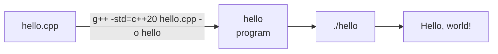

# Your first C++ program

C++ is the language behind game engines, browsers, databases, trading systems and much of the software that has to be fast. It started as "C with classes" and grew into a big modern language. You'll learn the modern way from the start: `std::string`, `std::vector`, references and smart pointers, not raw C tricks.

If you took the C course, much will feel familiar. If you didn't, that's fine too.

## What you need

- **Linux / WSL:** `sudo apt install g++ cmake gdb`
- **macOS:** run `xcode-select --install` in Terminal (gives you `clang++`, which works the same way)
- **Windows:** install Visual Studio Community with "Desktop development with C++", or use WSL
- **Just trying it:** an online compiler such as godbolt.org (choose C++ and tick "Execute")

Any editor works. VS Code with the C/C++ extension is a good free choice.

## Hello, world

Save this as `hello.cpp`:

```cpp
#include <iostream>

int main() {
    std::cout << "Hello, world!\n";
    return 0;
}
```

```output
Hello, world!
```

Compile and run it:

```bash
g++ -std=c++20 -Wall -Wextra hello.cpp -o hello
./hello
```

- `-std=c++20` uses the 2020 version of the language. Everything in this course works with it.
- `-Wall -Wextra` turn on warnings. Always use them; warnings are free bug reports.

## Line by line

- `#include <iostream>` brings in input and output.
- `int main()` is where the program starts. Returning 0 means "all went well".
- `std::cout` is the screen ("character output"). `<<` sends things to it.
- `std::` means "from the standard library". Everything the language gives you lives in `std`.
- `"\n"` ends the line. You'll also see `std::endl`, which ends the line **and** flushes the output; it's slower and you rarely need it.

<!-- diagram -->


## Printing several things

`<<` can be chained, and it knows how to print numbers too:

```cpp
#include <iostream>

int main() {
    std::cout << "Cups sold: " << 42 << "\n";
    std::cout << "Price: " << 3.5 << " each\n";
    std::cout << "Total: " << 42 * 3.5 << "\n";
    return 0;
}
```

```output
Cups sold: 42
Price: 3.5 each
Total: 147
```

No format codes like `%d`: the type of each value decides how it's printed.

## Comments

```cpp
// a comment to the end of the line
/* a comment that can
   span several lines */
```

## About `using namespace std;`

Many tutorials write `using namespace std;` at the top so they can type `cout` instead of `std::cout`. It's fine in a tiny program, but in real code it pulls hundreds of names into your program and causes clashes. This course writes `std::` every time. It's a good habit and you'll stop noticing it after a day.

## When it doesn't compile

C++ error messages can be long. Read the **first** error only, fix it, and compile again. The most common beginner errors:

- `expected ';'`: a missing semicolon, usually on the line **before** the one mentioned.
- `'cout' was not declared in this scope`: you forgot `std::` or `#include <iostream>`.
- `undefined reference to main`: you misspelled `main`.

## Summary

- Compile with `g++ -std=c++20 -Wall -Wextra file.cpp -o name`.
- `std::cout << ... << "\n";` prints; every standard name starts with `std::`.
- Fix the first error first.

## Optional videos

The lesson above is complete on its own. These videos go deeper, if you like learning by watching.

**Welcome to C++ (The Cherno)**

https://www.youtube.com/watch?v=18c3MTX0PK0

**How C++ Works (The Cherno)**

https://www.youtube.com/watch?v=SfGuIVzE_Os
