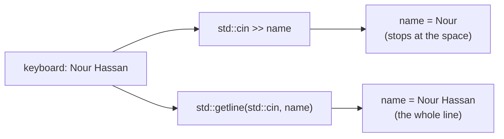

# Variables, strings and input

## Basic types

```cpp
int count = 12;            // whole numbers
double price = 4.75;       // numbers with a decimal point
bool open = true;          // true or false
char grade = 'A';          // one character, single quotes
```

Prefer **brace initialization**: `int count{12};`. It refuses to silently lose data:

```cpp
int a = 3.9;    // compiles (with a warning); a becomes 3
int b{3.9};     // error: narrowing from double to int
```

## auto

`auto` lets the compiler work out the type from the value:

```cpp
auto n = 10;        // int
auto ratio = 0.25;  // double
```

Use it when the type is obvious or very long to write.

## const

`const` means the value can't change after it's set. Use it whenever you can; it prevents mistakes and tells readers what's fixed.

```cpp
const double tax_rate = 0.14;
```

## std::string

C++ strings grow as needed and know their own length. No arrays of char, no `strcpy`:

```cpp
#include <iostream>
#include <string>

int main() {
    std::string first = "Nour";
    std::string last = "Hassan";
    std::string full = first + " " + last;

    std::cout << full << "\n";
    std::cout << "Length: " << full.size() << "\n";
    std::cout << "First letter: " << full[0] << "\n";
    std::cout << "Has 'Has'? " << (full.find("Has") != std::string::npos) << "\n";

    full += "!";
    std::cout << full << "\n";
    return 0;
}
```

```output
Nour Hassan
Length: 11
First letter: N
Has 'Has'? 1
Nour Hassan!
```

`find` returns the position, or the special value `std::string::npos` when the text isn't there. `bool` values print as 1 and 0 (add `std::cout << std::boolalpha;` once to print `true` and `false`).

## Input with std::cin

`std::cin >>` reads one word or number, skipping spaces:

<!-- diagram -->


<!-- stdin: 3\n12.5\n -->
```cpp
#include <iostream>

int main() {
    int qty{};
    double price{};
    std::cout << "How many? ";
    std::cin >> qty;
    std::cout << "Price each? ";
    std::cin >> price;
    std::cout << "\nTotal: " << qty * price << "\n";
    return 0;
}
```

```output
How many? Price each? 
Total: 37.5
```

(When you run it yourself, your typing appears after each question.)

## Reading a whole line

`>>` stops at the first space, so "Nour Hassan" would give only "Nour". Use `std::getline` for whole lines:

<!-- stdin: Nour Hassan\n -->
```cpp
#include <iostream>
#include <string>

int main() {
    std::string name;
    std::cout << "Your full name: ";
    std::getline(std::cin, name);
    std::cout << "\nWelcome, " << name << "!\n";
    return 0;
}
```

```output
Your full name: 
Welcome, Nour Hassan!
```

A classic trap: after `std::cin >> age;` the Enter key is still waiting, so the next `getline` reads an empty line. Fix it by calling `std::cin.ignore();` before `getline`, or read everything with `getline`.

## Converting

```cpp
int n = std::stoi("42");          // text to int
double d = std::stod("3.14");     // text to double
std::string s = std::to_string(7); // number to text
```

## Integer division, again

Like C, two ints divide to an int: `7 / 2` is 3. Make one side a double to get 3.5: `7 / 2.0`, or `static_cast<double>(a) / b`. `static_cast` is the C++ way to convert types on purpose, easy to search for and harder to misuse than C's `(double)a`.

## Summary

- int, double, bool, char; prefer `{}` initialization; `const` whatever doesn't change.
- `std::string` joins with `+`, has `.size()` and `.find()`.
- `std::cin >>` reads words and numbers; `std::getline` reads whole lines.

## Optional videos

The lesson above is complete on its own. These videos go deeper, if you like learning by watching.

**Variables in C++ (The Cherno)**

https://www.youtube.com/watch?v=zB9RI8_wExo
