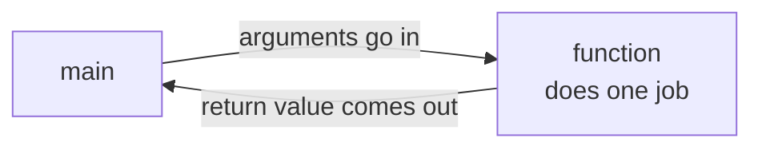

# Decisions, loops and functions

If you know any C-like language, this lesson goes fast: C++ uses the same `if`, `switch`, `while` and `for`.

## if / else

```cpp
#include <iostream>

int main() {
    int score = 73;
    if (score >= 85) {
        std::cout << "Excellent\n";
    } else if (score >= 65) {
        std::cout << "Pass\n";
    } else {
        std::cout << "Try again\n";
    }
    return 0;
}
```

```output
Pass
```

Comparisons: `==  !=  <  <=  >  >=`. Combining: `&&` (and), `||` (or), `!` (not). And the classic slip: `=` stores, `==` compares. With `-Wall` the compiler warns you about `if (x = 5)`.

## switch

For one value against fixed choices:

```cpp
switch (day) {
    case 5:
    case 6:
        std::cout << "Weekend\n";
        break;
    default:
        std::cout << "Work day\n";
}
```

Without `break`, execution falls into the next case.

## Loops

```cpp
#include <iostream>

int main() {
    for (int i = 1; i <= 5; ++i) {
        std::cout << i << " squared is " << i * i << "\n";
    }

    int balance = 1000;
    int months = 0;
    while (balance > 0) {
        balance -= 300;
        ++months;
    }
    std::cout << "Money lasts " << months << " months\n";
    return 0;
}
```

```output
1 squared is 1
2 squared is 4
3 squared is 9
4 squared is 16
5 squared is 25
Money lasts 4 months
```

`break` leaves a loop; `continue` jumps to the next round.

## Functions

A function has a return type, a name, and parameters:

<!-- diagram -->


```cpp
#include <iostream>
#include <string>

double with_tax(double price, double rate) {
    return price * (1 + rate);
}

std::string grade(int score) {
    if (score >= 85) return "A";
    if (score >= 65) return "B";
    return "C";
}

void greet(const std::string& name) {   // void: returns nothing
    std::cout << "Hi, " << name << "!\n";
}

int main() {
    std::cout << with_tax(100, 0.14) << "\n";
    std::cout << grade(91) << grade(70) << grade(12) << "\n";
    greet("Omar");
    return 0;
}
```

```output
114
ABC
Hi, Omar!
```

`const std::string&` in `greet` is a **reference**, explained in the next lesson. For now: it's the usual way to pass strings without copying them.

A function must be **declared** before it's used. Either define it above `main`, or put a declaration (the first line followed by `;`) at the top:

```cpp
double with_tax(double price, double rate);   // declaration
```

## Default arguments and overloading

Parameters can have default values, and several functions can share a name if their parameters differ:

```cpp
#include <iostream>

double area(double side) { return side * side; }               // square
double area(double w, double h) { return w * h; }              // rectangle

void line(int width = 10, char ch = '-') {
    for (int i = 0; i < width; ++i) std::cout << ch;
    std::cout << "\n";
}

int main() {
    std::cout << area(3) << " " << area(3, 4) << "\n";
    line();
    line(5, '*');
    return 0;
}
```

```output
9 12
----------
*****
```

The compiler picks the right `area` from the arguments you pass. This is called **overloading**.

## Summary

- if/else, switch, for, while work as in C.
- Functions: return type, name, parameters; declare before use.
- Default arguments and overloading make functions easier to call.

## Optional videos

The lesson above is complete on its own. These videos go deeper, if you like learning by watching.

**Conditions and branches in C++ (The Cherno)**

https://www.youtube.com/watch?v=qEgCT87KOfc

**Functions in C++ (The Cherno)**

https://www.youtube.com/watch?v=V9zuox47zr0
